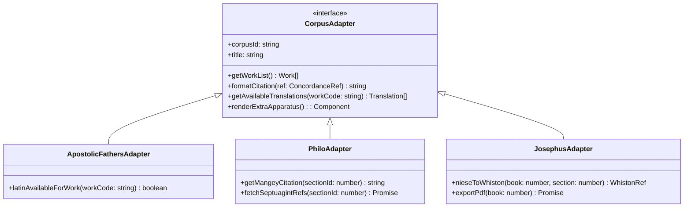
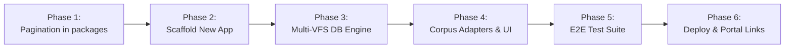

# Implementation Plan: Ancient Corpora Reader (`ancient-corpora-reader`)

> [!NOTE]
> **AI Generation Notice**: Generated by **Antigravity 2.26.0** (Engine: **Gemini 3.8 Flash**) on **November 2, 2026**.

## 1. Executive Summary & Objectives

Following the suite-wide refactoring (tags `suite.v0.3.0`, `suite.v0.3.1`) and the lemma performance audit, the Hellenistic and early Christian/Jewish Greek readers—**Apostolic Fathers** (`af`), **Philo of Alexandria** (`philo`), and **Flavius Josephus** (`josephus`)—now share an identical technical architecture:
- **Framework**: SvelteKit 2 + Svelte 5 (runes `$state`, `$derived`, `$props`)
- **Styling**: Tailwind CSS
- **Data Layer**: `@polyglot/db-vfs` (`sql.js-httpvfs`) querying range-requested SQLite databases
- **Shared Libraries**: `@polyglot/ui`, `@polyglot/lemma-ui`, `@polyglot/ancient-languages`

Maintaining three separate reader applications with nearly 90% identical UI and client-side logic incurs recurring maintenance friction (syncing bug fixes, duplicated performance patches, redundant deployment configs).

This project consolidates them into a unified, high-performance application: **`apps/ancient-corpora-reader`**.

### Core Objectives
1. **Unified Application**: Provide a single reader interface serving all three corpora under clean, shareable routes (`/[corpus]/[work]/[...section]`).
2. **Lemma-Results Pagination**: Replace legacy `LIMIT 200` query bottlenecks with cursor/offset pagination in both the DB service layer and [`LexemeSidePanel.svelte`](file:///home/cbrannan/dev/2-tmp/polyglot-suite/packages/lemma-ui/src/components/LexemeSidePanel.svelte), allowing readers to browse unlimited occurrences of frequent lemmas without exhausting HTTP-VFS byte transfers.
3. **Corpus-Specific Feature Preservation**: Maintain full fidelity of corpus-specific apparatuses (Philo's Mangey milestones & LXX index, Josephus's Whiston cross-references & PDF export, and AF's parallel Latin column).
4. **Non-Disruptive Transition**: Maintain existing standalone apps and databases during development, utilizing existing database chunk assets before deciding on database consolidation.

---

## 2. Architecture & Design

### 2.1 Routing Structure

The application will use SvelteKit's file-based routing with dynamic segments:

```
apps/ancient-corpora-reader/src/routes/
├── +layout.svelte               # Global theme, nav bar, header, and lemma panel host
├── +layout.ts                   # Universal load (SSR disabled: export const ssr = false; prerender = false)
├── +page.svelte                 # Corpus portal & multi-corpus search landing page
├── [corpus]/
│   ├── +page.svelte             # Corpus work picker & introduction
│   └── [work]/
│       ├── +page.svelte         # Redirect to first work chapter/section
│       └── [...section]/
│           ├── +page.svelte     # Main parallel reader view
│           └── +page.ts         # Route param validation & metadata loader
```

#### Route URL Examples:
- `/` &rarr; Ancient Corpora portal landing page
- `/af/1-clem/1/1` &rarr; Apostolic Fathers: *1 Clement*, Chapter 1, Section 1
- `/philo/opif/1` &rarr; Philo: *De Opificio Mundi*, Section 1
- `/josephus/ant/1/1` &rarr; Josephus: *Antiquities of the Jews*, Book 1, Section 1 (Niese 1)

---

### 2.2 Database & HTTP-VFS Strategy

```mermaid
flowchart TD
    subgraph Client Application
        Route[Route Controller: /[corpus]/[work]/...]
        VFSManager[Corpus DB Worker Manager]
    end

    subgraph HTTP-VFS Worker Pool
        AFWorker[AF DB Worker<br/>af.db.*]
        PhiloWorker[Philo DB Worker<br/>philo.db.*]
        JRWorker[Josephus DB Worker<br/>josephus.db.*]
    end

    subgraph Static Assets
        AFDB[(static/db/af.db.*<br/>~29 MB)]
        PhiloDB[(static/db/philo.db.*<br/>~219 MB)]
        JRDB[(static/db/josephus.db.*<br/>~123 MB)]
    end

    Route -->|Active Corpus| VFSManager
    VFSManager -->|corpus == 'af'| AFWorker
    VFSManager -->|corpus == 'philo'| PhiloWorker
    VFSManager -->|corpus == 'josephus'| JRWorker

    AFWorker -.->|HTTP Range Requests| AFDB
    PhiloWorker -.->|HTTP Range Requests| PhiloDB
    JRWorker -.->|HTTP Range Requests| JRDB
```

#### Multi-VFS DB Client Architecture
Rather than immediately requiring a risky ~371 MB database merge during UI consolidation:
- **Phase A (Multi-VFS Worker Multiplexer)**: The client service [`dbManager.ts`](file:///home/cbrannan/dev/2-tmp/polyglot-suite/apps/ancient-corpora-reader/src/lib/services/dbManager.ts) maintains a lazy connection map:
  ```typescript
  type CorpusId = 'af' | 'philo' | 'josephus';
  const workerPool = new Map<CorpusId, Promise<SqlJsVfsWorker>>();
  ```
  Only the SQLite database for the actively viewed corpus is downloaded and mounted via HTTP range requests. When a user switches from Philo to Josephus, the Josephus worker is spun up on demand.
- **Phase B (Future Monolithic DB)**: Optional subsequent migration to `ancient_corpora.sqlite3` with indexed `corpus_id` partitioning.

---

### 2.3 Paginated Lemma Concordance Design

The recent performance audit demonstrated that:
1. Hardcoded `LIMIT 200` cuts off high-frequency terms prematurely (e.g. `λόγος`, `θεός`, `πίστις`).
2. Fetching unindexed or unbounded rows triggers excessive HTTP-VFS chunk transfers.
3. The CTE pushdown pattern (`WITH top_refs AS (...) SELECT ... JOIN text_units`) eliminated full table scans and avoided deserializing bulky `tokens_json`.

#### Paginated Service Signature
We extend [`dbClient.ts`](file:///home/cbrannan/dev/2-tmp/polyglot-suite/packages/lemma-ui/src/types.ts) and the app layer with a paginated query interface:

```typescript
export interface PaginatedConcordance {
  refs: ConcordanceRef[];
  totalCount: number;
  hasMore: boolean;
  nextOffset: number;
}

export async function fetchConcordancePage(
  corpusId: string,
  lemma: string,
  offset: number = 0,
  pageSize: number = 50
): Promise<PaginatedConcordance>;
```

#### Optimized SQL Implementation
```sql
-- Step 1: Count total occurrences (leveraging index on (corpus_id, lemma))
SELECT COUNT(*) AS total
FROM concordance_refs
WHERE corpus_id = ? AND (lemma = ? OR lemma = ?);

-- Step 2: Fetch indexed page with CTE pushdown
WITH paged_refs AS (
  SELECT display_citation, work_unit_id
  FROM concordance_refs
  WHERE corpus_id = ? AND (lemma = ? OR lemma = ?)
  ORDER BY work_unit_id ASC
  LIMIT ? OFFSET ?
)
SELECT 
  r.display_citation, 
  r.work_unit_id, 
  t.work_code, 
  t.chapter, 
  t.section, 
  t.text_content
FROM paged_refs r
JOIN text_units t ON t.id = r.work_unit_id;
```

#### UI Implementation in `packages/lemma-ui/src/components/LexemeSidePanel.svelte`:
- **Progressive "Load More"**: Concordance tab initially loads page 1 (50 results). A footer displays: `"Showing 50 of 342 occurrences"`.
- Clicking **"Load More (50)"** fetches the next slice and appends items to the active list without reloading existing DOM nodes.
- **Form Filter Compatibility**: Filtering by attested form applies client-side to fetched occurrences or passes an optional `matched_word` filter to the query worker when available.

---

### 2.4 Corpus-Specific Feature Adapters

To ensure zero feature regression from the standalone apps, `ancient-corpora-reader` implements a modular corpus adapter interface:

| Feature | Apostolic Fathers | Philo of Alexandria | Flavius Josephus |
| :--- | :--- | :--- | :--- |
| **Primary Reference Scheme** | Chapter + Section | Section / Milestone | Book + Niese Section |
| **Secondary/Alt Reference** | N/A | Mangey Volume & Page (`II.456`) | Whiston Book, Chapter, Section |
| **Multi-Column Alignment** | Greek (Lake) + English (Lake) + Latin (Hermas/Polycarp) | Greek (Cohn-Wendland) + English (Yonge) | Greek (Niese) + English (Thackeray) |
| **Apparatus / Sidebars** | Latin parallel text toggle | Septuagint Citation Index panel | Whiston concordance modal + PDF Print exporter |
| **Lexicon Source** | LSJ Greek Lexicon | LSJ Greek Lexicon | LSJ Greek Lexicon |



---

## 3. Step-by-Step Implementation Sequence



### Phase 1: Shared Package Enhancements
1. **Extend [`@polyglot/lemma-ui`](file:///home/cbrannan/dev/2-tmp/polyglot-suite/packages/lemma-ui/)**:
   - Update [`LexemeSidePanel.svelte`](file:///home/cbrannan/dev/2-tmp/polyglot-suite/packages/lemma-ui/src/components/LexemeSidePanel.svelte) to accept `fetchConcordancePage?: (lemma: string, offset: number, pageSize: number) => Promise<PaginatedConcordance>`.
   - Maintain backward compatibility with legacy `fetchConcordance?: (lemma: string) => Promise<ConcordanceRef[]>`.
   - Add "Load More" controls and result count badge.
2. **Extend [`@polyglot/ancient-languages`](file:///home/cbrannan/dev/2-tmp/polyglot-suite/packages/ancient-languages/)**:
   - Add unified citation helpers and cross-corpus citation parser (`"1 Clem. 5:1"`, `"Opif. 15"`, `"Ant. 1.25"`).

### Phase 2: App Scaffolding (`apps/ancient-corpora-reader`)
1. Create `apps/ancient-corpora-reader` directory with:
   - `package.json` referencing workspace dependencies (`@polyglot/ui`, `@polyglot/lemma-ui`, `@polyglot/ancient-languages`, `@polyglot/db-vfs`).
   - `vite.config.ts`, `svelte.config.js`, `tsconfig.json`, `tailwind.config.ts`.
2. Configure symlinks or build scripts for database chunk assets (`static/db/af`, `static/db/philo`, `static/db/josephus`).

### Phase 3: Multi-VFS Service Layer
1. Implement `src/lib/services/dbManager.ts`:
   - Connection pool managing SQLite VFS instances for `'af'`, `'philo'`, and `'josephus'`.
   - Implement `fetchConcordancePage` with `LIMIT ? OFFSET ?` and total count calculation.
   - Implement cross-corpus lemma search (`searchLemmasAcrossCorpora`).

### Phase 4: Core Navigation & Reader Views
1. Build `src/routes/[corpus]/[work]/[...section]/+page.svelte`:
   - Bind `ParallelColumnView.svelte` for synchronizing Greek and English (plus Latin when available in AF).
   - Integrate `ReaderHeader.svelte` with Corpus switcher dropdown (`[ Apostolic Fathers | Philo | Josephus ]`).
   - Implement `WorkPickerModal` and `SectionPickerModal` dynamically populated by the active corpus adapter.
2. Wire up corpus-specific apparatus tabs:
   - Philo: LXX citations tab in `LexemeSidePanel`.
   - Josephus: Whiston converter popup & PDF generator.
   - AF: Latin parallel column toggle.

### Phase 5: Verification & Quality Gates
1. **Unit Tests**:
   - Query generation and offset pagination math in `dbManager.test.ts`.
   - Corpus adapter reference formatting in `adapters.test.ts`.
2. **Playwright E2E Tests**:
   - Reading navigation across all three corpora.
   - Concordance pagination test: searching `καί` or `ὁ`, confirming initial 50 records load, clicking "Load More", verifying second 50 records render without layout shift.
   - Corpus switching test: navigating from AF *Didache* to Philo *Opif* to Josephus *War*.

### Phase 6: Build Integration & Suite Deployment (Completed)
1. **Root `package.json` Integration**:
   - Added `build:www:corpora`: `ADAPTER=static BASE_PATH=/polyglot-suite/corpora BUILD_DIR=../../dist/corpora npm --workspace=ancient-corpora-reader run build`.
   - Included `build:www:corpora` in `build:www`.
   - Added `preview:corpora`: `npm --workspace=ancient-corpora-reader run preview:www`.
   - Added `test:corpora`: `npm --workspace=ancient-corpora-reader test`.
2. **Suite Portal Landing Page & URL Generators**:
   - Added Ancient Corpora Reader card to `templates/portal.html` with live status badge and feature tags.
   - Updated `scripts/generate_portal.js` with `'{{CORPORA_URL}}'` mapping for both GitHub Pages (`./corpora/`) and VPS domains (`PUBLIC_CORPORA_APP_URL`).
   - Updated `scripts/preview.js` to log the Corpora Reader preview URL (`http://localhost:${PORT}/polyglot-suite/corpora/`).
   - Updated `.env.deploy.example` with `PUBLIC_CORPORA_APP_URL`.
3. **Build & Test Verification**:
   - Built static distribution cleanly with `@sveltejs/adapter-static` (`dist/corpora/`).
   - Verified zero-error type checks (`check:corpora`) and 15/15 unit tests passing.

---

## 4. Risk Mitigation & Verification Strategy

| Risk | Impact | Mitigation Strategy |
| :--- | :--- | :--- |
| **Large Total Asset Size** | 371 MB total DB assets could slow initial application loading. | HTTP-VFS only loads byte-ranges on demand; inactive corpora download 0 bytes until navigated to. Keep 3 separate `.sqlite3` files in Phase A. |
| **VFS Worker Contention** | Switching corpora rapidly might spawn multiple workers or leak memory. | Implement a lazy singleton manager that caps active workers or reuses existing web workers. |
| **Pagination State Drift** | Changing lemma or closing panel during an async page fetch could interleave results. | Use an incrementing query transaction ID in `LexemeSidePanel.svelte` to discard out-of-order pagination resolutions. |
| **Legacy URL Breakage** | Existing bookmarks to `af-reader` or `philo-reader` could break. | Retain standalone apps initially or deploy client-side redirect rules (`/philo/#/...` &rarr; `/ancient-corpora/#/philo/...`). |

---

## 5. Review & Feedback Points

> [!IMPORTANT]
> **Key Decisions for Confirmation:**
> 1. **Database Strategy**: Confirm starting with **Phase A (3 separate DBs via VFS Multiplexer)** to avoid immediate multi-hundred-megabyte database rebuilding, with a clear path to **Phase B (Single Merged DB)** later.
> 2. **Pagination Granularity**: Default page size of **50 items per page** for the concordance list in `LexemeSidePanel.svelte`.
> 3. **Standalone App Deprecation**: Confirm whether the three standalone apps should remain available in parallel during development until `ancient-corpora-reader` reaches feature parity and passes E2E verification.
