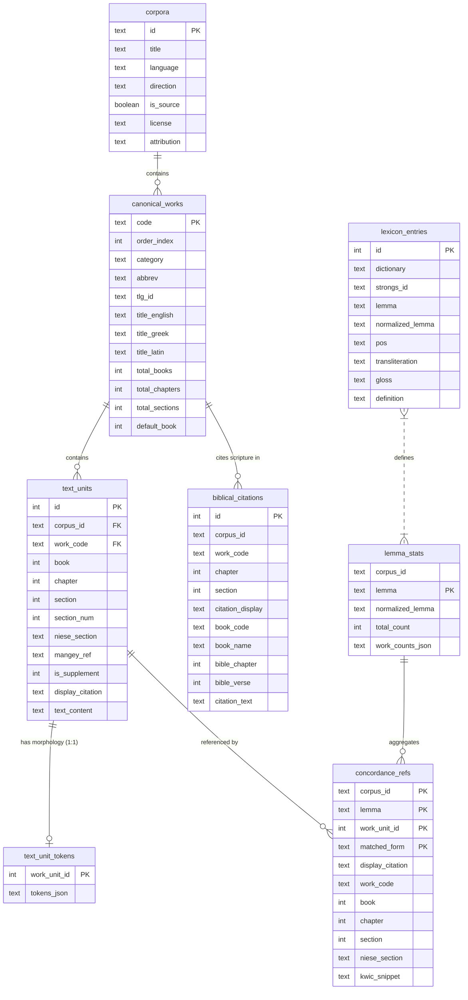

# Ancient Corpora Reader (ACR): Database Design & Architecture

> [!NOTE]
> **AI Generation Notice**: Generated by **Antigravity 2.26.0** (Engine: **Gemini 3.8 Flash**) on **November 2, 2026, at 19:07 EST**.

This document serves as the architectural reference and schema specification for the SQLite database engine powering the **Ancient Corpora Reader (ACR)** within the `polyglot-suite` monorepo.

---

## 1. Executive Summary & Architecture Overview

The Ancient Corpora Reader is a unified, static web application that enables parallel reading, linguistic analysis, concordance exploration, and cross-reference discovery across multiple historical text corpora (currently: **Philo of Alexandria**, **Flavius Josephus**, and the **Apostolic Fathers**).

### High-Level Architecture

```
┌─────────────────────────────────────────────────────────────────────────────┐
│                             Browser Frontend                                │
│                                                                             │
│   ┌───────────────────────────┐         ┌───────────────────────────────┐   │
│   │   AncientCorporaReader    │         │       LexemeSidePanel         │   │
│   │     Parallel Reader       │         │  (Concordance, Stats, Lexicon)│   │
│   └─────────────┬─────────────┘         └──────────────┬────────────────┘   │
│                 │                                      │                    │
│                 ▼                                      ▼                    │
│   ┌─────────────────────────────────────────────────────────────────────┐   │
│   │                 dbClient.ts (Unified API Layer)                     │   │
│   └──────────────────────────────────┬──────────────────────────────────┘   │
│                                      │                                      │
│                                      ▼                                      │
│   ┌─────────────────────────────────────────────────────────────────────┐   │
│   │           dbWorker.ts (sql.js-httpvfs Worker Pool)                  │   │
│   └──────────────────────────────────┬──────────────────────────────────┘   │
└──────────────────────────────────────┼──────────────────────────────────────┘
                                       │ HTTP Range Requests
                                       ▼ (10 MB chunks)
┌─────────────────────────────────────────────────────────────────────────────┐
│                      Static Web Server (CDN / VPS)                          │
│                                                                             │
│   static/db/philo/     static/db/josephus/     static/db/af/                │
│   ├── config.json      ├── config.json         ├── config.json              │
│   ├── philo.db.0       ├── josephus.db.0       ├── af.db.0                  │
│   └── philo.db.1 ...   └── josephus.db.1 ...   └── af.db.1 ...              │
└─────────────────────────────────────────────────────────────────────────────┘
```

### Key Principles
1. **Zero Backend**: All querying runs client-side in WebAssembly using [`sql.js-httpvfs`](https://github.com/phiresky/sql.js-httpvfs).
2. **Targeted HTTP Range Requests**: Large databases (~20 MB to ~80 MB) are split into 10 MB chunk files. SQLite reads only the exact 4096-byte database pages required for each query over HTTP range requests.
3. **Dedicated, Normalized ACR Store**: ACR maintains its own dedicated, optimized databases in `apps/ancient-corpora-reader/static/db/{corpus}/`. The source databases and standalone reader apps (`apps/philo-reader`, `apps/josephus-reader`, `apps/apostolic-fathers-reader`) remain independent and untouched.
4. **Covering Concordance Indexes**: Concordance queries never join across tables or scan full texts. All display metadata and precomputed Key-Word-in-Context (KWIC) snippets are inlined directly into a `WITHOUT ROWID` covering B-tree.

---

## 2. Evolution: Why This Design Was Built

### The Legacy Problem (Tier 0 & 1)
In the initial architecture, concordance queries required:
- Joining `text_units` with token tables or scanning text blocks.
- Unpacking large `tokens_json` payloads (up to 120 KB per section) that were embedded directly in the `text_units` table.
- Multi-lemma scans: searching high-frequency words (e.g., the Greek article **"ὁ"** with 37,000+ occurrences in Philo) triggered full-table scans, dynamic temp B-tree sorts, and over **1,000 HTTP range requests** across 55 chunk files, leading to memory exhaustion and browser freezing.

### The Solution (Tier 2, 2.6 & 3)
1. **Normalized `text_units`**: Removed heavy `tokens_json` into a separate `text_unit_tokens` table. Reading a section now downloads only a tiny text payload (~1–2 KB).
2. **Covering `concordance_refs` Table**: Created a specialized `concordance_refs` table with primary key `(corpus_id, lemma, work_unit_id, matched_form)` containing pre-generated KWIC snippets. Queries execute in **<30 ms with 0 joins, 0 temp B-trees, and only 1–2 HTTP range requests**.
3. **On-Demand Hydration**: Morphology tokens and full-paragraph section texts are fetched only when the user explicitly clicks on a token or toggles "Full Text".
4. **Batched ID Queries**: When full text or tokens are requested, `dbClient` batches IDs using `WHERE id IN (...)` to prevent connection saturation.

---

## 3. Database Schema Specification

All three corpora databases (`af.sqlite3`, `josephus.sqlite3`, `philo.sqlite3`) share the exact same canonical schema.



---

### Table Details & DDL

#### 3.1 `corpora`
Stores top-level metadata about the corpus edition, language, and reading direction.
```sql
CREATE TABLE corpora (
    id TEXT PRIMARY KEY,
    title TEXT NOT NULL,
    language TEXT NOT NULL,
    direction TEXT NOT NULL DEFAULT 'ltr',
    is_source BOOLEAN NOT NULL DEFAULT 0,
    license TEXT,
    attribution TEXT
);
```

#### 3.2 `canonical_works`
Unified catalog of all individual treatises/books within the corpus.
```sql
CREATE TABLE canonical_works (
    code TEXT PRIMARY KEY,
    order_index INTEGER NOT NULL,
    category TEXT NOT NULL,
    abbrev TEXT,
    tlg_id TEXT,
    title_english TEXT NOT NULL,
    title_greek TEXT,
    title_latin TEXT,
    total_books INTEGER DEFAULT 0,
    total_chapters INTEGER DEFAULT 0,
    total_sections INTEGER DEFAULT 0,
    default_book INTEGER DEFAULT 1
);
```
*Note*: `category` groups works in navigation pickers (e.g., "Historical", "Philosophical", "Apologetic").

#### 3.3 `text_units`
Lean representation of textual paragraphs/sections. **Crucially, `tokens_json` is excluded** to keep B-tree leaf pages lightweight for fast parallel reading.
```sql
CREATE TABLE text_units (
    id INTEGER PRIMARY KEY AUTOINCREMENT,
    corpus_id TEXT NOT NULL REFERENCES corpora(id),
    work_code TEXT NOT NULL REFERENCES canonical_works(code),
    book INTEGER DEFAULT 0,
    chapter INTEGER DEFAULT 0,
    section INTEGER NOT NULL,
    section_num INTEGER DEFAULT 0,
    niese_section TEXT DEFAULT '',
    mangey_ref TEXT,
    is_supplement INTEGER NOT NULL DEFAULT 0,
    display_citation TEXT NOT NULL,
    text_content TEXT NOT NULL
);

CREATE INDEX idx_text_units_coords 
ON text_units(work_code, book, chapter, section, corpus_id);
```

#### 3.4 `text_unit_tokens`
Stores the detailed morphological token breakdown (lemmas, parts of speech, glosses) in a dedicated table, loaded on-demand.
```sql
CREATE TABLE text_unit_tokens (
    work_unit_id INTEGER PRIMARY KEY,
    tokens_json TEXT NOT NULL
) WITHOUT ROWID;
```
- Declared `WITHOUT ROWID` to eliminate secondary index overhead.
- Only queried when the user hovers/clicks on individual words to inspect grammatical morphology.

#### 3.5 `concordance_refs` (Covering Concordance Table)
The core optimization engine for the concordance search. Every row represents an occurrence of a lemma in a specific section, pre-paired with its surface form and precomputed KWIC snippet.
```sql
CREATE TABLE concordance_refs (
    corpus_id TEXT NOT NULL,
    lemma TEXT NOT NULL,
    work_unit_id INTEGER NOT NULL,
    matched_form TEXT NOT NULL,
    display_citation TEXT NOT NULL,
    work_code TEXT NOT NULL,
    book INTEGER DEFAULT 0,
    chapter INTEGER DEFAULT 0,
    section INTEGER NOT NULL,
    niese_section TEXT DEFAULT '',
    kwic_snippet TEXT NOT NULL,
    PRIMARY KEY (corpus_id, lemma, work_unit_id, matched_form)
) WITHOUT ROWID;
```

**Why this structure is optimal:**
- **Clustered Index**: The `PRIMARY KEY (corpus_id, lemma, work_unit_id, matched_form)` orders rows contiguously on disk by `lemma` and ascending `work_unit_id`.
- **Zero Joins**: Citations, work codes, section numbers, and KWIC text snippets are contained in the row.
- **Index-Only Execution**: A query like:
  ```sql
  SELECT display_citation, work_code, book, chapter, section, 
         niese_section, work_unit_id, kwic_snippet, matched_form
  FROM concordance_refs
  WHERE lemma = ?
  ORDER BY work_unit_id ASC
  LIMIT 50 OFFSET 0;
  ```
  executes via a single B-tree index seek and sequential range scan. It never touches another table and requires **0 temporary B-trees or memory sorts**.

#### 3.6 `lemma_stats`
Stores pre-aggregated occurrence frequencies and per-work distributions.
```sql
CREATE TABLE lemma_stats (
    corpus_id TEXT NOT NULL,
    lemma TEXT NOT NULL,
    normalized_lemma TEXT NOT NULL,
    total_count INTEGER NOT NULL,
    work_counts_json TEXT NOT NULL,
    PRIMARY KEY (corpus_id, lemma)
);

CREATE INDEX idx_lemma_stats_norm ON lemma_stats(normalized_lemma);
```
- Concordance pagination uses `total_count` directly from this table, eliminating costly `SELECT COUNT(*)` table scans.

#### 3.7 `lexicon_entries`
Greek (Liddell-Scott-Jones) dictionary entries.
```sql
CREATE TABLE lexicon_entries (
    id INTEGER PRIMARY KEY AUTOINCREMENT,
    dictionary TEXT NOT NULL,
    strongs_id TEXT,
    lemma TEXT NOT NULL,
    normalized_lemma TEXT NOT NULL,
    pos TEXT,
    transliteration TEXT,
    gloss TEXT NOT NULL,
    definition TEXT NOT NULL
);

CREATE INDEX idx_lexicon_lemma ON lexicon_entries(dictionary, normalized_lemma);
CREATE INDEX idx_lexicon_exact ON lexicon_entries(dictionary, lemma);
```

#### 3.8 `biblical_citations` (Corpus-Specific: Philo)
Stores in-text biblical/scripture citations identified in critical editions.
```sql
CREATE TABLE biblical_citations (
    id INTEGER PRIMARY KEY AUTOINCREMENT,
    corpus_id TEXT NOT NULL,
    work_code TEXT NOT NULL,
    chapter INTEGER DEFAULT 0,
    section INTEGER DEFAULT 0,
    citation_display TEXT NOT NULL,
    book_code TEXT NOT NULL,
    book_name TEXT NOT NULL,
    bible_chapter INTEGER DEFAULT 0,
    bible_verse INTEGER DEFAULT 0,
    citation_text TEXT NOT NULL
);

CREATE INDEX idx_bib_book ON biblical_citations(book_code);
CREATE INDEX idx_bib_loc ON biblical_citations(work_code, chapter, section);
```

---

## 4. Physical Storage & HTTP-VFS Chunking

To ensure smooth client-side execution over HTTP, the SQLite databases are compiled with specific SQLite page sizes and chunked into static segments:

1. **Page Size**: `PRAGMA page_size = 4096;` matches standard filesystem and memory block allocations.
2. **Vacuum & Optimize**: Every generated database runs `PRAGMA optimize;` and `VACUUM;` to eliminate free-list fragmentation and ensure B-trees are densely packed.
3. **Chunking**: Chunked via `pipeline_core.DatabaseChunker` with a target size of **10,000,000 bytes (~9.53 MB)**.
4. **Manifest (`config.json`)**:
   ```json
   {
     "serverMode": "chunked",
     "requestChunkSize": 10000000,
     "databaseLengthBytes": 20480000,
     "maxPageSize": 4096,
     "chunkSize": 10000000,
     "chunkNames": [
       "philo.db.0",
       "philo.db.1",
       "philo.db.2"
     ]
   }
   ```
5. **Cache Optimization**: In HTTP production environments (Vercel, Cloudflare, VPS, GitHub Pages), `.db.*` chunk files should be served with immutable caching headers:
   ```
   Cache-Control: public, max-age=31536000, immutable
   ```

---

## 5. Client-Side Service Architecture (`dbClient.ts`)

The ACR frontend interacts with the database through [`src/lib/services/dbClient.ts`](file:///home/cbrannan/dev/2-tmp/polyglot-suite/apps/ancient-corpora-reader/src/lib/services/dbClient.ts) and [`src/lib/services/dbWorker.ts`](file:///home/cbrannan/dev/2-tmp/polyglot-suite/apps/ancient-corpora-reader/src/lib/services/dbWorker.ts).

### Key Subsystems:

1. **Lazy Web Worker Pool**:
   Workers are initialized lazily per corpus using `getDbWorker(corpusId)`. When a user switches from Philo to Josephus, the Josephus worker is spun up independently without evicting or reloading Philo.

2. **Single-Lemma Concordance Pagination**:
   - `fetchConcordancePage(corpusId, lemma, offset, pageSize)` resolves the exact lemma from `lemma_stats` to get `total_count`.
   - Fetches the exact slice from `concordance_refs` using `LIMIT ? OFFSET ?`.
   - Supports dynamic page sizes `[50, 100, 250, 500]`.

3. **On-Demand Full Text & Morphology**:
   - `fetchSectionText(corpusId, workUnitId)` retrieves the complete section text on demand if the user expands a KWIC card.
   - `fetchSectionsTextBatch(corpusId, workUnitIds)` fetches multiple paragraphs in a single `WHERE id IN (...)` query when toggling "Full Text" for the page.
   - `fetchTokens(corpusId, workUnitIds)` pulls morphological tokens on demand from `text_unit_tokens`.

4. **Scripture Citation Apparatus**:
   - `fetchScriptureSummaries(corpusId)` provides summary citation counts grouped by biblical book for canon overview filtering.
   - `searchScriptureCitations(corpusId, filter)` searches citations by biblical book code, chapter, verse, or work code.

---

## 6. How to Rebuild or Update ACR Databases

The compilation and chunking pipeline is automated and isolated inside the ACR package:

```bash
# Rebuild all three corpora databases (af, josephus, philo)
python3 -m apps.ancient-corpora-reader.pipeline.build

# Rebuild a single corpus (e.g., Philo)
python3 -m apps.ancient-corpora-reader.pipeline.build --corpus philo
```

### Pipeline Flow (`build.py`):
1. **Reads** from source databases:
   - `packages/data-pipeline/data/philo.sqlite3`
   - `packages/data-pipeline/data/josephus.sqlite3`
   - `packages/data-pipeline/data/apostolic_fathers.sqlite3`
2. **Normalizes** tables into lean canonical schema (`canonical_works`, `text_units`, `text_unit_tokens`, `lexicon_entries`).
3. **Generates** KWIC snippets and writes `concordance_refs` (`WITHOUT ROWID`).
4. **Optimizes & vacuums** the database.
5. **Splits** into 10 MB chunks and generates `config.json` in `apps/ancient-corpora-reader/static/db/{corpus}/`.

---

## 7. Extending ACR to a New Ancient Corpus

To add a new ancient language corpus (e.g., *Early Christian Apologists*, *Polybius*, or *Septuagint*):

1. **Add Corpus Definition**:
   Register the new corpus in [`pipeline/build.py`](file:///home/cbrannan/dev/2-tmp/polyglot-suite/apps/ancient-corpora-reader/pipeline/build.py#L33) with its source database path and target output directory.
2. **Source Data Requirements**:
   Ensure the source database provides:
   - `corpora` metadata.
   - `canonical_works` catalog.
   - `text_units` with `text_content` and `tokens_json`.
   - `lemma_stats` containing precomputed lemma frequencies.
   - `lexicon_entries` (LSJ or relevant dictionary).
3. **Run Pipeline**:
   Execute `python3 -m apps.ancient-corpora-reader.pipeline.build --corpus <id>`.
4. **Register in Frontend**:
   Add the new corpus ID and metadata to `CORPUS_TITLES` in [`dbClient.ts`](file:///home/cbrannan/dev/2-tmp/polyglot-suite/apps/ancient-corpora-reader/src/lib/services/dbClient.ts) and the corpus switcher dropdown in [`CorpusHeader.svelte`](file:///home/cbrannan/dev/2-tmp/polyglot-suite/apps/ancient-corpora-reader/src/lib/components/CorpusHeader.svelte).
