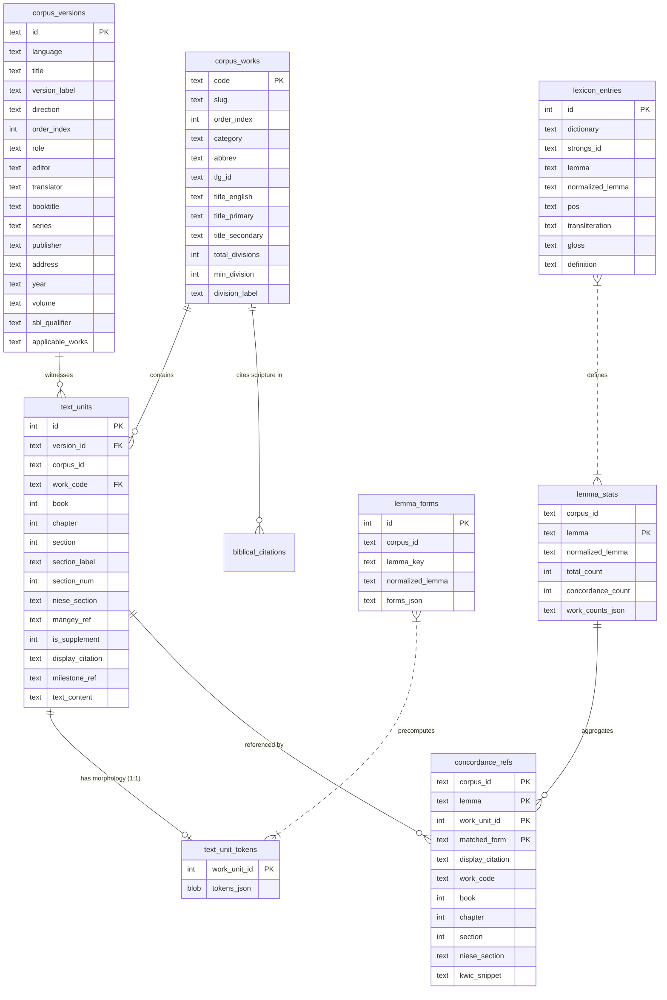

# Ancient Corpora Reader (ACR): Database Design & Architecture

> [!NOTE]
> **AI Generation Notice**: Updated on **November 25, 2026** to document the Consolidated Single Source of Truth (SSOT) architecture for corpus versions, bibliographic metadata, and canonical works.

This document serves as the authoritative architectural reference and schema specification for the SQLite database engine and generated TypeScript manifests powering the **Ancient Corpora Reader (ACR)** within the `polyglot-suite` monorepo.

---

## 1. Executive Summary & Architecture Overview

The Ancient Corpora Reader is a unified, static web application that enables parallel reading, linguistic analysis, concordance exploration, and academic citation generation across major historical text corpora:
1. **Apostolic Fathers (`af`)**
2. **Philo of Alexandria (`philo`)**
3. **Flavius Josephus (`josephus`)**
4. **Justin Martyr (`justin`)**

### High-Level Architecture

```
┌─────────────────────────────────────────────────────────────────────────────┐
│                             Browser Frontend                                │
│                                                                             │
│   ┌───────────────────────────┐         ┌───────────────────────────────┐   │
│   │   AncientCorporaReader    │         │       LexemeSidePanel         │   │
│   │     Parallel Reader       │         │  (Concordance, Stats, Lexicon)│   │
│   └─────────────┬─────────────┘         └──────────────┬────────────────┘   │
│                 │                                      │                    │
│                 ▼                                      ▼                    │
│   ┌─────────────────────────────────────────────────────────────────────┐   │
│   │                 dbClient.ts (Unified API Layer)                     │   │
│   └──────────────────────────────────┬──────────────────────────────────┘   │
│                                      │                                      │
│                                      ▼                                      │
│   ┌─────────────────────────────────────────────────────────────────────┐   │
│   │           dbWorker.ts (sql.js-httpvfs Worker Pool)                  │   │
│   └──────────────────────────────────┬──────────────────────────────────┘   │
└──────────────────────────────────────┼──────────────────────────────────────┘
                                       │ HTTP Range Requests
                                       ▼ (5 MB chunks)
┌─────────────────────────────────────────────────────────────────────────────┐
│                      Static Web Server (CDN / VPS)                          │
│                                                                             │
│   static/db/af/        static/db/philo/     static/db/josephus/   static/db/justin/
│   ├── config.json      ├── config.json      ├── config.json       ├── config.json
│   ├── af.db.00         ├── philo.db.00      ├── josephus.db.00    ├── justin.db.00
│   └── af.db.01 ...     └── philo.db.01 ...  └── josephus.db.01... └── justin.db.01...
└─────────────────────────────────────────────────────────────────────────────┘
```

### Key Principles
1. **Single Source of Truth (SSOT) in SQLite**: All corpus text versions, witnesses, and rich bibliographic records are stored canonically in the SQLite databases (`corpus_versions` table).
2. **Auto-Generated TypeScript Manifests**: The pipeline build script automatically extracts metadata from the SQLite databases into typed `*.generated.ts` manifests (`corpusVersions.generated.ts` and `canonicalWorks.generated.ts`). Svelte components import these manifests, eliminating data duplication.
3. **Zero Backend**: All querying runs client-side in WebAssembly using [`sql.js-httpvfs`](https://github.com/phiresky/sql.js-httpvfs).
4. **Targeted HTTP Range Requests**: Databases are split into 5 MB chunk files (`CHUNK_SIZE = 5 * 1024 * 1024`). SQLite reads only the exact database pages required for each query over HTTP range requests.
5. **Covering Concordance Indexes**: Concordance queries never join across tables or scan full texts. Display metadata and precomputed Key-Word-in-Context (KWIC) snippets are inlined directly into a `WITHOUT ROWID` covering B-tree table (`concordance_refs`).

---

## 2. Standardized Version ID Convention

All textual witnesses and translations use a standardized naming convention: `<corpus>_<edition>_<lang>`.

| Corpus | Version ID | Language | Role | Edition / Source |
| :--- | :--- | :--- | :--- | :--- |
| **Apostolic Fathers** | `af_lake_grc` | `grc` | Critical Edition | Kirsopp Lake (Loeb Classical Library, 1912) |
| | `af_lake_lat` | `lat` | Ancient Witness | Latin Witness (Loeb Classical Library, 1912; where extant) |
| | `af_lake_eng` | `eng` | Translation | Kirsopp Lake English Translation (1912) |
| **Philo of Alexandria** | `philo_cw_grc` | `grc` | Critical Edition | Cohn-Wendland Greek Critical Text (*Editio Maior*, 1896–1915) |
| | `philo_yonge_eng` | `eng` | Translation | C. D. Yonge English Translation (1854) |
| **Flavius Josephus** | `josephus_niese_grc` | `grc` | Critical Edition | Benedikt Niese Greek Critical Text (1885–1895) |
| | `josephus_whiston_eng`| `eng` | Translation | William Whiston English Translation (1737) |
| **Justin Martyr** | `justin_celano_grc` | `grc` | Critical Edition | Giuseppe Celano Lemmatized Greek (First1KGreek tlg0645) |
| | `justin_anf_eng` | `eng` | Translation | Ante-Nicene Fathers Vol. 1 (Roberts & Donaldson, 1885) |

---

## 3. Database Schema Specification

All four corpora databases (`af.sqlite3`, `philo.sqlite3`, `josephus.sqlite3`, `justin.sqlite3`) implement the canonical Tier-2 schema:



---

### Table Details & DDL

#### 3.1 `corpus_versions` (Canonical Versions & Bibliographic SSOT)
Stores complete metadata and academic citation fields for every textual edition, witness, or translation:
```sql
CREATE TABLE corpus_versions (
    id TEXT PRIMARY KEY,
    language TEXT NOT NULL,
    title TEXT NOT NULL,
    version_label TEXT,
    direction TEXT DEFAULT 'ltr',
    order_index INTEGER DEFAULT 0,
    role TEXT NOT NULL,
    editor TEXT,
    translator TEXT,
    booktitle TEXT NOT NULL,
    series TEXT,
    publisher TEXT NOT NULL,
    address TEXT,
    year TEXT NOT NULL,
    volume TEXT,
    sbl_qualifier TEXT,
    applicable_works TEXT
);

-- Backward compatibility view
CREATE VIEW IF NOT EXISTS corpora AS
SELECT id, title, language, direction, 1 AS is_source, '' AS license, '' AS attribution
FROM corpus_versions;
```
- `applicable_works`: A JSON string array (e.g. `["HER", "POL_PHI"]`) restricting versions to specific works where extant (e.g., Latin witness in AF). When `NULL`, the version is extant across all works in the corpus.
- `sbl_qualifier`: Standard qualifier string for SBL academic citations (e.g., `(Latin)`, `(trans. Lake)`).

#### 3.2 `corpus_works` (Canonical Works Catalog)
Catalog of treatises, books, and epistles within the corpus:
```sql
CREATE TABLE corpus_works (
    code TEXT PRIMARY KEY,
    slug TEXT NOT NULL,
    order_index INTEGER NOT NULL,
    category TEXT NOT NULL,
    abbrev TEXT NOT NULL,
    tlg_id TEXT,
    title_english TEXT NOT NULL,
    title_primary TEXT,
    title_secondary TEXT,
    total_divisions INTEGER NOT NULL,
    min_division INTEGER DEFAULT 1,
    division_label TEXT NOT NULL
);

-- Backward compatibility view
CREATE VIEW IF NOT EXISTS canonical_works AS
SELECT code, order_index, category, abbrev, tlg_id, title_english,
       title_primary AS title_greek, title_secondary AS title_latin,
       total_divisions AS total_books, total_divisions AS total_chapters,
       0 AS total_sections, min_division AS default_book
FROM corpus_works;
```

#### 3.3 `text_units`
Lean representation of textual paragraphs/sections:
```sql
CREATE TABLE text_units (
    id INTEGER PRIMARY KEY AUTOINCREMENT,
    version_id TEXT NOT NULL REFERENCES corpus_versions(id),
    corpus_id TEXT NOT NULL,
    work_code TEXT NOT NULL REFERENCES corpus_works(code),
    book INTEGER NOT NULL DEFAULT 0,
    chapter INTEGER NOT NULL DEFAULT 0,
    section INTEGER NOT NULL,
    section_label TEXT,
    section_num INTEGER DEFAULT 0,
    niese_section TEXT DEFAULT '',
    mangey_ref TEXT,
    is_supplement INTEGER NOT NULL DEFAULT 0,
    display_citation TEXT NOT NULL,
    milestone_ref TEXT,
    text_content TEXT NOT NULL
);

CREATE INDEX idx_text_units_seek ON text_units(work_code, book, chapter, section, version_id);
CREATE INDEX idx_text_units_coords ON text_units(work_code, book, chapter, section, corpus_id);
```

#### 3.4 `text_unit_tokens`
Stores detailed morphological tokens compressed as gzip blobs:
```sql
CREATE TABLE text_unit_tokens (
    work_unit_id INTEGER PRIMARY KEY,
    tokens_json BLOB NOT NULL
) WITHOUT ROWID;
```

#### 3.5 `concordance_refs` (Covering Concordance Table)
```sql
CREATE TABLE concordance_refs (
    corpus_id TEXT NOT NULL,
    lemma TEXT NOT NULL,
    work_unit_id INTEGER NOT NULL,
    matched_form TEXT NOT NULL,
    display_citation TEXT NOT NULL,
    work_code TEXT NOT NULL,
    book INTEGER DEFAULT 0,
    chapter INTEGER DEFAULT 0,
    section INTEGER NOT NULL,
    niese_section TEXT DEFAULT '',
    kwic_snippet TEXT NOT NULL,
    PRIMARY KEY (corpus_id, lemma, work_unit_id, matched_form)
) WITHOUT ROWID;

CREATE INDEX idx_concordance_refs_form 
ON concordance_refs(corpus_id, lemma, matched_form, work_unit_id);
```

#### 3.6 `lemma_forms`
Precomputed attested inflectional forms for fast lemma morphological breakdowns without runtime token scanning:
```sql
CREATE TABLE lemma_forms (
    id INTEGER PRIMARY KEY AUTOINCREMENT,
    corpus_id TEXT NOT NULL,
    lemma_key TEXT NOT NULL,
    normalized_lemma TEXT NOT NULL,
    forms_json TEXT NOT NULL
);

CREATE INDEX idx_lemma_forms_lookup 
ON lemma_forms(corpus_id, normalized_lemma, lemma_key);
```

---

## 4. Manifest Generation (`*.generated.ts`)

During the pipeline build (`apps/ancient-corpora-reader/pipeline/build.py`), the script `export_canonical_manifests.py` automatically extracts data from the compiled SQLite databases and generates:

1. **`src/lib/config/corpusVersions.generated.ts`**:
   Exports `CANONICAL_CORPUS_VERSIONS: Record<string, TextVersionConfig[]>`, containing full bibliographic structures, roles, and applicable works.
2. **`src/lib/config/canonicalWorks.generated.ts`**:
   Exports `CANONICAL_CORPUS_WORKS: Record<AncientCorpusId, CorpusWork[]>`, containing works, division labels, min/total divisions, and precomputed `sectionsByDivision` maps.

### Application Integration
- `src/lib/config/corpora.ts` imports `CANONICAL_CORPUS_VERSIONS` to populate each corpus config's `textVersions` array.
- `src/lib/config/corpora.data.ts` re-exports `CANONICAL_CORPUS_WORKS` as `ALL_CORPUS_WORKS`, `AF_WORKS`, `PHILO_WORKS`, `JOSEPHUS_WORKS`, and `JUSTIN_WORKS`.
- `AcademicCitationModalWrapper.svelte` dynamically generates complete **SBL**, **Chicago Manual of Style**, and **BibTeX** citations for each available edition/witness using `formatVersionAcademicCitations()`.

---

## 5. Building and Chunking

To recompile all Tier-2 SQLite databases, rechunk them for HTTP range requests, and regenerate the TypeScript manifests:

```bash
# From workspace root
npm --prefix apps/ancient-corpora-reader run pipeline:build

# Or directly via python
cd apps/ancient-corpora-reader
python3 -m pipeline.build
```

To build a specific corpus:
```bash
python3 -m pipeline.build --corpus af
python3 -m pipeline.build --corpus philo
python3 -m pipeline.build --corpus josephus
python3 -m pipeline.build --corpus justin
```
