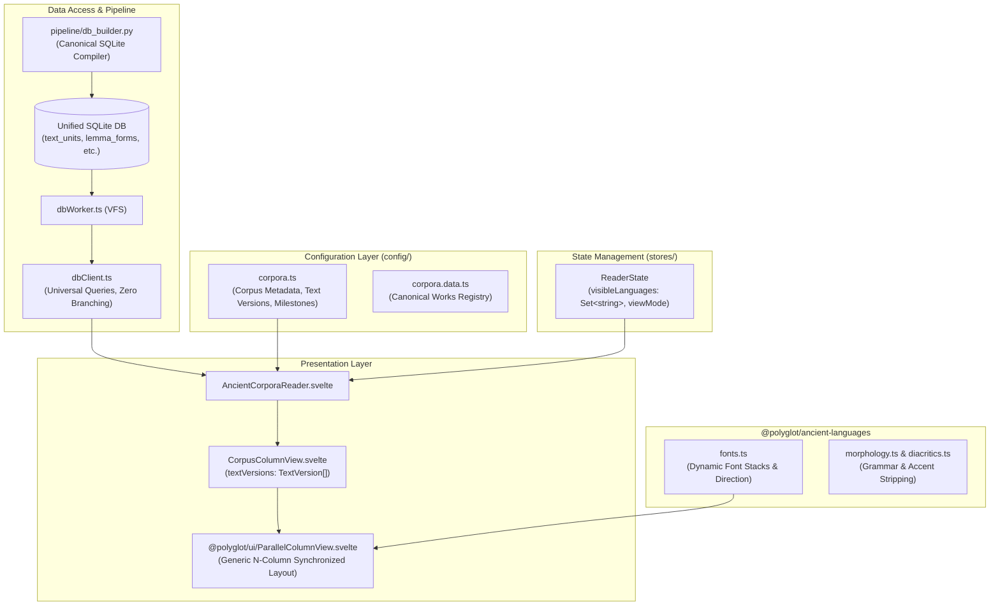

# Design Document 01: ACR Architecture & Refactoring Overview

> [!NOTE]
> **AI Generation Notice**: Generated by **Antigravity 2.26.0** (Engine: **Gemini 3.8 Flash**) on **November 4, 2026, at 11:10 EST**.

**Design Version**: 0.2  
**Document Version**: 0.2  
**Created**: 2026-11-04T11:10:06-05:00  
**Last Modified**: 2026-11-04T15:28:00-05:00  
**Status**: Draft / RFC  
**Human Reviewer**: [cbop-dev](https://github.com/cbop-dev)
---

## 1. Context & Motivation

The **Ancient Corpora Reader (ACR)** is a unified multi-text reader and lexical study environment within the Polyglot Suite. Historically, ACR was rapidly assembled by consolidating features from three standalone applications: `philo-reader`, `josephus-reader`, and `apostolic-fathers-reader`. 

While this consolidation succeeded in proving the concept of a single reader application, it left behind pervasive hardcoded assumptions:
* Svelte components directly query corpus codes (`readerState.currentCorpus === 'af'`, `'philo'`) to select edition titles, citation labels, and milestones (e.g. `"Niese §"`, `"Mangey M."`).
* Column reading views hardcode props for `'greek'`, `'english'`, and `'latin'`, precluding other languages (Hebrew, Aramaic, Syriac, German) or flexible $N$-column alignment.
* Database querying logic branches on `corpusId` in client services, executing wildly divergent queries against non-uniform SQLite tables.
* Work catalogs and citation rules are duplicated and out-of-sync between ACR and `@polyglot/ancient-languages`.

Because the three standalone reader applications have now been superseded and deleted, ACR has complete architectural freedom to establish a clean-sheet, extensible, language- and corpus-agnostic foundation.

---

## 2. Core Architectural Principles

1. **Zero Corpus Coupling in Components**: Svelte components must never contain `if (corpus === 'af')` checks or hardcoded corpus strings. All corpus-specific identity, edition labels, milestone prefixes, and features must be declared in configuration files.
2. **Zero Language Coupling in Views**: Layouts, columns, and reading views must operate over generic text version structures (`TextVersion[]`), dynamically determining column count, text direction (`ltr` vs `rtl`), and font stacks.
3. **Single Canonical Database Schema**: Every corpus compiled into an SQLite database for ACR must implement the exact same relational schema contract (`corpus_versions`, `corpus_works`, `text_units`, `lemma_forms`, etc.). The database client service (`dbClient.ts`) must never execute corpus-conditional SQL.
4. **Single Source of Truth for Metadata**: All corpus definitions, corpus works, division structures, and citation formats must reside in `config/` (e.g. `corpora.ts`, `corpora.data.ts`, and optional pipeline-generated files like `corpora.generated.ts`). Redundant static tables in `@polyglot/ancient-languages` must be eliminated.
5. **Decoupled Shared Lexicons Architecture**: Lexicons (e.g. LSJ, BDB) should live in a dedicated, unified `lexicons.sqlite3` database with its own GitHub release, rather than being duplicated inside every individual corpus database.
6. **Dynamic Font & Typography Integration**: Font styling must not use static, hardcoded classes like `.greek-font`. Instead, CSS classes and font families must be dynamically resolved via `@polyglot/ancient-languages/fonts.ts`.
7. **Progressive Batch Rendering for Large Divisions**: To eliminate main-thread freezes on long treatises (such as Philo's 150+ section works with 25,000+ interactive word tokens), column views must render an initial interactive batch immediately (< 50ms) and progressively stream subsequent batches during browser idle cycles.

---

## 3. High-Level Architecture Diagram

---

## 4. Structure of Design Documents

This design suite is organized into six targeted technical specifications:

| Document | Title | Purpose |
| :--- | :--- | :--- |
| **01** | [Design Overview](file:///home/cbrannan/.gemini/antigravity/worktrees/polyglot-suite/audit_acr_refactoring/apps/ancient-corpora-reader/docs/design-v0.3/01_design_overview.md) | Architectural manifesto, design goals, and document index. |
| **02** | [Unified Database Schema](file:///home/cbrannan/.gemini/antigravity/worktrees/polyglot-suite/audit_acr_refactoring/apps/ancient-corpora-reader/docs/design-v0.3/02_unified_database_schema.md) | DDL specification for the canonical SQLite contract across all corpora. |
| **03** | [Corpus Configuration Architecture](file:///home/cbrannan/.gemini/antigravity/worktrees/polyglot-suite/audit_acr_refactoring/apps/ancient-corpora-reader/docs/design-v0.3/03_corpus_configuration_architecture.md) | Specification for `config/corpora.ts`, `corpora.data.ts`, and canon definitions. |
| **04** | [TypeScript Data Structures & State](file:///home/cbrannan/.gemini/antigravity/worktrees/polyglot-suite/audit_acr_refactoring/apps/ancient-corpora-reader/docs/design-v0.3/04_typescript_data_structures_and_state.md) | Interfaces (`TextVersion`, `TextUnit`) and reactive `ReaderState` design. |
| **05** | [UI Components & Font Integration](file:///home/cbrannan/.gemini/antigravity/worktrees/polyglot-suite/audit_acr_refactoring/apps/ancient-corpora-reader/docs/design-v0.3/05_ui_components_and_font_integration.md) | Refactoring specifications for `CorpusColumnView`, `@polyglot/ui`, and font bindings. |
| **06** | [Pipeline & Ingestion Build Contract](file:///home/cbrannan/.gemini/antigravity/worktrees/polyglot-suite/audit_acr_refactoring/apps/ancient-corpora-reader/docs/design-v0.3/06_pipeline_and_build_specification.md) | Python pipeline specification for compiling raw source texts into the canonical SQLite schema. |

---

## 5. Migration Strategy & Rollout Phases

1. **Phase 1: Configuration & Typography Groundwork**
   - Author `src/lib/config/corpora.ts` and `src/lib/config/corpora.data.ts`.
   - Wire dynamic font resolution via `@polyglot/ancient-languages/fonts.ts`.
   - Remove redundant static dictionaries from `@polyglot/ancient-languages`.
2. **Phase 2: Database Pipeline Standardization**
   - Update `pipeline/db_builder.py` to enforce the canonical schema, including standardized `lemma_forms`.
   - Recompile and chunk SQLite databases into `static/db/{af,philo,josephus}/`.
3. **Phase 3: Database Client & State Generalization**
   - Refactor `dbClient.ts` to return generic `TextVersion[]` with zero corpus branches.
   - Refactor `readerState.svelte.ts` to use `visibleLanguages: Set<string>`.
4. **Phase 4: Component Refactoring**
   - Refactor `@polyglot/ui/ParallelColumnView.svelte` to accept generic `textVersions`.
   - Refactor `CorpusColumnView.svelte`, `AncientCorporaReader.svelte`, and modal wrappers.
5. **Phase 5: Route Generalization & Verification**
   - Update route loaders to dynamically validate against `CORPORA_CONFIG`.
   - Update unit and end-to-end test suites.
