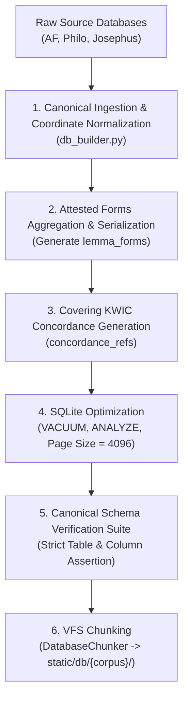

# Design Document 06: Pipeline & Build Specification

> [!NOTE]
> **AI Generation Notice**: Generated by **Antigravity 2.26.0** (Engine: **Gemini 3.8 Flash**) on **November 4, 2026, at 11:10 EST**.

**Design Version**: 0.2  
**Document Version**: 0.2  
**Created**: 2026-11-04T11:10:06-05:00  
**Last Modified**: 2026-11-04T15:20:00-05:00  
**Status**: Draft / RFC  

---

## 1. Objective & Scope

The ACR data tier relies on static SQLite database chunks queried in the browser via `sql.js-httpvfs`. For client services (`dbClient.ts`) to be completely corpus-agnostic, the offline database build pipeline must compile raw source files into the exact canonical schema defined in **Design Document 02**.

This specification defines the build-time contract for [`apps/ancient-corpora-reader/pipeline/`](file:///home/cbrannan/.gemini/antigravity/worktrees/polyglot-suite/audit_acr_refactoring/apps/ancient-corpora-reader/pipeline/), detailing how raw source texts from Apostolic Fathers, Philo, and Josephus are normalized, indexed, and chunked.

---

## 2. Ingestion & Transformation Rules

### 2.1 Standardizing Text Coordinates & Milestones (`text_units`)
During the extraction of text units from upstream source files, coordinates must be mapped to the canonical `(book, chapter, section)` layout, and edition-specific markers mapped to `milestone_ref`:

| Source Corpus | Source Coordinate Mapping | Source Milestone Mapping | Canonical Schema Assignment |
| :--- | :--- | :--- | :--- |
| **Josephus** | `book = row.book`, `chapter = 0`, `section = row.section_num` | `row.niese_section` | `milestone_ref = str(row.niese_section)` |
| **Philo** | `book = row.chapter`, `chapter = row.chapter`, `section = row.section` | `row.mangey_ref` | `milestone_ref = str(row.mangey_ref)` |
| **Apostolic Fathers** | `book = row.chapter`, `chapter = row.chapter`, `section = row.section` | None | `milestone_ref = NULL` |

This guarantees that:
* Primary seeking queries filter on `WHERE work_code = ? AND (book = ? OR chapter = ?)`.
* Milestones are rendered without checking corpus names.

---

### 2.2 Precomputing `lemma_forms` for All Corpora
**Resolving the Tier 2.6 Omission**: Rather than delegating inflection resolution to runtime client queries, the build pipeline generates a uniform `lemma_forms` table across all corpora.

#### Build Algorithm:
1. **Josephus**:
   - Query source `attested_forms` table: `SELECT lemma, form, pos, parse_code, description FROM attested_forms`.
   - Group records by lemma, serialize to JSON: `[{"word":"form", "pos":"pos", "parse":"parse_code", "count":count}, ...]`.
   - Insert into canonical `lemma_forms(corpus_id, lemma_key, normalized_lemma, forms_json)`.
2. **Philo**:
   - Query source `lemma_forms`: extract `forms_json`.
   - Normalize schema keys and insert into canonical `lemma_forms`.
3. **Apostolic Fathers**:
   - At build time, iterate over all `tokens_json` in `text_unit_tokens`.
   - Aggregate frequencies of inflected forms for each unique lemma (`tok.l` -> `tok.w`, `tok.m`, `tok.p`).
   - Insert grouped forms into canonical `lemma_forms`.
   - *Result*: Completely eliminates runtime scans and joins in AF.

---

### 2.3 Covering Concordance & KWIC Generation (`concordance_refs`)
* Build-time generation of `concordance_refs` (`WITHOUT ROWID`) remains standard across all corpora.
* For each token with a valid lemma:
  - Generate a 60-character precomputed KWIC snippet with the matched form highlighted.
  - Store `work_unit_id`, `work_code`, `book`, `chapter`, `section`, and `milestone_ref`.
  - Compile the primary key as `(corpus_id, lemma, work_unit_id, matched_form)`.

---

## 3. Pipeline Execution Workflow (`pipeline/build.py`)

The pipeline runner executes the following sequential stages:



---

## 4. Automated Schema Verification Suite

Before chunking any compiled database, `db_builder.py` executes an automated contract verification query against `sqlite_master`:

```python
REQUIRED_TABLES = {
    "corpus_versions": {"id", "language", "title", "version_label", "direction", "order_index"},
    "corpus_works": {"code", "slug", "order_index", "category", "abbrev", "title_english", "total_divisions", "division_label"},
    "text_units": {"id", "version_id", "work_code", "book", "chapter", "section", "display_citation", "milestone_ref", "text_content"},
    "text_unit_tokens": {"work_unit_id", "tokens_json"},
    "concordance_refs": {"corpus_id", "lemma", "work_unit_id", "display_citation", "work_code", "matched_form", "kwic_snippet"},
    "lexicon_entries": {"id", "dictionary", "lemma", "normalized_lemma", "pos", "transliteration", "gloss", "definition"},
    "lemma_forms": {"id", "corpus_id", "lemma_key", "normalized_lemma", "forms_json"}
}

def verify_canonical_schema(db_path: Path):
    """Asserts that the compiled database conforms 100% to the canonical schema contract."""
    conn = sqlite3.connect(db_path)
    cur = conn.cursor()
    for table, required_cols in REQUIRED_TABLES.items():
        cur.execute(f"PRAGMA table_info({table});")
        cols = {row[1] for row in cur.fetchall()}
        missing = required_cols - cols
        if missing:
            raise ValueError(f"Schema violation in {db_path.name} table '{table}': missing columns {missing}")
    conn.close()
```
If any corpus database fails this check, compilation halts immediately, preventing non-canonical databases from ever reaching the frontend.
