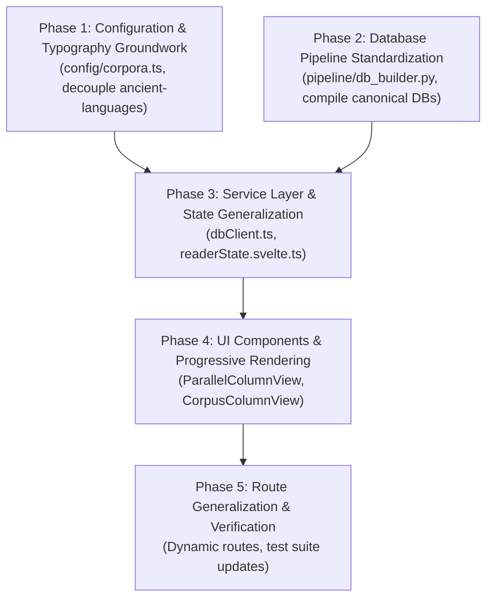

# Implementation Plan: ACR Refactoring Overview

> [!NOTE]
> **AI Generation Notice**: Generated by **Antigravity 2.26.0** (Engine: **Gemini 3.8 Flash**) on **November 4, 2026, at 16:02 EST**.

**Design Version**: 0.2  
**Document Version**: 0.1  
**Created**: 2026-11-04T16:02:11-05:00  
**Last Modified**: 2026-11-04T16:32:00-05:00  
**Status**: Ready for Execution  

---

## 1. Executive Summary & Strategy

This document outlines the master implementation roadmap to execute the **ACR Design v0.3 (Design Version 0.2)** architecture.

The objective is to eliminate all hardcoded corpus-specific and language-specific assumptions from UI views and client services, establish a unified canonical database contract across all corpora, and introduce high-performance **Progressive Batch Rendering** for large philosophical and historical texts.

### Execution Guiding Principles:
1. **Zero Downtime / Broken States**: Each phase produces a self-contained, testable milestone that compiles cleanly with `npm run check`.
2. **Bottom-Up Migration**: We establish the configuration and database schema foundation before altering state stores and UI views.
3. **No Legacy Baggage**: Because legacy standalone readers (`philo-reader`, `josephus-reader`, `af-reader`) have been deleted, components in `@polyglot/ui` are refactored cleanly without backward-compatibility bloat.

---

## 2. Phase Breakdown & Dependency Graph

| Phase | Title | Key Deliverables | Risk Level |
| :--- | :--- | :--- | :---: |
| **Phase 1** | [Configuration & Typography Groundwork](file:///home/cbrannan/.gemini/antigravity/worktrees/polyglot-suite/audit_acr_refactoring/docs/design-v0.3/implement/phase_1_configuration_and_typography.md) | `config/corpora.ts`, `corpora.data.ts`, decouple `@polyglot/ancient-languages` | Low |
| **Phase 2** | [Database Pipeline Standardization](file:///home/cbrannan/.gemini/antigravity/worktrees/polyglot-suite/audit_acr_refactoring/docs/design-v0.3/implement/phase_2_database_pipeline_standardization.md) | Standardize `pipeline/db_builder.py`, precompute `lemma_forms`, re-chunk databases | Medium |
| **Phase 3** | [Service Layer & State Generalization](file:///home/cbrannan/.gemini/antigravity/worktrees/polyglot-suite/audit_acr_refactoring/docs/design-v0.3/implement/phase_3_service_layer_and_state.md) | Universal `dbClient.ts` queries, runes `ReaderState` with `visibleLanguages: Set<string>` | Medium |
| **Phase 4** | [UI Components & Progressive Rendering](file:///home/cbrannan/.gemini/antigravity/worktrees/polyglot-suite/audit_acr_refactoring/docs/design-v0.3/implement/phase_4_ui_components_and_progressive_rendering.md) | Refactor `@polyglot/ui/ParallelColumnView`, add Progressive Batch Rendering (< 50ms TBT) | High |
| **Phase 5** | [Route Generalization, E2E Testing & Verification](file:///home/cbrannan/.gemini/antigravity/worktrees/polyglot-suite/audit_acr_refactoring/docs/design-v0.3/implement/phase_5_routes_and_verification.md) | Dynamic landing page & routes, modernized Playwright E2E suite, unit test updates | Medium |

---

## 3. Definition of Done (Exit Criteria)

The refactoring is considered complete when:
1. **Zero Hardcoded Corpus Branches in Components**: Grepping for `readerState.currentCorpus === 'af'` or `'philo'` in Svelte components yields zero matches.
2. **Zero Language Suffix Sniffing in Client Services**: `dbClient.ts` contains no logic inspecting `_grc`, `_eng`, or `_lat` string suffixes.
3. **Canonical DB Conformance**: All SQLite databases (`af`, `philo`, `josephus`) pass the automated Python schema assertion suite.
4. **Instant First Paint on Large Works**: Opening Philo *De Opificio Mundi* (172 sections) renders Batch 1 (< 50ms) with zero UI freeze.
5. **Full E2E Test Suite Passes**: Comprehensive Playwright tests cover reading, token inspection, milestone navigation, multi-language column toggling, and progressive batch scrolling across all corpora.
6. **Clean Monorepo Checks**:
   - `npm run check -w apps/ancient-corpora-reader` passes with 0 errors.
   - `npm run check -w packages/ui` passes with 0 errors.
   - `npm run check -w packages/ancient-languages` passes with 0 errors.
   - All unit test suites pass 100%.
