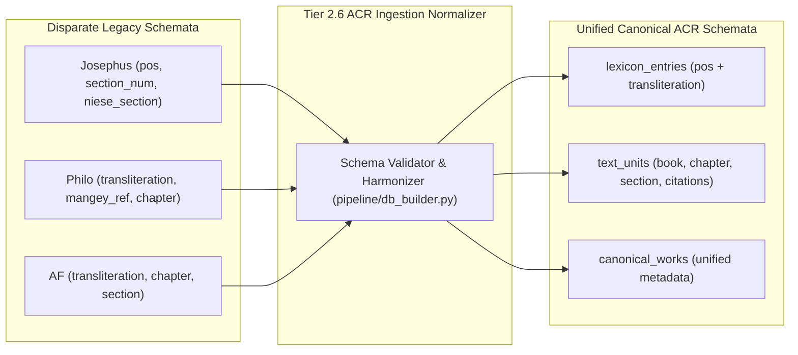

# Implementation Plan: Tier 2.6 – Cross-Corpora DB Schema Normalization

> [!NOTE]
> **AI Generation Notice**: Generated by **Antigravity 2.26.0** (Engine: **Gemini 3.8 Flash**) on **November 2, 2026, at 19:07 EST**.

## Executive Summary & Objective

In **Tier 2**, we successfully unified the schema and index layout of `concordance_refs`, achieving a zero-join covering table with precomputed KWIC snippets. However, secondary tables (`lexicon_entries`, `text_units`, `canonical_works`) still reflect disparate historical schemas from independent legacy codebases. This triggered runtime failures such as:
> `SQLite: no such column: transliteration` in Josephus.

**Tier 2.6** establishes and enforces a **single canonical database schema contract** across all corpora compiled for Ancient Corpora Reader (ACR).



---

## 1. Architectural Isolation Constraint

> [!IMPORTANT]
> **Zero Touch of Standalone Reader Databases**:
> All schema normalization, migration mappings, and chunking run **strictly within [`apps/ancient-corpora-reader/`](file:///home/cbrannan/dev/2-tmp/polyglot-suite/apps/ancient-corpora-reader)**.
> * [`apps/philo-reader`](file:///home/cbrannan/dev/2-tmp/polyglot-suite/apps/philo-reader), [`apps/josephus-reader`](file:///home/cbrannan/dev/2-tmp/polyglot-suite/apps/josephus-reader), and [`apps/apostolic-fathers-reader`](file:///home/cbrannan/dev/2-tmp/polyglot-suite/apps/apostolic-fathers-reader) remain 100% untouched.
> * Source databases are treated as read-only inputs.

---

## 2. Target Canonical Schema Contracts

### 2.1 Canonical `lexicon_entries`
Unifies dictionary columns across all corpora so both `pos` and `transliteration` are first-class columns:

```sql
CREATE TABLE lexicon_entries (
    id INTEGER PRIMARY KEY AUTOINCREMENT,
    dictionary TEXT NOT NULL,
    strongs_id TEXT,
    lemma TEXT NOT NULL,
    normalized_lemma TEXT NOT NULL,
    pos TEXT,
    transliteration TEXT,
    gloss TEXT NOT NULL,
    definition TEXT NOT NULL
);
CREATE INDEX idx_lexicon_lemma ON lexicon_entries(dictionary, normalized_lemma);
CREATE INDEX idx_lexicon_exact ON lexicon_entries(dictionary, lemma);
```

* **Philo / AF**: Populates `transliteration` from source; `pos` defaults to `NULL`.
* **Josephus**: Populates `pos` from source; `transliteration` is populated via lightweight Greek transliteration generator (or defaults to `NULL`).

---

### 2.2 Canonical `text_units` (Lean Text Storage)
Standardizes section navigation coordinates so `fetchDivisionSections` requires zero corpus-specific branching:

```sql
CREATE TABLE text_units (
    id INTEGER PRIMARY KEY AUTOINCREMENT,
    corpus_id TEXT NOT NULL REFERENCES corpora(id),
    work_code TEXT NOT NULL REFERENCES canonical_works(code),
    book INTEGER DEFAULT 0,
    chapter INTEGER DEFAULT 0,
    section INTEGER NOT NULL,
    section_num INTEGER DEFAULT 0,
    niese_section TEXT DEFAULT '',
    mangey_ref TEXT,
    is_supplement INTEGER NOT NULL DEFAULT 0,
    display_citation TEXT NOT NULL,
    text_content TEXT NOT NULL
);
CREATE INDEX idx_text_units_coords ON text_units(work_code, book, chapter, section, corpus_id);
```

* **Client Impact**: `fetchDivisionSections` becomes a single universal SQL query for all three corpora:
  ```sql
  SELECT u.id, u.corpus_id, u.work_code, u.book, u.chapter, u.section, 
         u.section_num, u.niese_section, u.display_citation, u.text_content, tok.tokens_json
  FROM text_units u
  LEFT JOIN text_unit_tokens tok ON tok.work_unit_id = u.id
  WHERE u.work_code = ? AND (u.chapter = ? OR u.book = ?)
  ORDER BY u.section ASC, u.corpus_id ASC;
  ```

---

### 2.3 Canonical `canonical_works`
Merges work metadata columns into a superset schema:

```sql
CREATE TABLE canonical_works (
    code TEXT PRIMARY KEY,
    order_index INTEGER NOT NULL,
    category TEXT NOT NULL,
    abbrev TEXT,
    tlg_id TEXT,
    title_english TEXT NOT NULL,
    title_greek TEXT,
    title_latin TEXT,
    total_books INTEGER DEFAULT 0,
    total_chapters INTEGER DEFAULT 0,
    total_sections INTEGER DEFAULT 0,
    default_book INTEGER DEFAULT 1
);
```

---

## 3. Implementation Steps & Completion Status

- [x] **Step 1: Update Ingestion Mapper in `pipeline/db_builder.py`**
  - Replaced dynamic table copying with explicit canonical schemas for `canonical_works`, `text_units`, and `lexicon_entries`.
  - Mapped source database fields cleanly into uniform columns (e.g. `pos` + `transliteration` in `lexicon_entries`, unified navigation coordinates in `text_units`).
- [x] **Step 2: Recompile & Chunk ACR Databases**
  - Rebuilt and chunked all three corpora in `apps/ancient-corpora-reader/static/db/{af,josephus,philo}/`.
  - Verified 100% column parity across all tables across AF, Josephus, and Philo.
- [x] **Step 3: Streamline ACR Client Service (`src/lib/services/dbClient.ts`)**
  - Eliminated the `translitCol` conditional in `fetchLexiconEntry`; now queries canonical `pos` and `transliteration` directly.
  - Replaced 84 lines of branching in `fetchDivisionSections` with a single, universal SQL query.
  - Unified `fetchAvailableDivisions` on `CASE WHEN book > 0 THEN book ELSE chapter END`.
- [x] **Step 4: Verification & Validation**
  - Schema parity verified via `PRAGMA table_info` across all 3 databases.
  - Svelte diagnostics: **0 errors** (`npm run check -w apps/ancient-corpora-reader`).
  - SvelteKit static adapter build: **Succeeded**.
  - All test suites passed: `test:lexeme` (64 passed), `test:josephus` (14 passed).
  - Standalone reader databases and apps remain 100% untouched.
