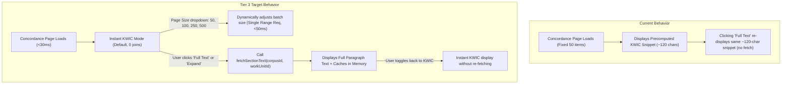

# Implementation Plan: Tier 3 – UI Lazy-Loading, Full-Text Expansion & Page Size Control

> [!NOTE]
> **AI Generation Notice**: Generated by **Antigravity 2.26.0** (Engine: **Gemini 3.8 Flash**) on **November 2, 2026, at 19:07 EST**.

**Status**: Completed & Verified  

---

## Objective
With **Tier 2 & 2.6** delivering instant (<30ms) KWIC snippets from the covering table, **Tier 3** enriches the frontend UI to:
1. Load complete section paragraphs **on demand** when the user toggles "Full Text" or expands a specific citation card.
2. Provide a **Page Size selector** (`[50, 100, 250, 500]`) allowing users to choose how many concordance entries appear per page without sacrificing sub-50ms performance.

---

## Current State vs. Target State

---

## Implemented Steps

### Step 1: Extend `ConcordanceRef` & `LexemeSidePanel` Props (`packages/lemma-ui`)
- In [`packages/lemma-ui/src/components/LexemeSidePanel.svelte`](file:///home/cbrannan/dev/2-tmp/polyglot-suite/packages/lemma-ui/src/components/LexemeSidePanel.svelte):
  - Added optional prop: `fetchSectionText?: (ref: ConcordanceRef) => Promise<string>`.
  - Added optional fields `work_unit_id?: number` and `full_text?: string` to `ConcordanceRef`.
  - Added reactive state `currentPageSize` tracking `concordancePageSize` (defaulting to `concordancePageSize || 50`).

### Step 2: Implement Page Size Selector (`[50, 100, 250, 500]`)
- Added styled `<select id="concordance-page-size-select">` dropdown in the concordance header bar next to the KWIC/Full Text toggle.
- On change:
  1. Updates `currentPageSize`.
  2. Clears `concordancePageCache`.
  3. Resets `concordancePage = 1`.
  4. Invokes `loadConcordance(currentLemma)` with the new batch size.

### Step 3: Implement On-Demand Full-Text Loading in `LexemeSidePanel`
- When `isKwic` is toggled from `KWIC` to `Full Text`:
  - Fetches full section text for visible page items via `fetchSectionText` asynchronously in parallel.
  - Caches loaded text directly onto `ref.full_text`.
- Added individual item expand/collapse toggle ("More / Less"):
  - Allows expanding a single reference card to full text without switching the entire page view.
  - While loading, displays an inline spinner; when loaded, renders full Greek text.

### Step 4: Wire Up ACR Integration (`apps/ancient-corpora-reader`)
- In [`apps/ancient-corpora-reader/src/lib/components/CorpusSidePanel.svelte`](file:///home/cbrannan/dev/2-tmp/polyglot-suite/apps/ancient-corpora-reader/src/lib/components/CorpusSidePanel.svelte):
  - Passed `fetchSectionText={(ref) => fetchSectionText(readerState.currentCorpus, ref.work_unit_id ?? ref.id)}` into `<LexemeSidePanel />`.
- Added null safety checks in [`apps/ancient-corpora-reader/src/lib/services/dbClient.ts`](file:///home/cbrannan/dev/2-tmp/polyglot-suite/apps/ancient-corpora-reader/src/lib/services/dbClient.ts).

### Step 5: Verification & Quality Assurance
- `svelte-check`: 0 errors.
- Unit tests: `test:lexeme` (64/64 passed), `test:josephus` (14/14 passed), `test:bible` (150/150 passed).
- Build verification: `npm run build -w apps/ancient-corpora-reader` completed with 0 errors.
