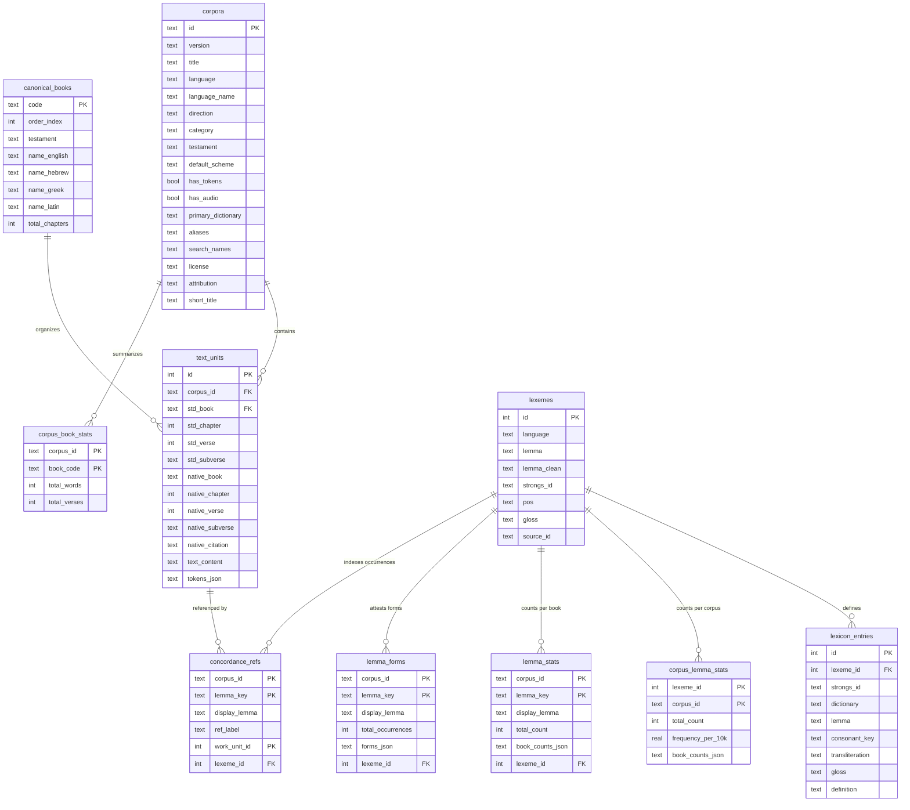

# Polyglot Bible Reader (PBR): Database Design & Architecture

> [!IMPORTANT]
> **AI-Generated Documentation Notice**  
> **Human Review Status:** `To be reviewed`  
> This documentation was generated with AI assistance and may contain inaccuracies. Please verify with the codebase and primary sources.

This document serves as the architectural reference and schema specification for the consolidated SQLite database (`polyglot-working.sqlite3`, ~857 MiB) powering **Polyglot Bible Reader (PBR)** and **Biblical Lexeme Explorer (BLE)** within the `polyglot-suite` monorepo.

---

## 1. Executive Summary & Architecture Overview

PBR and BLE query a single consolidated SQLite database compiled offline by [`packages/data-pipeline`](../../../packages/data-pipeline). There is no backend database server: the browser executes SQL queries in WebAssembly via [`@polyglot/db-vfs`](../../../packages/db-vfs) (`sql.js-httpvfs`) using HTTP Range Requests against 5 MB static chunks.

### High-Level Architecture

```
┌─────────────────────────────────────────────────────────────────────────────┐
│                             Browser Frontend                                │
│                                                                             │
│   ┌───────────────────────────┐         ┌───────────────────────────────┐   │
│   │   Polyglot Bible Reader   │         │       LexemeSidePanel         │   │
│   │  (Parallel TVTMS Reader)  │         │  (Concordance, Stats, BDB/LSJ)│   │
│   └─────────────┬─────────────┘         └──────────────┬────────────────┘   │
│                 │                                      │                    │
│                 ▼                                      ▼                    │
│   ┌─────────────────────────────────────────────────────────────────────┐   │
│   │           dbWorker (sql.js-httpvfs via @polyglot/db-vfs)            │   │
│   └──────────────────────────────────┬──────────────────────────────────┘   │
└──────────────────────────────────────┼──────────────────────────────────────┘
                                       │ HTTP Range Requests (4 KB pages)
                                       ▼ (5 MB server chunks)
┌─────────────────────────────────────────────────────────────────────────────┐
│                      Static Web Server (CDN / VPS)                          │
│                                                                             │
│   apps/polyglot-bible-reader/static/db/                                     │
│   ├── config.json                                                           │
│   ├── polyglot.db.00                                                        │
│   └── polyglot.db.01 ... polyglot.db.171                                    │
└─────────────────────────────────────────────────────────────────────────────┘
```

### Key Principles
1. **Single-VFS Consolidated Database**: All 12 biblical editions and 2 unabridged lexicons (`bdb`, `lsj`) reside in one SQLite database (`polyglot-working.sqlite3`, ~856.9 MiB) split into 5 MB chunks (`serverChunkSize: 5242880`, `requestChunkSize: 4096`).
2. **TVTMS Dual-Coordinate Alignment**: Every verse in `text_units` carries both **Universal Standard Hub Coordinates** (`std_book`, `std_chapter`, `std_verse`, `std_subverse`) for side-by-side parallel alignment and **Native Historical Coordinates** (`native_book`, `native_chapter`, `native_verse`, `native_subverse`, `native_citation`) preserving the edition's native numbering.
3. **Universal Lexeme Identity (`lexemes.id`)**: Headwords across Hebrew, Aramaic, Greek, Syriac, and Latin are normalized to integer `lexemes.id` keys linking `text_units`, `lexicon_entries`, `corpus_lemma_stats`, `lemma_stats`, `lemma_forms`, and `concordance_refs`.
4. **Covering Concordance & Pre-Computed Statistics**: `concordance_refs` is a `WITHOUT ROWID` table storing precomputed `ref_label` and `display_lemma` keyed by `(corpus_id, lemma_key, work_unit_id)`.

---

## 2. Ingested Corpora & Dictionaries

The `corpora` table contains **14 entries** (12 biblical editions + 2 lexicons):

| Corpus ID | Version | Language | Category | Testament |
| :--- | :--- | :--- | :--- | :--- |
| `wlc` | `BHS` | Hebrew / Aramaic (`hbo`) | `bible` | `ot` |
| `swete_lxx` | `LXX` | Ancient Greek (`grc`) | `bible` | `ot` |
| `sblgnt` | `SBLGNT` | Ancient Greek (`grc`) | `bible` | `nt` |
| `ognt` | `OpenGNT` | Ancient Greek (`grc`) | `bible` | `nt` |
| `peshitta` | `Peshitta` | Classical Syriac (`syc`) | `bible` | `both` |
| `vulgate` | `Vulgate` | Latin (`lat`) | `bible` | `both` |
| `kjv` | `KJV` | English (`eng`) | `bible` | `both` |
| `webbe` | `WEB` | English (`eng`) | `bible` | `both` |
| `brenton-lxx` | `Brenton` | English (`eng`) | `bible` | `ot` |
| `douay` | `Douay` | English (`eng`) | `bible` | `both` |
| `luther1912` | `Luther1912` | German (`deu`) | `bible` | `both` |
| `vamvas` | `Vamvas` | Modern Greek (`ell`) | `bible` | `both` |
| `bdb` | `BDB` | Hebrew (`hbo`) | `lexicon` | `ot` |
| `lsj` | `LSJ` | Ancient Greek (`grc`) | `lexicon` | `both` |

---

## 3. Database Schema Specification

`polyglot-working.sqlite3` implements **10 tables** and **18 indexes**:



---

### Table Details & DDL

#### 3.1 `corpora`
Metadata for every biblical edition and lexicon:
```sql
CREATE TABLE corpora (
    id TEXT PRIMARY KEY,
    version TEXT NOT NULL,
    title TEXT NOT NULL,
    language TEXT NOT NULL,
    language_name TEXT NOT NULL,
    direction TEXT NOT NULL DEFAULT 'ltr',
    category TEXT NOT NULL,
    testament TEXT NOT NULL DEFAULT 'both',
    default_scheme TEXT NOT NULL,
    has_tokens BOOLEAN NOT NULL DEFAULT 0,
    has_audio BOOLEAN NOT NULL DEFAULT 0,
    primary_dictionary TEXT,
    aliases TEXT,
    search_names TEXT,
    license TEXT,
    attribution TEXT,
    short_title TEXT DEFAULT ''
);
```

#### 3.2 `canonical_books`
Canonical book order, names, and chapter counts (synced to TypeScript via `generate_canonical_books.py`):
```sql
CREATE TABLE canonical_books (
    code TEXT PRIMARY KEY,
    order_index INTEGER NOT NULL,
    testament TEXT NOT NULL,
    name_english TEXT NOT NULL,
    name_hebrew TEXT,
    name_greek TEXT,
    name_latin TEXT,
    total_chapters INTEGER NOT NULL
);
```

#### 3.3 `text_units`
Verse-level text and morphological tokens with dual TVTMS (standard hub + native) coordinates:
```sql
CREATE TABLE text_units (
    id INTEGER PRIMARY KEY AUTOINCREMENT,
    corpus_id TEXT NOT NULL REFERENCES corpora(id),

    -- Universal Hub Coordinates (Used for side-by-side alignment range scans)
    std_book TEXT NOT NULL REFERENCES canonical_books(code),
    std_chapter INTEGER NOT NULL,
    std_verse INTEGER NOT NULL,
    std_subverse TEXT DEFAULT '',

    -- Native Historical Coordinates (Preserving true scheme citation)
    native_book TEXT NOT NULL,
    native_chapter INTEGER NOT NULL,
    native_verse INTEGER NOT NULL,
    native_subverse TEXT DEFAULT '',
    native_citation TEXT NOT NULL,

    -- Content
    text_content TEXT NOT NULL,
    tokens_json TEXT
);

CREATE INDEX idx_text_units_hub
ON text_units(std_book, std_chapter, std_verse, corpus_id);

CREATE INDEX idx_text_units_native
ON text_units(corpus_id, native_book, native_chapter, native_verse);
```

#### 3.4 `lexemes`
Canonical headword registry across languages:
```sql
CREATE TABLE lexemes (
    id INTEGER PRIMARY KEY AUTOINCREMENT,
    language TEXT NOT NULL,         -- 'hebrew', 'aramaic', 'greek', 'syriac', 'latin'
    lemma TEXT NOT NULL,            -- Standard NFC display form (Greek Tonos-normalized, pointed Hebrew)
    lemma_clean TEXT NOT NULL,      -- Accent/vowel-stripped search/sort key
    strongs_id TEXT,                -- 'G2316', 'H430' (normalized, nullable)
    pos TEXT,                       -- Standardized POS
    gloss TEXT,                     -- Primary English gloss
    source_id TEXT                  -- Original Text-Fabric / source node ID
);

CREATE INDEX idx_lexemes_lookup ON lexemes(language, lemma_clean);
CREATE INDEX idx_lexemes_strongs ON lexemes(strongs_id) WHERE strongs_id IS NOT NULL;
CREATE INDEX idx_lexemes_lang_lemma ON lexemes(language, lemma);
CREATE INDEX idx_lexemes_source_id ON lexemes(source_id);
```

#### 3.5 `lexicon_entries`
Unabridged BDB (`bdb`) and STEPBible LSJ (`lsj`) dictionary entries:
```sql
CREATE TABLE lexicon_entries (
    id INTEGER PRIMARY KEY AUTOINCREMENT,
    lexeme_id INTEGER REFERENCES lexemes(id),
    strongs_id TEXT NOT NULL,
    dictionary TEXT NOT NULL,
    lemma TEXT NOT NULL,
    consonant_key TEXT,
    transliteration TEXT,
    gloss TEXT NOT NULL,
    definition TEXT
);

CREATE INDEX idx_lexicon_strongs ON lexicon_entries(strongs_id);
CREATE INDEX idx_lexicon_dict_strongs ON lexicon_entries(dictionary, strongs_id);
CREATE INDEX idx_lexicon_consonant ON lexicon_entries(consonant_key);
CREATE INDEX idx_lexicon_lexeme_id ON lexicon_entries(lexeme_id);
```

#### 3.6 `corpus_lemma_stats` & `lemma_stats`
Pre-computed lemma frequency counts and per-book distributions:
```sql
CREATE TABLE corpus_lemma_stats (
    lexeme_id INTEGER NOT NULL REFERENCES lexemes(id),
    corpus_id TEXT NOT NULL,
    total_count INTEGER NOT NULL,
    frequency_per_10k REAL,
    book_counts_json TEXT NOT NULL,
    PRIMARY KEY (lexeme_id, corpus_id)
);

CREATE INDEX idx_cls_corpus_count ON corpus_lemma_stats(corpus_id, total_count DESC);
CREATE INDEX idx_cls_lexeme ON corpus_lemma_stats(lexeme_id);

CREATE TABLE lemma_stats (
    corpus_id TEXT NOT NULL,
    lemma_key TEXT NOT NULL,
    display_lemma TEXT NOT NULL,
    total_count INTEGER NOT NULL,
    book_counts_json TEXT NOT NULL,
    lexeme_id INTEGER REFERENCES lexemes(id),
    PRIMARY KEY (corpus_id, lemma_key)
);

CREATE INDEX idx_lemma_stats_lookup ON lemma_stats(corpus_id, lemma_key);
CREATE INDEX idx_lemma_stats_lexeme_id ON lemma_stats(lexeme_id);
```

#### 3.7 `lemma_forms`
Pre-computed attested inflected forms with integer `work_unit_ids` arrays:
```sql
CREATE TABLE lemma_forms (
    corpus_id TEXT NOT NULL,
    lemma_key TEXT NOT NULL,
    display_lemma TEXT NOT NULL,
    total_occurrences INTEGER NOT NULL,
    forms_json TEXT NOT NULL,
    lexeme_id INTEGER REFERENCES lexemes(id),
    PRIMARY KEY (corpus_id, lemma_key)
);

CREATE INDEX idx_lemma_forms_lookup ON lemma_forms(corpus_id, lemma_key);
CREATE INDEX idx_lemma_forms_lexeme_id ON lemma_forms(lexeme_id);
```

#### 3.8 `concordance_refs`
Covering `WITHOUT ROWID` concordance index mapping lemmas to `text_units.id` (`work_unit_id`):
```sql
CREATE TABLE concordance_refs (
    corpus_id TEXT NOT NULL,
    lemma_key TEXT NOT NULL,
    display_lemma TEXT NOT NULL,
    ref_label TEXT NOT NULL,
    work_unit_id INTEGER NOT NULL,
    lexeme_id INTEGER,
    PRIMARY KEY (corpus_id, lemma_key, work_unit_id)
) WITHOUT ROWID;

CREATE INDEX idx_concordance_refs_lookup
ON concordance_refs(corpus_id, lemma_key, work_unit_id);

CREATE INDEX idx_concordance_lexeme_id
ON concordance_refs(lexeme_id);
```

#### 3.9 `corpus_book_stats`
Aggregate word and verse counts per corpus and book:
```sql
CREATE TABLE corpus_book_stats (
    corpus_id TEXT NOT NULL,
    book_code TEXT NOT NULL,
    total_words INTEGER NOT NULL,
    total_verses INTEGER NOT NULL,
    PRIMARY KEY (corpus_id, book_code)
);
```

---

## 4. Building, Validating, and Chunking

Run pipeline commands from the repository root:

```bash
# 1. Fetch upstream texts and lexicons into packages/data-pipeline/cache/
npm run fetch:db

# 2. Build polyglot-working.sqlite3, canonical book TS definitions, and BLE manifests
npm run build:db

# 3. Slice into 5 MB HTTP-VFS chunks in apps/polyglot-bible-reader/static/db/
npm run chunk:db

# Or run the full pipeline (fetch -> build -> validate -> chunk -> BLE manifests)
npm run data:all
```

Or run directly with Python inside `packages/data-pipeline/`:
```bash
python3 build.py --fetch
python3 build.py --build
python3 build.py --validate
python3 build.py --chunk
```
