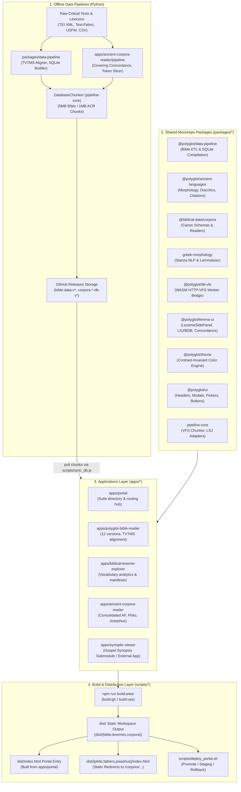

# Polyglot Suite: Monorepo Architecture & Technical Design

An architectural blueprint and technical guide for the **Polyglot Suite** monorepo—an ecosystem of static, client-side digital readers, lexical search engines, and comparative textual tooling for Biblical, Classical, and Hellenistic literature.

> [!IMPORTANT]
> **AI-Generated Documentation Notice**  
> **Human Review Status:** `Reviewed Part 1. Others: to be reviewed`  
> This documentation was generated with AI assistance and may contain inaccuracies. Please verify against the active codebase and primary sources.

---

## 1. Architectural Principles

The Polyglot Suite operates under four governing technical principles:

1. **100% Static & Client-Side Execution**:
   
   - The platform builds into static HTML, CSS, JavaScript, and WebAssembly assets (`dist/`).
   - There are **no server-side daemons**, Node.js runtime processes, or dynamic SQL database servers (PostgreSQL/MySQL) required for reader operation. Instead, the client uses an `sql.js-httpvfs`  worker (SQLite compiled to WebAssembly with an HTTP Virtual File System), issuing standard **HTTP Range Requests** to fetch only the specific ([B-Tree](https://www.geeksforgeeks.org/dsa/introduction-of-b-tree-2/)) pages required for active chapters, verses, or concordance queries.
   - Any static hosting environment, CDN, or object store (such as GitHub Pages or Nginx) can host the entire suite with minimal infrastructure cost.

2. **Modular Packages over Code Duplication**:
   
   - Common linguistic parsing (orthography, morphology, citation formatting), UI components (modal pickers, reader headers), lemma panels, and theme systems are extracted into shared workspace packages under `packages/*`
     
     > [!IMPORTANT]
     > Much code-refactoring still needs to be done. The apps were originally developed indepentendly and the integration into one monorepo is still on-going.
3. **Consolidated Unified Readers**:
   - Non-biblical literature is unified into one multi-corpus reader, [`apps/ancient-corpora-reader`](../apps/ancient-corpora-reader). Currently, this reader has three corpora: Apostolic Fathers, Philo of Alexandria, and Flavius Josephus. But it build to be extensible to other ancient texts/corpora.
4- **Submodule and External App Integration**:
   - Other tools can be integrated, either as modular external apps or submodules. Currently, the Greek NT Synoptic Viewer is set up as a submodule in [`apps/synoptic-viewer`](../apps/synoptic-viewer), but deployed in the portal as a link to an external app.

---

## 2. System Architecture



---

## 3. Monorepo Topology & Boundaries

The repository is configured as an **npm workspace** with explicit separation between user applications and shared packages:

```
polyglot-suite/
├── apps/                               # User-facing applications
│   ├── ancient-corpora-reader/         # [Active] Consolidated AF, Philo, and Josephus reader
│   ├── biblical-lexeme-explorer/       # [Active] Analytical vocabulary tool & lexical charts
│   ├── polyglot-bible-reader/          # [Active] Multi-version parallel biblical reader
│   ├── portal/                         # [Active] SvelteKit suite entry portal & landing directory
│   └── synoptic-viewer/                # [Active] Gospel synopsis viewer (submodule / external app)
├── packages/                           # Shared cross-app libraries
│   ├── ancient-languages/              # Linguistic parsing, diacritics, citation models, highlight store
│   ├── biblical-data/                  # Biblical canon schemas & client reader interfaces
│   ├── data-pipeline/                  # Offline Bible data ingestion, TVTMS alignment & SQLite builder
│   ├── db-vfs/                         # WASM SQLite HTTP-VFS client worker bridge & row parsers
│   ├── greek-morphology/               # Lemmatization, morphological solvers & Stanza NLP bridge
│   ├── lemma-ui/                       # Lexeme sidepanel, lexicon cards, paginated concordance
│   ├── pipeline-core/                  # Shared Python utilities for database chunking & LSJ adapters
│   ├── theme/                          # Continuous contrast-invariant theme engine & UI controls
│   └── ui/                             # Buttons, modals, toolbars, reader headers
├── scripts/                            # Monorepo orchestration & release tooling
│   ├── build_gh.js                     # GitHub Pages suite builder
│   ├── build_vps.js                    # Production VPS suite builder
│   ├── deploy_portal.sh                # Portal staging, promotion, and rollback automation
│   ├── dev.js                          # Multi-app local development server runner
│   ├── export_ble_manifests.py         # Build-time JSON manifest exporter for BLE
│   ├── preview.js                      # Local HTTP-VFS byte-range preview server
│   ├── release.js                      # Monorepo package/app semver bumper and tagger
│   ├── release_db.js                   # Database semver bumper & GitHub Release publisher
│   ├── status_db.js                    # Local vs remote database release inspector
│   └── sync_db.js                      # GitHub Release database chunk asset synchronizer
├── .github/workflows/                  # GitHub Actions CI/CD workflows
│   └── deploy.yml                      # Automated build, cache, and deployment pipeline
└── package.json                        # Monorepo workspace configuration & root scripts
```

### 3.1 Application Portfolio

| Application                  | Path                                                                | Framework              | Deployment Target    | Description                                                                                                                                                                                                                |
|:---------------------------- |:------------------------------------------------------------------- |:---------------------- |:-------------------- |:-------------------------------------------------------------------------------------------------------------------------------------------------------------------------------------------------------------------------- |
| **Polyglot Bible Reader**    | [`apps/polyglot-bible-reader`](../apps/polyglot-bible-reader)       | SvelteKit 2 + Svelte 5 | `dist/bible/`        | Multi-corpus biblical reader (WLC Hebrew, Swete LXX, SBLGNT, Open Greek NT, Syriac Peshitta, Clementine Vulgate, KJV, WEB, Brenton LXX, Douay-Rheims, Luther 1912, Vamvas 1850) with TVTMS alignment and LSJ/BDB lexicons. |
| **Biblical Lexeme Explorer** | [`apps/biblical-lexeme-explorer`](../apps/biblical-lexeme-explorer) | SvelteKit 2 + Svelte 5 | `dist/lexemes/`      | Vocabulary exploration, frequency distributions, concordance searches, and word clouds powered by build-time manifests generated from the master DB.                                                                       |
| **Ancient Corpora Reader**   | [`apps/ancient-corpora-reader`](../apps/ancient-corpora-reader)     | SvelteKit 2 + Svelte 5 | `dist/corpora/`      | Consolidated parallel reader for Apostolic Fathers, Philo of Alexandria, and Flavius Josephus with 1MB chunked HTTP-VFS databases, covering concordances, and milestone citations.                                         |
| **Suite Portal**             | [`apps/portal`](../apps/portal)                                     | SvelteKit 2 + Svelte 5 | `dist/index.html`    | Central suite navigation hub. Serves backward-compatible redirect pages (`dist/{philo,fathers,josephus}/`) and handles environment-based URL overrides.                                                                    |
| **Synoptic Viewer**          | [`apps/synoptic-viewer`](../apps/synoptic-viewer)                   | SvelteKit 2 + Svelte 5 | Submodule / External | Comparative synopsis of NT Gospel parallels according to Kurt Aland's outline. Deployed independently at `https://synopsis.texts.faith`.                                                                                   |

---

## 4. Client-Side Database & HTTP-VFS Architecture

### 4.1 WebAssembly HTTP-VFS Mechanics

Applications eliminate dynamic backend database servers by hosting an SQLite query engine inside a Web Worker:

```
[Browser UI Thread]
       │
       │  postMessage({ action: "query", sql: "SELECT ... LIMIT 50" })
       ▼
[Web Worker: @polyglot/db-vfs (sql.js-httpvfs)]
       │
       │  Translates SQLite B-Tree page requests into byte offsets
       ▼
[HTTP Range Requests (GET bytes 20480-24576)]
       │
       ▼
[Static Web Server / CDN (GitHub Pages / Nginx)]
```

### 4.2 Single-VFS vs. Multi-VFS Architectural Patterns

1. **Single-VFS Pattern (`polyglot-bible-reader`, `biblical-lexeme-explorer`)**:
   
   - Both applications read from a single consolidated database (`polyglot.db.*`, ~857 MB).
   - **Chunk Configuration**: 5MB server chunks (`serverChunkSize: 5242880`), 4KB request chunks (`requestChunkSize: 4096`).
   - Cross-corpus queries (e.g., comparing Hebrew WLC against Greek LXX and SBLGNT) execute over unified `text_units`, `lexemes`, and `concordance_refs` tables.

2. **Multi-VFS Modular Pattern (`ancient-corpora-reader`)**:
   
   - Manages an isolated worker pool across three independent corpus databases:
     - `static/db/af/` (~43MB, 44 chunks)
     - `static/db/philo/` (~223MB, 224 chunks)
     - `static/db/josephus/` (~193MB, 194 chunks)
   - **Chunk Configuration**: 1MB server chunks (`serverChunkSize: 1048576`), 16KB request chunks (`requestChunkSize: 16384`).
   - **Advantage**: Zero bytes are downloaded for a corpus until a user explicitly navigates to it. Smaller 1MB chunks reduce transfer latency on sporadic searches and mobile devices.

### 4.3 Query Performance & Indexing Strategies

HTTP-VFS queries incur latency on page misses. The database schemas are engineered to minimize round-trips:

- **CTE Pushdown Pagination**: Queries never perform heavy table joins before applying pagination limits. Common Table Expressions (CTEs) isolate matching primary keys first, paginate to 50 rows, and join full text and metadata on the paginated slice only.
- **Covering Concordance Indexes**: In ACR, `concordance_refs` includes `matched_form`, `kwic_snippet`, `milestone_ref`, and `niese_section`, backed by index `idx_concordance_refs_form (corpus_id, lemma, matched_form, work_unit_id)`. Searches resolve directly from index pages without touching base text records.
- **Decoupled Token Blobs**: Word token structures in ACR are segregated into `text_unit_tokens(work_unit_id, tokens_json BLOB)` with zlib compression, keeping the core `text_units` table lean for rapid scanning.
- **Monotonic Query IDs**: Rapid typing in lemma and concordance panels assigns incrementing integer transaction IDs to each query. Stale asynchronous responses are discarded to prevent race conditions.

---

## 5. Database Release Lifecycle & Asset Management

### 5.1 Storage Decoupling

Compiled SQLite databases and chunks (`*.db.*`) are strictly `.gitignore`d to prevent Git repository bloat. Chunk assets are hosted on **GitHub Releases** and version-locked via `static/db/config.json`:

```bash
# Check status of local chunks against remote GitHub Releases
npm run status:db:gh

# Publish a new database version (creates tag, uploads chunks via gh CLI):
npm run release:db:bible 1.0.0
npm run release:db:corpora:af 1.2.4
npm run release:db:corpora:philo 1.2.3
npm run release:db:corpora:josephus 1.2.3
```

### 5.2 Automated CI/CD Caching

During GitHub Actions deployment ([`.github/workflows/deploy.yml`](../.github/workflows/deploy.yml)):

1. **Cache Verification**: `actions/cache@v5` checks for cached chunk directories using a hash of all `config.json` files as the cache key.
2. **Automated Pull**: On a cache miss, `npm run pull:db` runs `scripts/sync_db.js`, which reads the `databaseVersion` tag from each `config.json` and fetches chunk assets via `gh release download`.

---

## 6. Build, Routing & Deployment Pipeline

### 6.1 Multi-Target Static Builds

The production build script generates the complete static workspace in `dist/`:

```bash
npm run build:www
```

Outputs:

- `dist/bible/` &larr; Built from `apps/polyglot-bible-reader` (Base path: `/bible`)
- `dist/lexemes/` &larr; Built from `apps/biblical-lexeme-explorer` (Base path: `/lexemes`)
- `dist/corpora/` &larr; Built from `apps/ancient-corpora-reader` (Base path: `/corpora`)
- `dist/index.html` &larr; Built from `apps/portal`
- `dist/{philo,fathers,josephus}/index.html` &larr; Copied from `apps/portal/static/` to redirect legacy URLs

### 6.2 Portal Deployment Automation (`scripts/deploy_portal.sh`)

For VPS and production deployments, `scripts/deploy_portal.sh` provides staged rollouts:

- **Deploy Staging**: `./scripts/deploy_portal.sh` builds and deploys to a timestamped staging release.
- **Promote to Production**: `./scripts/deploy_portal.sh --promote` (`npm run dpp`) atomically switches the active web symlink.
- **Rollback**: `./scripts/deploy_portal.sh --rollback` rolls back to the previous release.
- **Release History**: `./scripts/deploy_portal.sh --history` lists historical deployment snapshots.

---

## 7. Developer Onboarding & Code Placement Rules

### 7.1 Key Commands

| Task                         | Command                                      | Target / Scope                                     |
|:---------------------------- |:-------------------------------------------- |:-------------------------------------------------- |
| **Install Monorepo**         | `npm install`                                | Workspace root and all packages                    |
| **Run All Dev Servers**      | `npm run dev`                                | Starts portal and all local reader apps            |
| **Dev: Portal**              | `npm run dev:portal`                         | `apps/portal` (Port 5170)                          |
| **Dev: Bible**               | `npm run dev:bible`                          | `apps/polyglot-bible-reader` (Port 5171)           |
| **Dev: Lexemes**             | `npm run dev:lexeme`                         | `apps/biblical-lexeme-explorer` (Port 5172)        |
| **Dev: Corpora**             | `npm run dev:corpora`                        | `apps/ancient-corpora-reader` (Port 5173)          |
| **Package Unit Tests**       | `npm run test:packages`                      | Vitest suites for `ancient-languages` and `db-vfs` |
| **Application Typecheck**    | `npm run check:bible`, `check:corpora`, etc. | SvelteKit and TypeScript verification              |
| **Check Database Status**    | `npm run status:db:gh`                       | Compares local chunks to GitHub Releases           |
| **Download Database Chunks** | `npm run pull:db`                            | Pulls chunk assets for all databases               |

### 7.2 Code Placement Conventions

- **`packages/ancient-languages`**: Linguistic utilities, Greek/Hebrew text cleaners, diacritic stripping, academic citation formatters, and highlight store logic.
- **`packages/data-pipeline`**: Offline Python ETL pipelines, versification mapping (TVTMS), and SQLite master database compilation for biblical corpora.
- **`packages/db-vfs`**: Web Worker bridge, `sql.js-httpvfs` wrappers, range-request error recovery, and SQLite row serialization.
- **`packages/lemma-ui`**: Reusable lexical UI components (dockable sidepanels, LSJ/BDB dictionary cards, paginated concordance displays).
- **`packages/theme`**: Contrast-invariant continuous theme slider, color palette interpolation, and theme persistence.
- **`packages/ui`**: Application-agnostic UI controls (buttons, headers, modals, search dropdowns).
- **`apps/<app-name>`**: Application routing, page state runes, route layouts, and corpus navigation bars.
