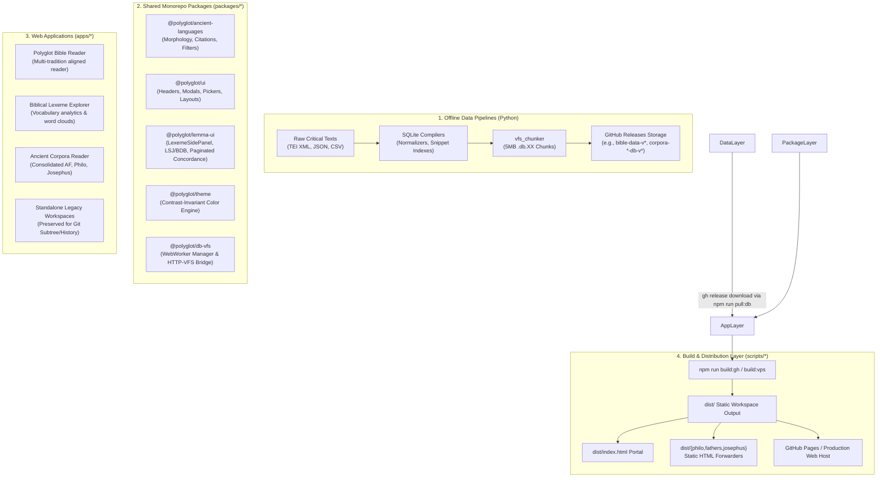

# Polyglot Suite: Monorepo Architecture & Technical Design

An architectural blueprint and developer guide for the **Polyglot Suite** monorepo—an ecosystem of static, client-side digital readers, lexical engines, and comparative textual tooling for Biblical, Classical, and Hellenistic literature.

> [!NOTE]
> **AI Generation Notice**: Documented with the assistance of **Antigravity 2.26.0** (Engine: **Gemini 3.8 Flash**). Code and architecture developed under human direction.

---

## 1. Architectural Philosophy & Principles

The Polyglot Suite operates under four governing technical principles:

1. **100% Static & Client-Side Execution**:
   - The entire platform builds into standard static HTML, CSS, JavaScript, and WebAssembly assets (`dist/`).
   - There are **no server-side daemons**, no Node.js backend processes, and no dynamic SQL database servers (PostgreSQL/MySQL).
   - Any static web server, object storage bucket, or CDN (such as **GitHub Pages**) can host the platform with zero runtime operational overhead.

2. **Zero-Backend Database Virtualization (`sql.js-httpvfs`)**:
   - Scholarly corpora and unabridged lexicons (LSJ, BDB) require hundreds of megabytes of relational data. Downloading these monolithic databases on page load would create unacceptable network latency and mobile memory crashes.
   - Using **`sql.js-httpvfs`** (SQLite compiled to WebAssembly with an HTTP Virtual File System), the client issues standard **HTTP Range Requests** to read only the specific 4KB B-Tree pages required for the active chapter, verse, or concordance query.

3. **Modular Packages over Code Duplication**:
   - Common linguistic logic (orthography, morphology, citation formatting), UI components (modal pickers, reader headers), lemma sidepanels, and theme systems are extracted into shared workspace packages under `packages/*`.

4. **Progressive Consolidation with Historical Continuity**:
   - Closely related corpora (e.g., the Hellenistic Greek readers: Apostolic Fathers, Philo of Alexandria, and Flavius Josephus) are unified into a consolidated reader application (`ancient-corpora-reader`).
   - Standalone app workspaces are preserved in the monorepo to maintain upstream Git subtree commit histories and dedicated testing sandboxes without deploying them as redundant standalone sites.

---

## 2. System Architecture



---

## 3. Monorepo Topology & Boundaries

The repository is structured as an **npm workspace** with clear boundaries between user-facing apps and reusable packages:

```
polyglot-suite/
├── apps/                               # Web applications & corpus-specific pipelines
│   ├── polyglot-bible-reader/          # [Active] SvelteKit 5 Biblical reader
│   ├── biblical-lexeme-explorer/       # [Active] SvelteKit 5 analytical vocabulary tool
│   ├── ancient-corpora-reader/         # [Active] SvelteKit 2 + Svelte 5 consolidated reader
│   ├── apostolic-fathers-reader/       # [Preserved] Standalone AF reader
│   ├── philo-reader/                   # [Preserved] Standalone Philo reader
│   └── josephus-reader/                # [Preserved] Standalone Josephus reader
├── packages/                           # Shared cross-app libraries
│   ├── ancient-languages/              # Linguistic parsing, diacritics, citation models
│   ├── biblical-data/                  # Biblical canon definitions & book registries
│   ├── db-vfs/                         # WASM SQLite HTTP-VFS client worker bridge
│   ├── greek-morphology/               # Lemmatization & morphological solvers
│   ├── lemma-ui/                       # Lexeme sidepanel, lexicon cards, concordance list
│   ├── pipeline-core/                  # Python utilities for database chunking
│   ├── theme/                          # Continuous contrast-invariant theme engine
│   └── ui/                             # Buttons, modals, toolbars, reader headers
├── scripts/                            # Monorepo orchestration & CI/CD scripts
│   ├── build_gh.js                     # GitHub Pages suite builder
│   ├── build_vps.js                    # Production VPS suite builder
│   ├── generate_portal.js              # Portal generator & legacy redirect builder
│   ├── preview.js                      # Local HTTP-VFS byte-range preview server
│   ├── release_db.js                   # Database semver bumper & GitHub Release publisher
│   ├── status_db.js                    # Local vs remote database release inspector
│   └── sync_db.js                      # GitHub Release asset downloader/uploader
├── templates/                          # Static portal templates
│   └── portal.html                     # Main entry portal template
├── .github/workflows/                  # GitHub Actions CI/CD workflows
│   └── deploy.yml                      # Automated test, cache, build & deploy pipeline
└── package.json                        # Monorepo workspace configuration & root scripts
```

### 3.1 Active Applications vs. Preserved Workspaces

| Application | Path | Status | Target Scope |
| :--- | :--- | :--- | :--- |
| **Polyglot Bible Reader** | [`apps/polyglot-bible-reader`](file:///home/cbrannan/dev/2-tmp/polyglot-suite/apps/polyglot-bible-reader) | **Active** (Deployed) | Hebrew MT, Greek LXX, SBLGNT, Latin Vulgate, English translations with Tyndale House TVTMS verse alignment. |
| **Biblical Lexeme Explorer** | [`apps/biblical-lexeme-explorer`](file:///home/cbrannan/dev/2-tmp/polyglot-suite/apps/biblical-lexeme-explorer) | **Active** (Deployed) | Vocabulary acquisition, morphological filtering, D3 word clouds, and frequency distributions. |
| **Ancient Corpora Reader** | [`apps/ancient-corpora-reader`](file:///home/cbrannan/dev/2-tmp/polyglot-suite/apps/ancient-corpora-reader) | **Active** (Deployed) | Consolidated parallel Greek/English/Latin reader for **Apostolic Fathers**, **Philo of Alexandria**, and **Flavius Josephus**. |
| **Apostolic Fathers Reader** | [`apps/apostolic-fathers-reader`](file:///home/cbrannan/dev/2-tmp/polyglot-suite/apps/apostolic-fathers-reader) | **Preserved** | Retained for upstream subtree history; consolidated into `ancient-corpora-reader`. |
| **Philo Reader** | [`apps/philo-reader`](file:///home/cbrannan/dev/2-tmp/polyglot-suite/apps/philo-reader) | **Preserved** | Retained for upstream subtree history; consolidated into `ancient-corpora-reader`. |
| **Josephus Reader** | [`apps/josephus-reader`](file:///home/cbrannan/dev/2-tmp/polyglot-suite/apps/josephus-reader) | **Preserved** | Retained for upstream subtree history; consolidated into `ancient-corpora-reader`. |

---

## 4. Client-Side Database & HTTP-VFS Architecture

### 4.1 How WebAssembly HTTP-VFS Operates

Traditional web applications query a server-side database over REST or GraphQL. Polyglot Suite eliminates the backend server by placing a SQLite engine directly inside a browser Web Worker:

```
[Browser UI Thread]
       │
       │  postMessage({ action: "query", sql: "SELECT ... LIMIT 50" })
       ▼
[Web Worker: sql.js-httpvfs]
       │
       │  Translates B-Tree page requests to HTTP byte offsets
       ▼
[HTTP Range Requests (GET bytes 20480-24576)]
       │
       ▼
[Static Web Host (e.g. GitHub Pages / S3 / Nginx)]
```

### 4.2 Single-VFS vs. Multi-VFS Architectural Patterns

The monorepo uses two distinct VFS deployment patterns:

1. **Single-VFS Pattern (`polyglot-bible-reader`, `biblical-lexeme-explorer`)**:
   - Both applications read from a single consolidated database (`polyglot.db.*`), allowing cross-corpus queries between the Hebrew Old Testament, Greek Septuagint, Greek New Testament, and unabridged lexicons.
2. **Multi-VFS Modular Pattern (`ancient-corpora-reader`)**:
   - Manages an isolated worker pool with three independent databases:
     - `static/db/af/` (~42MB)
     - `static/db/philo/` (~284MB)
     - `static/db/josephus/` (~185MB)
   - **Advantage**: Zero bytes are downloaded for a corpus until a user explicitly navigates to it. Furthermore, any corpus database can be rebuilt, optimized, or patched independently without invalidating cache assets for the others.

### 4.3 Query Performance Rules for HTTP-VFS

Because HTTP-VFS incurs network latency on page misses, queries must adhere to strict performance rules:
- **CTE Pushdown Pagination**: Never execute `JOIN text_units` across thousands of matches prior to applying `LIMIT`. Instead, use Common Table Expressions (CTEs) to find matching primary keys first, sort, limit to the current page (e.g., 50 items), and join only the paginated slice.
- **Precomputed Snippets**: Concordance snippet tables (`tokens_snippet`) store short contextual window strings, avoiding the need to deserialize multi-megabyte `tokens_json` structures during search.
- **Monotonic Transaction IDs**: Fast typing or rapid pagination requests in the UI must tag queries with monotonic incrementing IDs so slow asynchronous page resolutions do not interleave with newer user queries.

---

## 5. Database Release Lifecycle & Asset Management

### 5.1 Why Databases are Not in Git

Compiled SQLite databases and chunk files (`*.db.*`) are strictly `.gitignore`d. Checking 500MB+ of binary databases into Git creates repository bloat, inflates clone times, and degrades Git operations.

### 5.2 Release Flow via GitHub Releases

Databases are managed through automated semver release tags on GitHub Releases:

```bash
# Check status of local chunks against remote GitHub Releases
npm run status:db:gh

# Publish a new database version (creates tag, uploads 5MB chunks via gh CLI):
npm run release:db:bible 1.0.0
npm run release:db corpora-af 1.0.0
npm run release:db corpora-philo 1.0.0
npm run release:db corpora-josephus 1.0.0
```

### 5.3 Automated CI/CD Caching & Pulling

During automated GitHub Actions deployment ([`.github/workflows/deploy.yml`](file:///home/cbrannan/dev/2-tmp/polyglot-suite/.github/workflows/deploy.yml)):
1. **Cache Verification**: GitHub Actions checks `actions/cache@v5` using a hash of all `config.json` files as the cache key.
2. **On-Demand Fetch**: On cache misses, `npm run pull:db` runs `scripts/sync_db.js`, which reads the `"databaseVersion"` tag from each `config.json` and pulls chunk assets via `gh release download`.
3. **Zero Waste**: Only active applications are included in the default `all` target; archived standalone chunks are not downloaded during CI.

---

## 6. Build, Routing & Deployment Pipeline

### 6.1 Multi-Target Static Builds

The root build pipeline builds all active applications into subdirectories of `dist/`:

```bash
# Complete production build
npm run build:www
```

- `dist/bible/` &larr; Built from `apps/polyglot-bible-reader`
- `dist/lexemes/` &larr; Built from `apps/biblical-lexeme-explorer`
- `dist/corpora/` &larr; Built from `apps/ancient-corpora-reader`
- `dist/index.html` &larr; Generated from `templates/portal.html`

### 6.2 Legacy URL Forwarders

To maintain seamless backward compatibility with existing bookmarks and external citations, `scripts/generate_portal.js` automatically creates zero-byte static redirect pages:

- `dist/josephus/index.html` &rarr; `<meta http-equiv="refresh" content="0; url=../corpora/josephus/war/1">`
- `dist/fathers/index.html` &rarr; `<meta http-equiv="refresh" content="0; url=../corpora/af/1-clem/1">`
- `dist/philo/index.html` &rarr; `<meta http-equiv="refresh" content="0; url=../corpora/philo/opif/1">`

Users visiting legacy URLs are forwarded instantly to the unified reader with zero 404 errors.

### 6.3 Local Byte-Range Preview Server

Standard HTTP development servers (such as `vite preview` or `python -m http.server`) often lack proper support for HTTP `Range: bytes=X-Y` headers and `206 Partial Content` responses required by `sql.js-httpvfs`.

The monorepo provides a dedicated preview server:

```bash
# Launch preview server with full HTTP Range request and CORS support
npm run preview:gh
```
Available at `http://localhost:5000/polyglot-suite/`.

---

## 7. Developer Onboarding & Contribution Guide

### 7.1 Workspace Commands

| Task | Command | Scope |
| :--- | :--- | :--- |
| **Install Monorepo** | `npm install` | Root & all workspaces |
| **Dev: Bible** | `npm run dev:bible` | `apps/polyglot-bible-reader` |
| **Dev: Lexemes** | `npm run dev:lexeme` | `apps/biblical-lexeme-explorer` |
| **Dev: Corpora** | `npm run dev:corpora` | `apps/ancient-corpora-reader` |
| **Type Checking** | `npm run check:corpora` (or `check:bible`) | SvelteKit & TypeScript diagnostics |
| **Unit Testing** | `npm run test:corpora` (or `test:bible`) | Vitest test suites |
| **Check Databases** | `npm run status:db:gh` | Remote vs local chunk comparison |
| **Download Databases**| `npm run pull:db` | Pulls required chunks from GitHub |

### 7.2 Rules for Code Placement

- **Place in `packages/ancient-languages`**: If logic deals with Greek/Hebrew text manipulation, accents, diacritics, grammatical parsing, or academic citation formats.
- **Place in `packages/lemma-ui`**: If a component renders vocabulary statistics, word definitions, or concordance search results.
- **Place in `packages/ui`**: If a component is a generic UI element (modals, buttons, headers, layouts) with no language-specific business logic.
- **Place in `packages/theme`**: If code relates to palettes, color interpolation, contrast calculations, or theme persistence.
- **Place in `apps/<app-name>`**: If logic relates strictly to route orchestration, page state, or corpus-specific navigation.
