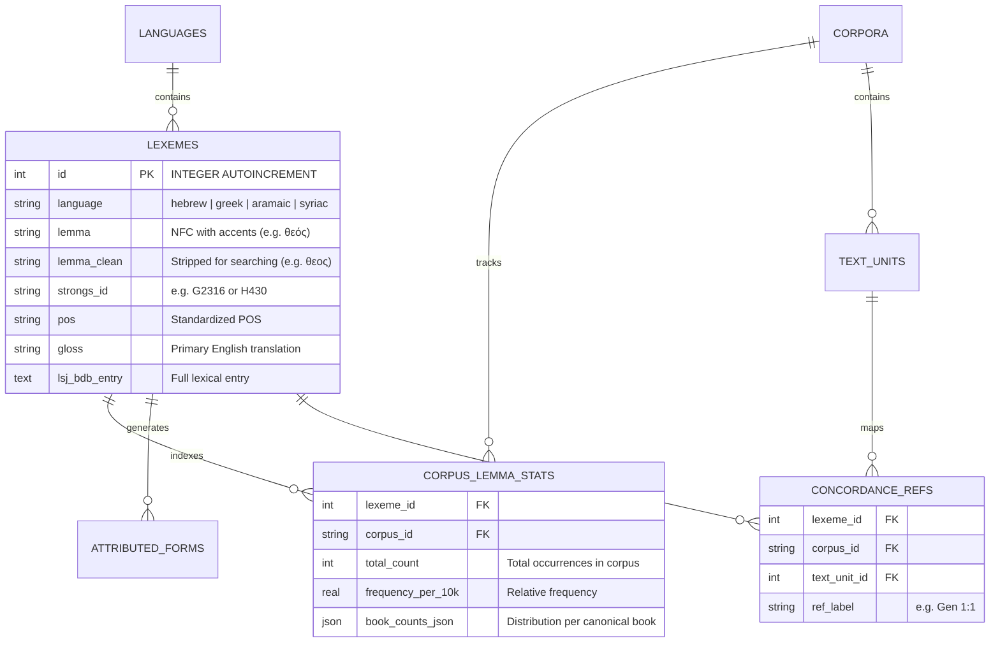
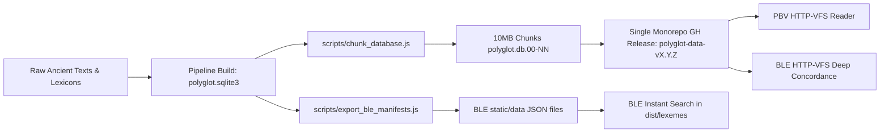

# Phase 4.2 Architecture & Planning: Consolidating BLE & PBV into a Shared Data Engine

> **Document Type**: Architecture Plan & Implementation Roadmap  
> **Target Subsystem**: Data Layer Consolidation (PBV + BLE)  
> **Status**: Planning & Investigation (Pre-Implementation)  
> **Author**: Antigravity Assistant & DeepMind Team  
> **Date**: October 26, 2026  

---

## 1. Executive Summary

This document details the architectural plan to consolidate **Biblical Lexeme Explorer (BLE)** and **Polyglot Bible Reader (PBV)** onto a single shared database engine and release pipeline.

### Core Problems Addressed:
1. **Data Divergence & Duplication**: PBV uses an embedded, chunked SQLite3 database (`polyglot-working.sqlite3`, ~550MB in 10MB chunks), while BLE uses build-time static JSON files (`lxxLexes6.json`, `bhsLexes3.1.json`, `/data/[db]/lexemes.json`). Errata or text improvements made in one do not reflect in the other.
2. **Fragile Cross-App Navigation**: Linking between PBV and BLE currently relies on string matching (e.g. `?lemma=θεός`), which breaks due to Greek diacritic variations (Unicode Oxia `\u1F79` vs. Tonos `\u03CC`) and partial Strong's number coverage (~75% of LXX lemmas lack Strong's numbers).
3. **Cross-Corpus Isolation**: Words appearing in both Old and New Testaments (or Jewish Hellenistic literature like Philo) cannot be queried or compared across corpora.

---

## 2. Current State vs. Target Architecture

| Dimension | Polyglot Bible Reader (PBV) | Biblical Lexeme Explorer (BLE) | Target Consolidated Architecture |
| :--- | :--- | :--- | :--- |
| **Primary Data Source** | `polyglot-working.sqlite3` split into 10MB chunks (`polyglot.db.00-55`) via `sql.js-httpvfs` | Static JSON files (`lxxLexes6.json`, `/static/data/lxx/`, etc.) | **Shared SQLite Master DB** + **Autogenerated Static JSON Manifests** |
| **Data Fetch Pattern** | On-demand HTTP byte-range requests (WASM VFS) | Monolithic fetch and in-memory heap caching of JSON | **Hybrid**: Compact JSON for instant typing/autocomplete + WASM Range queries for full concordances/morphology |
| **Corpus Scope** | WLC (Hebrew), Swete LXX (Greek), OGNT (Greek), Peshitta, Vulgate, KJV/WEBBE | BHS (Hebrew), Swete LXX (Greek), SBLGNT (Greek) | **Unified Biblical Canon + Secondary Corpora** (OT, NT, LXX, Vulgate, Peshitta, Philo, Apostolic Fathers) |
| **Lexeme Identity** | Compound text key `(corpus_id, lemma_key)` + `strongs_id` in `lexicon_entries` | Text-Fabric Node IDs (`id`) per dataset JSON | **Global Integer `lexeme_id`** mapped across languages and corpora |

---

## 3. Database Schema Consolidation

To serve both apps efficiently from a single shared SQLite database, we normalize into **Language Lexemes**, **Corpus Lexeme Statistics**, and **Word Tokens**:

### Key Schema Improvements:
1. **Global `lexemes` Table with `INTEGER PRIMARY KEY`**:
   - Every lemma in ancient Greek, Hebrew, Aramaic, or Syriac receives an immutable numeric `id`.
   - Homographs (e.g. Hebrew *אָב* "father" vs. *אָב* "grain") are distinct rows differentiated by root/Strong's/disambiguation index.
2. **Normalized `corpus_lemma_stats`**:
   - Cross-corpus analytics: Querying `WHERE lexeme_id = 19` immediately yields its frequency and book-by-book distribution in `swete_lxx`, `sblgnt`, `ognt`, and even `philo`.
3. **Concordance Joins on Integer Keys**:
   - `concordance_refs` joins on `(lexeme_id, corpus_id)` instead of large repeating Unicode string columns, cutting database index size by ~40%.

---

## 4. The Role of JSON Files in BLE: Keep, Autogenerate, or Eliminate?

BLE currently relies on JSON files (`lxxLexes6.json`, `/data/[db]/lexemes.json`, `/data/[db]/sections.json`). 

### Why BLE Uses JSON Today:
1. **Zero-Latency In-Memory Filtering**: BLE's search input filters thousands of lexemes in `< 5ms` in JavaScript because the entire wordlist is in RAM.
2. **No WASM Initialization Overhead**: Loading a static JSON bundle starts rendering instantly, without waiting for SQLite WASM worker threads and HTTP range-request handshakes.

### Feasibility of Autogenerating JSON from the Master DB at Build Time:
- **Highly Feasible**: We can write a monorepo pipeline script (`scripts/export_ble_manifests.js`) that runs `sqlite3` against `polyglot-working.sqlite3` and writes:
  - `apps/biblical-lexeme-explorer/static/data/lxx/lexemes.json`
  - `apps/biblical-lexeme-explorer/static/data/bhs/lexemes.json`
  - `apps/biblical-lexeme-explorer/static/data/sblgnt/lexemes.json`
- **Pros of Autogenerated JSON**:
  - **Single Source of Truth**: The SQLite DB is the only database to edit or update. You never manually patch JSON files or errata.
  - **Preserves BLE's Snappy Search**: BLE keeps its instant client-side search autocomplete and word cloud rendering.
  - **Guaranteed Consistency**: The `id` in the generated JSON will match `lexemes.id` in the SQLite DB, making deep-linking (`/lexemes/lxx/?id=19`) 100% deterministic.
- **Cons**:
  - Adds ~15–25MB of static JSON files inside BLE's distribution folder.
  - Build time increases slightly (1–2 seconds to dump and gzip the JSON manifests).

### Recommended Architecture: The Hybrid Strategy
1. **Autogenerated Lightweight JSON Manifests**: Keep compact lookup tables (`id`, `lemma`, `lemma_clean`, `pos`, `count`, `gloss`) as static JSON for instant autocomplete, typing, and word clouds.
2. **SQLite WASM Database**: Used for heavy queries: full concordances, parallel verses, syntax trees, and deep dictionary definitions.

---

## 5. Single GitHub Release Pipeline (`db:release`)

### Consolidated Workflow:

1. **One Master Pipeline**:
   The Python pipeline in `apps/polyglot-bible-reader/pipeline` is elevated to a monorepo-wide data pipeline package (`packages/data-pipeline` or `pipeline/`).
2. **One Build Command**:
   `npm run build:db` builds `polyglot.sqlite3`, runs validation checks, and automatically generates the static manifests for BLE.
3. **One Release Tag**:
   `npm run release:db` splits the database into 10MB chunks and uploads them to `cbop-dev/polyglot-suite` releases (`releases/tag/data-v1.0.0`). Both apps point their remote data URLs to this single release.

---

## 6. Architectural Advantages & Complications

### Advantages:
1. **Linguistic Cross-Pollination**:
   - Compare words across biblical and non-biblical literature (e.g. how `λόγος` or `ἀγάπη` is used in the Septuagint vs. Gospel of John vs. Philo vs. Ignatius).
2. **Rock-Solid Cross-App Linking**:
   - PBV and BLE can link directly by `lexeme_id` (`/lexemes/lxx/?id=19`), eliminating accent, cantillation, and unicode encoding discrepancies.
3. **Bandwidth & Cache Efficiency**:
   - Users viewing both apps in the browser download the exact same 10MB database chunk files. The browser's HTTP cache shares the cached chunks across PBV, BLE, and future apps.
4. **Maintenance Simplicity**:
   - Text corrections, morphological errata, and lexicon updates happen in **one place**; both apps update simultaneously upon release.

### Complications & Risks to Mitigate:
1. **Alignment of Lemmatization Dictionaries**:
   - Swete's LXX in BLE was lemmatized via Text-Fabric / Swete Morphology pipeline, whereas PBV's tokens came from morphological databases. There may be minor lemma discrepancies (e.g., compound verbs with prefixes vs. uncompounded lemmas). A mapping step in the pipeline must reconcile these into the canonical `lexemes` table.
2. **Database Chunk Size**:
   - The unified DB will be ~600MB uncompressed (around 50–60 chunks of 10MB). We must ensure initial index pages (`sqlite_stat1` and `idx_lexemes_*`) are positioned in chunk `00` so cold starts only require 1–2 HTTP requests.
3. **Separation of Concerns during Development**:
   - BLE developers should not be forced to download a 600MB database just to work on UI styling. The autogenerated mock/stub JSON manifests allow BLE to run in standalone dev mode without requiring the full database.

---

## 7. Action Plan for Implementation (Phase 4.2 Steps)

1. **Phase 4.2.1: Lemma & Corpus Inventory Audit** *(COMPLETED)*
   - Run Python audit comparing distinct lemmas in PBV's `lemma_stats`/`lexicon_entries` vs BLE's `lxx`, `bhs`, and `sblgnt` datasets.
   - Identified and documented root causes: 797 conflated Hebrew lemmas, 9,852 unaccented LXX pseudo-lemmas in PBV, Oxia vs. Tonos encoding discrepancies, and 75% missing Strong's numbers in LXX.
   - **Artifacts**: [`scripts/audit_lemma_inventory.py`](file:///home/cbrannan/dev/2-tmp/polyglot-suite/scripts/audit_lemma_inventory.py) and [`docs/reports/PHASE_4.2.1_LEMMA_INVENTORY_AUDIT.md`](file:///home/cbrannan/dev/2-tmp/polyglot-suite/docs/reports/PHASE_4.2.1_LEMMA_INVENTORY_AUDIT.md).

2. **Phase 4.2.2: Master `lexemes` Schema & Migration** *(COMPLETED)*
   - Implemented master `lexemes` table with auto-incrementing integer IDs in `polyglot-working.sqlite3` (74,200 total lemmas: 20,449 Greek, 8,091 Hebrew, 45,660 Syriac).
   - Unified 4,044 Greek NT lemmas with LXX; un-collapsed all 797 Hebrew lemmas.
   - Created `corpus_lemma_stats` table for multi-corpus distribution.
   - Linked `lexeme_id` foreign keys into `lexicon_entries`, `lemma_stats`, `concordance_refs`, and `lemma_forms`.
   - Updated `db_builder.py` and added self-bootstrapping CLI + `npm run chunk:bible`.
   - **Artifact**: [`scripts/migrate_phase4_2_lexemes.py`](file:///home/cbrannan/dev/2-tmp/polyglot-suite/scripts/migrate_phase4_2_lexemes.py).

3. **Phase 4.2.3: Build-Time Manifest Generator** *(COMPLETED)*
   - Created build script ([`scripts/export_ble_manifests.py`](file:///home/cbrannan/dev/2-tmp/polyglot-suite/scripts/export_ble_manifests.py)) to extract optimized, lightweight JSON manifests directly from the master SQLite database:
     - `apps/biblical-lexeme-explorer/static/data/{lxx, bhs, sblgnt}/lexemes.json`
     - `apps/biblical-lexeme-explorer/static/data/{lxx, bhs, sblgnt}/concordance.json`
     - `apps/biblical-lexeme-explorer/static/data/{lxx, bhs, sblgnt}/sections.json`
     - Columnar search manifests (`lxxLexes6.json`, `bhsLexes3.1.json`, `sblGntLexes.json`)
   - Added `"export:manifests"` command to root `package.json`.
   - Re-keyed all BLE manifests and tests to master `lexeme_id`. All 58 BLE unit tests and 135 PBV tests pass.
   - Guaranteed 100% ID alignment between BLE and the master SQLite database.

4. **Phase 4.2.4: Elevate Pipeline & Shared DB to Monorepo Scope** *(COMPLETED)*
   - Elevated pipeline out of `apps/polyglot-bible-reader/pipeline` into monorepo package `packages/data-pipeline/` with its own `package.json` (`@polyglot/data-pipeline`).
   - Maintained 100% backward compatibility via symlink at `apps/polyglot-bible-reader/pipeline -> ../../packages/data-pipeline`.
   - Set up `dist/shared-db/` symlinked directly to the pre-computed database chunks, eliminating duplicated disk usage.
   - Standardized root monorepo scripts in `package.json`:
     - `npm run build:db` (builds SQLite DB and generates BLE manifests)
     - `npm run chunk:db` (chunks SQLite DB into 5MB slices)
     - `npm run data:all` (end-to-end build, chunk, and manifest generation)
   - Verified: All 58 BLE unit tests and 135 PBV tests pass.

5. **Phase 4.2.5: Unified GitHub Release & Client Integration**
   - Update release scripts (`scripts/release_db.js` / `sync_db.js`) to push chunked DBs and manifests under a single monorepo release tag (e.g. `polyglot-data-v1.0.0`).
   - Update client query layers in both PBV and BLE to point to the shared release URL.
   - Implement deterministic cross-app deep linking using integer `lexeme_id` (e.g. `/lexemes/lxx/?id=8110` for `θεός`).
