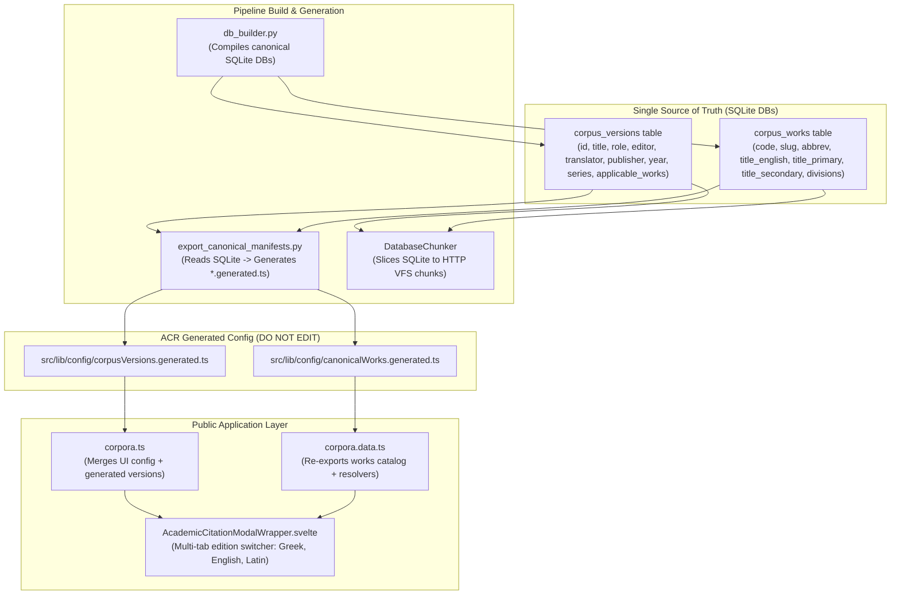

# Implementation Plan: Corpus Versions Single-Source Consolidation & Automated Manifest Generation (Option A)

> [!NOTE]
> **Status**: Ready for Execution  
> **Target Scope**: `apps/ancient-corpora-reader`, `packages/ancient-languages`, `packages/ui`  
> **Architecture Pattern**: Option A (Split Generated Manifests: `corpusVersions.generated.ts` & `canonicalWorks.generated.ts`)

---

## 1. Executive Summary & Objective

Currently, metadata in the Ancient Corpora Reader (ACR) is duplicated across hardcoded TypeScript arrays (`corpora.ts` and `corpora.data.ts`) and SQLite database tables (`corpus_versions` and `corpus_works`). Furthermore, the app's "Cite" dialog lacks complete bibliographic data for each specific textual edition (Greek critical text, English translation, and Latin witnesses).

This plan establishes the **SQLite databases (`corpus_versions` and `corpus_works`) as the single source of truth (SSOT)** for all version and work metadata. A dedicated pipeline step will auto-generate typed client manifests (`corpusVersions.generated.ts` and `canonicalWorks.generated.ts`) during the build process, feeding directly into the SvelteKit app.



---

## 2. Phase 1: Database Schema Expansion & `version_id` Standardization

### 2.1 What is `version_id` and Why Must It Be Standardized?

* **Purpose**: In the normalized ACR relational model, a single locus (e.g. *1 Clement 1:1*) contains multiple parallel rows in `text_units` (Greek, Latin, English). `version_id` is the **Foreign Key** on `text_units.version_id` pointing to `corpus_versions.id`. The client query layer (`dbClient.ts`) uses this key to partition returned rows into parallel column streams (`unitsByVersion.get(v.id)`).
* **The Legacy Inconsistency**:
  * Historically, the three standalone readers used conflicting ad-hoc identifiers:
    * `af`: named by editor + language (`lake_grc`, `lake_lat`, `lake_eng`)
    * `philo`: named by bare language code (`grc`, `eng`) — non-unique across corpora
    * `josephus`: named by corpus + language (`josephus_grc`, `josephus_eng`)
    * `justin`: named by corpus + language (`justin_grc`, `justin_eng`)
* **The Standard**: Every `version_id` must follow a globally unique, self-describing canonical format:  
  **`<corpus_id>_<edition/source>_<language>`** (or `<corpus_id>_<language>` when only a single witness exists):
  * AF: `af_lake_grc`, `af_lake_lat`, `af_lake_eng`
  * Philo: `philo_cw_grc`, `philo_yonge_eng`
  * Josephus: `josephus_niese_grc`, `josephus_whiston_eng`
  * Justin: `justin_celano_grc`, `justin_anf_eng`

### 2.2 Table DDL Contract (`pipeline/db_builder.py`)

Update the table definition in `pipeline/db_builder.py`:

```sql
CREATE TABLE corpus_versions (
    id TEXT PRIMARY KEY,                  -- Standardized canonical ID: e.g. 'af_lake_grc', 'philo_cw_grc'
    language TEXT NOT NULL,               -- ISO 639-3 (e.g. 'grc', 'eng', 'lat')
    title TEXT NOT NULL,                  -- Full descriptive title
    version_label TEXT,                   -- Short badge label (e.g. 'Lake 1912', 'Niese 1895')
    direction TEXT DEFAULT 'ltr',         -- 'ltr' or 'rtl'
    order_index INTEGER DEFAULT 0,        -- Column display priority (1 = Greek primary, 2 = Latin, 3 = English)
    -- Bibliographic Single Source of Truth
    role TEXT NOT NULL,                   -- 'critical_edition' | 'translation' | 'ancient_witness'
    editor TEXT,                          -- e.g. 'Kirsopp Lake', 'Leopold Cohn & Paul Wendland', 'Benedikt Niese'
    translator TEXT,                      -- e.g. 'Kirsopp Lake', 'Charles Duke Yonge', 'William Whiston'
    booktitle TEXT NOT NULL,              -- e.g. 'The Apostolic Fathers', 'Philonis Alexandrini Opera Quae Supersunt'
    series TEXT,                          -- e.g. 'Loeb Classical Library'
    publisher TEXT NOT NULL,              -- e.g. 'Harvard University Press', 'Georg Reimer', 'Weidmann'
    address TEXT,                         -- e.g. 'Cambridge, MA', 'Berlin', 'London'
    year TEXT NOT NULL,                   -- e.g. '1912', '1896–1915', '1885–1895'
    volume TEXT,                          -- e.g. 'Vols. 1–2', '6 vols.'
    sbl_qualifier TEXT,                   -- e.g. '(Niese)', '(trans. Whiston)', '(trans. Lake)'
    applicable_works TEXT                 -- JSON array: '["HER", "POL_PHI"]' for AF Latin; NULL for universal
);
```

### 2.3 Schema Verification Guard
Update `REQUIRED_TABLES["corpus_versions"]` in `db_builder.py` to enforce presence of these columns during automated validation.

---

## 3. Phase 2: Bibliographic Master Data in Pipeline

Define the authoritative bibliographic catalog in `pipeline/config.py` using the standardized IDs:

| Corpus | Standardized `id` | Language | Role | Primary Agents / Editors / Translators | Publication Series & Imprint | Extant Work Scope |
| :--- | :--- | :--- | :--- | :--- | :--- | :--- |
| **`af`** | `af_lake_grc` | `grc` | `critical_edition` | Ed. Kirsopp Lake | *The Apostolic Fathers*, Loeb Classical Library (Cambridge, MA: Harvard University Press, 1912) | Universal |
| **`af`** | `af_lake_lat` | `lat` | `ancient_witness` | Ed. Kirsopp Lake | *The Apostolic Fathers*, Loeb Classical Library (Cambridge, MA: Harvard University Press, 1912) | `['HER', 'POL_PHI']` |
| **`af`** | `af_lake_eng` | `eng` | `translation` | Trans. Kirsopp Lake | *The Apostolic Fathers*, Loeb Classical Library (Cambridge, MA: Harvard University Press, 1912) | Universal |
| **`philo`** | `philo_cw_grc` | `grc` | `critical_edition` | Eds. Leopold Cohn & Paul Wendland | *Philonis Alexandrini Opera Quae Supersunt*, 6 vols. (Berlin: Georg Reimer, 1896–1915) | Universal |
| **`philo`** | `philo_yonge_eng`| `eng` | `translation` | Trans. Charles Duke Yonge | *The Works of Philo Judaeus*, 4 vols. (London: H. G. Bohn, 1854–1855; rev. 1890) | Universal |
| **`josephus`** | `josephus_niese_grc` | `grc` | `critical_edition` | Ed. Benedikt Niese | *Flavii Iosephi Opera*, 7 vols. (Berlin: Weidmann, 1885–1895) | Universal |
| **`josephus`** | `josephus_whiston_eng`| `eng` | `translation` | Trans. William Whiston | *The Works of Flavius Josephus* (Auburn and Rochester: Alden and Beardsley, 1856) | Universal |
| **`justin`** | `justin_celano_grc` | `grc` | `critical_edition` | Celano Lemmatized (First1KGreek) | *Patrologia Graeca* Vol. 6 / First1KGreek (CC BY-NC 4.0) | Universal |
| **`justin`** | `justin_anf_eng` | `eng` | `translation` | Trans. Roberts & Donaldson | *Ante-Nicene Fathers* Vol. 1 (Buffalo: Christian Literature Publishing Co., 1885) | Universal |

---

## 4. Phase 3: Automated Manifest Generator

Create `apps/ancient-corpora-reader/pipeline/export_canonical_manifests.py` to query the compiled SQLite databases and write strongly typed TypeScript files.

### 4.1 Output File 1: `corpusVersions.generated.ts`
* Queries `SELECT * FROM corpus_versions ORDER BY order_index ASC` across each corpus database.
* Emits `CANONICAL_CORPUS_VERSIONS: Record<AncientCorpusId, TextVersionConfig[]>`.
* Includes the complete typed `bibliographic` record and parsed `applicableWorks?: string[]`.

### 4.2 Output File 2: `canonicalWorks.generated.ts`
* Queries `SELECT * FROM corpus_works ORDER BY order_index ASC` across each corpus database.
* Emits `CANONICAL_CORPUS_WORKS: Record<AncientCorpusId, CorpusWork[]>`.
* Populates all canonical codes, slugs, categories, abbreviations, Greek/Latin titles, and division counts.

### 4.3 Pipeline Integration
Integrate into `pipeline/build.py`:
1. Compile SQLite DBs (`build_optimized_corpus_db`).
2. Run `export_canonical_manifests.py` $\rightarrow$ emits `corpusVersions.generated.ts` & `canonicalWorks.generated.ts`.
3. Slice SQLite DBs with `DatabaseChunker` into `static/db/{corpus}/`.

---

## 5. Phase 4: SvelteKit App Refactoring

Refactor the application configuration layer to consume the generated manifests cleanly while preserving backwards compatibility:

### 5.1 Refactor `corpora.ts`
* Remove the hardcoded `textVersions` array from `CORPORA_CONFIG`.
* Import `CANONICAL_CORPUS_VERSIONS` from `./corpusVersions.generated.js`.
* Recombine versions with static UI metadata:
  ```typescript
  import { CANONICAL_CORPUS_VERSIONS } from './corpusVersions.generated.js';

  export const CORPORA_CONFIG: Record<string, CorpusConfig> = {
      af: {
          id: 'af',
          name: 'Apostolic Fathers',
          badge: 'AF',
          era: '1st–2nd c. CE',
          author: 'Early Christian Fathers',
          // ... static UI properties, badges, feature flags, license ...
          textVersions: CANONICAL_CORPUS_VERSIONS.af || []
      },
      // philo, josephus, justin...
  };
  ```

### 5.2 Refactor `corpora.data.ts`
* Delete >750 lines of static `RAW_*_WORKS` arrays.
* Import `CANONICAL_CORPUS_WORKS` from `./canonicalWorks.generated.js`.
* Retain and export the standard public helper functions (`getCorpusWorks`, `findWork`, `resolveDivisionCoordinates`), ensuring zero breaking changes for existing components.

---

## 6. Phase 5: Version-Agnostic Citation Generation & UI

### 6.1 Package Types & Citation Helper (`packages/ancient-languages`)
Add `VersionBibliographicConfig` to `ancient-corpora-types.ts` and add `formatVersionAcademicCitations(...)` in `src/citations/builders.ts`:

1. **SBL Handbook**:
   * Uses work abbreviation, coordinates, and `sblQualifier`:
     * Critical text: `1 Clem. 1:1` or `Josephus, Ant. 1.15 (Niese)`
     * Translation: `1 Clem. 1:1 (trans. Lake)` or `Josephus, Ant. 1.15 (Whiston)`
     * Latin witness: `Herm. Sim. 5.1 (Latin)`
2. **Chicago Manual of Style**:
   * Critical edition:
     `{Work Title} ({Primary Title}), in {booktitle}, ed. {editor}, {series} ({address}: {publisher}, {year}), {division}:{section}.`
   * Translation:
     `{Author}, {Work Title}, trans. {translator}, in {booktitle}, {series} ({address}: {publisher}, {year}), {division}:{section}.`
   * Latin witness:
     `{Work Title} ({Latin Title}), in {booktitle}, ed. {editor}...`
3. **BibTeX**:
   * Emits precise `@incollection` or `@book` blocks with proper fields (`author`, `editor`, `translator`, `booktitle`, `series`, `publisher`, `year`, `chapter`).

### 6.2 Component: `AcademicCitationModalWrapper.svelte`
Update the wrapper to drive the edition tabs in `AcademicCitationModal.svelte`:

```svelte
<script lang="ts">
    import { AcademicCitationModal } from '@polyglot/ui';
    import { readerState } from '../stores/readerState.svelte.js';
    import { formatVersionAcademicCitations, formatAncientCorpusCitation } from '@polyglot/ancient-languages';

    let activeEditionIndex = $state(0);

    // Filter versions by applicable works (e.g. Latin only for Hermas and Polycarp)
    let availableVersions = $derived.by(() => {
        const workCode = readerState.currentWork.code;
        return readerState.currentCorpusConfig.textVersions.filter(v =>
            !v.applicableWorks || v.applicableWorks.includes(workCode)
        );
    });

    let activeVersion = $derived(availableVersions[activeEditionIndex] || availableVersions[0]);

    let tabHeadings = $derived(availableVersions.map(v => v.shortTitle || v.title));

    let locus = $derived.by(() => formatAncientCorpusCitation({
        corpusId: readerState.currentCorpus,
        work: readerState.currentWork,
        division: readerState.currentDivision,
        section: readerState.currentSection ?? undefined
    }));

    let citations = $derived.by(() => formatVersionAcademicCitations({
        corpusConfig: readerState.currentCorpusConfig,
        version: activeVersion,
        work: readerState.currentWork,
        division: readerState.currentDivision,
        section: readerState.currentSection ?? undefined
    }));
</script>

<AcademicCitationModal
    open={readerState.showCitationModal}
    title="Academic Citation"
    {locus}
    subtitle="{readerState.currentWork.titleEnglish} — {readerState.currentWork.divisionLabel} {readerState.currentDivision}"
    {tabHeadings}
    bind:activeEditionIndex
    {citations}
    onClose={() => (readerState.showCitationModal = false)}
/>
```

---

## 7. Phase 6: Documentation Synchronization

As a required final delivery step:
1. **Update [`docs/database-design.md`](file:///home/cbrannan/dev/2-tmp/polyglot-suite/apps/ancient-corpora-reader/docs/database-design.md)**:
   * Replace legacy `corpora` table references with the canonical `corpus_versions` DDL specification.
   * Document all new bibliographic fields (`role`, `editor`, `translator`, `booktitle`, `series`, `publisher`, `address`, `year`, `volume`, `sbl_qualifier`, `applicable_works`).
   * Document the standardized `version_id` convention (`<corpus>_<edition>_<lang>`).
   * Detail the build-time generation flow (`export_canonical_manifests.py` $\rightarrow$ `*.generated.ts`).
2. **Update [`README.md`](file:///home/cbrannan/dev/2-tmp/polyglot-suite/apps/ancient-corpora-reader/README.md)**:
   * In Section 2 ("Project Structure") and Section "Database Management", add explicit links pointing to `docs/database-design.md` as the authoritative architectural specification.

---

## 8. Verification & Test Plan

1. **Schema & Pipeline Verification**:
   * Run `npm run db:build:acr` (or `python3 apps/ancient-corpora-reader/pipeline/build.py`).
   * Verify all 4 corpora compile with canonical `corpus_versions` columns and standardized IDs.
   * Verify generated files match expected TypeScript types and contain zero compile errors.
2. **Unit Tests**:
   * Run `npx vitest run apps/ancient-corpora-reader/tests/corporaConfig.test.ts` to ensure works resolution and version lookups function identically.
   * Add unit tests in `packages/ancient-languages` verifying Chicago, SBL, and BibTeX outputs for Greek, English, and Latin across AF, Philo, Josephus, and Justin.
3. **Playwright E2E Tests**:
   * Update `e2e/05_academic_citations_and_hotkeys.e2e.ts`:
     * Test switching between "Greek Critical Text" and "English Translation" tabs.
     * Verify Latin tab appears for Shepherd of Hermas (`HER`), but does not appear for 1 Clement (`1CLE`).
     * Verify copy buttons successfully write accurate Chicago, SBL, and BibTeX strings to the clipboard.
4. **Documentation Audit**:
   * Verify `README.md` correctly links to `docs/database-design.md` and renders without broken links.
