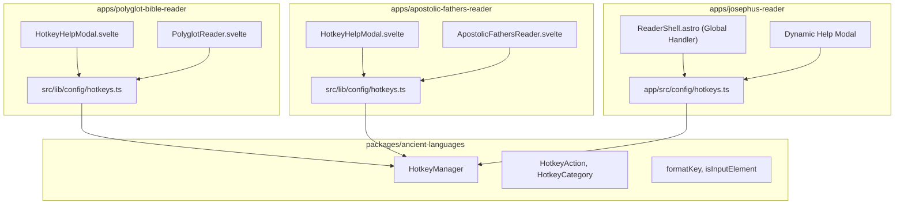

# Implementation Plan: Shared Hotkey Core & Multi-Project Refactoring

## 1. Overview & Motivation

Currently across the `polyglot-suite` monorepo:
- **`polyglot-bible-reader`** and **`apostolic-fathers-reader`** each maintain separate, duplicate copies of a `HotkeyManager` service class (`hotkeyManager.ts`) and associated unit test suites (`hotkeyManager.test.ts`).
- **`josephus-reader`** has no hotkey abstraction at all; it relies on a hardcoded 110-line `switch(key)` block in an inline `<script>` tag inside `ReaderShell.astro` and an 80-line static HTML table for the help modal.

### Goal
Extract the underlying hotkey management engine into the existing shared package (**`@polyglot/ancient-languages`**), and refactor all three reader applications to use this shared core. Each application will retain only a declarative, project-specific `hotkeys.ts` file defining its key mappings and actions.



---

## 2. Phase 1: Shared Core Engine in `@polyglot/ancient-languages`

`@polyglot/ancient-languages` is already linked as a workspace dependency across all three apps. We will house the core hotkey engine here.

### 2.1 Files to Create
- `packages/ancient-languages/src/hotkeys.ts`:
  - **`HotkeyCategory`**: Union type `'Navigation' | 'View' | 'General' | string`.
  - **`HotkeyAction<TState = unknown>`**:
    ```typescript
    export interface HotkeyAction<TState = unknown> {
      id: string;
      name: string;
      description: string;
      category: HotkeyCategory;
      keys: string[];
      action: (state?: TState, event?: KeyboardEvent) => void | Promise<void>;
      enabled?: (state?: TState) => boolean;
      preventDefault?: boolean;
    }
    ```
  - **`HotkeyManager<TState = unknown>`**:
    - Constructor accepts `HotkeyAction<TState>[]`.
    - `getActions()` and `setActions()`.
    - `isInputElement(target: EventTarget | null): boolean`: checks `input`, `textarea`, `select`, `[contenteditable]`, and nested form elements.
    - `matchesBinding(binding: string, event: KeyboardEvent): boolean`: handles combinations like `mod+k` (Mac `⌘` vs Linux/Windows `Ctrl`), `alt+`, `shift+`, and case-insensitive single keys.
    - `handleKeyDown(event: KeyboardEvent, state?: TState, options?: { enabled?: boolean }): boolean`: dispatches matching action, ignores repeated key hold events (`event.repeat`), respects guards and `preventDefault`.
  - **Helper utilities**:
    - `formatKey(binding: string): string`: Converts `mod+k` to `⌘K` on Mac or `Ctrl+K` on PC, `ArrowLeft` to `←`, etc.
    - `groupActionsByCategory(actions: HotkeyAction[]): Record<string, HotkeyAction[]>`.

### 2.2 Package Exports
Update `packages/ancient-languages/package.json` and `packages/ancient-languages/src/index.ts`:
```json
"exports": {
  ".": "./src/index.ts",
  "./hotkeys": "./src/hotkeys.ts",
  ...
}
```

### 2.3 Shared Tests
Create `packages/ancient-languages/tests/hotkeys.test.ts` covering:
- Key combinations (`mod+k`, `ctrl+k`, `shift+?`).
- Platform modifier detection (Mac meta vs non-Mac ctrl).
- Input guard suppression (`input`, `textarea`, `contenteditable`).
- Single keys vs modifier-augmented keys (e.g. `b` does not fire on `Ctrl+B`).
- `preventDefault` and `enabled` predicates.

---

## 3. Phase 2: Refactoring Existing Readers

### 3.1 `polyglot-bible-reader`
1. **Update `apps/polyglot-bible-reader/src/lib/config/hotkeys.ts`**:
   - Import `type HotkeyAction` from `@polyglot/ancient-languages/hotkeys`.
   - Retain all Bible-specific `READER_HOTKEYS`.
2. **Update `apps/polyglot-bible-reader/src/lib/services/hotkeyManager.ts`**:
   - Re-export `HotkeyManager` from `@polyglot/ancient-languages/hotkeys`.
   - Instantiate `export const hotkeyManager = new HotkeyManager<ReaderState>(READER_HOTKEYS)`.
3. **Verify UI & Tests**:
   - Run `npm --workspace=polyglot-bible-reader run test` and `run check`.

### 3.2 `apostolic-fathers-reader`
1. **Update `apps/apostolic-fathers-reader/src/lib/config/hotkeys.ts`**:
   - Import `type HotkeyAction` from `@polyglot/ancient-languages/hotkeys`.
   - Retain all AF-specific `AF_HOTKEYS`.
2. **Update `apps/apostolic-fathers-reader/src/lib/services/hotkeyManager.ts`**:
   - Re-export `HotkeyManager` from `@polyglot/ancient-languages/hotkeys`.
   - Instantiate `export const hotkeyManager = new HotkeyManager<ReaderState>(AF_HOTKEYS)`.
3. **Verify UI & Tests**:
   - Run `npm --workspace=apostolic-fathers-reader run test` (or check).

---

## 4. Phase 3: Refactoring `josephus-reader`

### 4.1 Create Dedicated Hotkey Configuration
Create `apps/josephus-reader/app/src/config/hotkeys.ts`:
```typescript
import { HotkeyManager, type HotkeyAction } from '@polyglot/ancient-languages/hotkeys';

export const JOSEPHUS_HOTKEYS: HotkeyAction[] = [
  // Navigation
  {
    id: 'jump-niese',
    name: 'Jump to Section',
    description: 'Open and focus "Jump to §" input',
    category: 'Navigation',
    keys: ['j'],
    preventDefault: true,
    action: () => window.dispatchEvent(new CustomEvent('open-niese-jump'))
  },
  {
    id: 'nav-next',
    name: 'Next Section',
    description: 'Jump to next section',
    category: 'Navigation',
    keys: ['n', 'ArrowRight'],
    preventDefault: true,
    action: () => window.dispatchEvent(new CustomEvent('reader-nav-next'))
  },
  {
    id: 'nav-prev',
    name: 'Previous Section',
    description: 'Jump to previous section',
    category: 'Navigation',
    keys: ['p', 'ArrowLeft'],
    preventDefault: true,
    action: () => window.dispatchEvent(new CustomEvent('reader-nav-prev'))
  },
  {
    id: 'nav-first',
    name: 'First Section',
    description: 'Jump to first section (§ 1)',
    category: 'Navigation',
    keys: ['f'],
    preventDefault: true,
    action: () => window.dispatchEvent(new CustomEvent('reader-nav-first'))
  },
  {
    id: 'nav-last',
    name: 'Last Section',
    description: 'Jump to last section',
    category: 'Navigation',
    keys: ['l'],
    preventDefault: true,
    action: () => window.dispatchEvent(new CustomEvent('reader-nav-last'))
  },
  {
    id: 'nav-lang-switch',
    name: 'Switch Language',
    description: 'Switch/scroll between Greek & English in section',
    category: 'Navigation',
    keys: ['o'],
    preventDefault: true,
    action: () => window.dispatchEvent(new CustomEvent('reader-nav-lang-switch'))
  },
  // View
  {
    id: 'view-theme',
    name: 'Cycle Theme',
    description: 'Cycle theme (Light ☀️ → Dark 🌙 → Sepia 📜)',
    category: 'View',
    keys: ['t'],
    preventDefault: true,
    action: () => window.dispatchEvent(new CustomEvent('cycle-theme'))
  },
  {
    id: 'view-greek',
    name: 'Greek Only',
    description: 'Show Greek text only',
    category: 'View',
    keys: ['g'],
    preventDefault: true,
    action: () => window.dispatchEvent(new CustomEvent('reader-set-viewmode', { detail: 'greek' }))
  },
  {
    id: 'view-english',
    name: 'English Only',
    description: 'Show English text only',
    category: 'View',
    keys: ['e'],
    preventDefault: true,
    action: () => window.dispatchEvent(new CustomEvent('reader-set-viewmode', { detail: 'english' }))
  },
  {
    id: 'view-dual',
    name: 'Dual Mode',
    description: 'Toggle Dual language modes (Parallel ◧ ↔ Stacked ⬓)',
    category: 'View',
    keys: ['d'],
    preventDefault: true,
    action: () => window.dispatchEvent(new CustomEvent('reader-toggle-dualmode'))
  },
  {
    id: 'view-zen',
    name: 'Zen Mode',
    description: 'Toggle Zen Mode (full-screen focus view)',
    category: 'View',
    keys: ['z'],
    preventDefault: true,
    action: () => window.dispatchEvent(new CustomEvent('reader-toggle-zen'))
  },
  {
    id: 'font-increase',
    name: 'Increase Font',
    description: 'Increase text size',
    category: 'View',
    keys: ['+', '='],
    preventDefault: true,
    action: () => window.dispatchEvent(new CustomEvent('reader-set-fontsize', { detail: 'inc' }))
  },
  {
    id: 'font-decrease',
    name: 'Decrease Font',
    description: 'Decrease text size',
    category: 'View',
    keys: ['-', '_'],
    preventDefault: true,
    action: () => window.dispatchEvent(new CustomEvent('reader-set-fontsize', { detail: 'dec' }))
  },
  // General & Tools
  {
    id: 'tools-morph',
    name: 'Word Info',
    description: 'Toggle Word Info mode (interactive word popups)',
    category: 'General',
    keys: ['w'],
    preventDefault: true,
    action: () => window.dispatchEvent(new CustomEvent('reader-toggle-morph'))
  },
  {
    id: 'tools-search',
    name: 'Corpus Search',
    description: 'Open Corpus Search',
    category: 'General',
    keys: ['s'],
    preventDefault: true,
    action: () => window.dispatchEvent(new CustomEvent('reader-toggle-search', { detail: { tab: 'lemma' } }))
  },
  {
    id: 'tools-highlights',
    name: 'Active Highlights',
    description: 'Open Active Highlights Tab',
    category: 'General',
    keys: ['h'],
    preventDefault: true,
    action: () => window.dispatchEvent(new CustomEvent('reader-toggle-search', { detail: { tab: 'highlights' } }))
  },
  {
    id: 'tools-bookmarks',
    name: 'Bookmarks',
    description: 'Toggle Bookmarks Modal',
    category: 'General',
    keys: ['b'],
    preventDefault: true,
    action: () => window.dispatchEvent(new CustomEvent('reader-toggle-bookmarks'))
  },
  {
    id: 'cmd-palette',
    name: 'Command Palette',
    description: 'Open Search & Command Palette',
    category: 'General',
    keys: ['mod+k'],
    preventDefault: true,
    action: () => window.dispatchEvent(new CustomEvent('open-command-palette'))
  },
  {
    id: 'help-shortcuts',
    name: 'Keyboard Shortcuts Help',
    description: 'Toggle this Keyboard Shortcuts modal',
    category: 'General',
    keys: ['?'],
    preventDefault: true,
    action: () => window.dispatchEvent(new CustomEvent('toggle-help-modal'))
  },
  {
    id: 'close-modals',
    name: 'Close Dialogs',
    description: 'Close active popups, menus, or modals',
    category: 'General',
    keys: ['Escape'],
    preventDefault: true,
    action: () => window.dispatchEvent(new CustomEvent('close-all-modals'))
  }
];

export const hotkeyManager = new HotkeyManager(JOSEPHUS_HOTKEYS);
```

### 4.2 Simplify `ReaderShell.astro`
1. **Replace the 110-line switch-case** in `ReaderShell.astro` (`lines 525–634`) with:
   ```typescript
   import { hotkeyManager } from '../config/hotkeys';
   window.addEventListener('keydown', (e) => hotkeyManager.handleKeyDown(e));
   ```
2. **Replace the 80-line static HTML table** (`lines 254–335`):
   Dynamically iterate over `JOSEPHUS_HOTKEYS` (or render using a shared `HotkeyHelpModal` / table component).
   ```astro
   {JOSEPHUS_HOTKEYS.map(action => (
     <tr>
       <td>{action.keys.map(k => <kbd>{formatKey(k)}</kbd>)}</td>
       <td>{action.description}</td>
     </tr>
   ))}
   ```
3. Remove redundant `⌘K` handlers in `CommandPalette.svelte` so all shortcuts are orchestrated consistently.

---

## 5. Verification Checklist

1. **Unit Tests**:
   - `npm --workspace=@polyglot/ancient-languages run test` to verify the core `HotkeyManager` engine.
   - `npm --workspace=polyglot-bible-reader run test` to ensure no regression in Bible Reader hotkeys.
2. **Build Verification**:
   - `npm run check:bible`
   - `npm run check:josephus`
   - `npm run build:www`
3. **Interactive Verification**:
   - Navigation: `j` (Niese Jump input auto-focuses), `n`/`→`, `p`/`←`, `f`, `l`, `o`.
   - Modifiers: `⌘K` / `Ctrl+K` opens Command Palette.
   - View Modes: `g`, `e`, `d`, `z`, `+`, `-`, `t`.
   - Input Guard: Typing inside the search bar or Niese jump input does not trigger reader hotkeys.
   - Dynamic Modal: Pressing `?` displays all hotkeys populated directly from `hotkeys.ts`.
