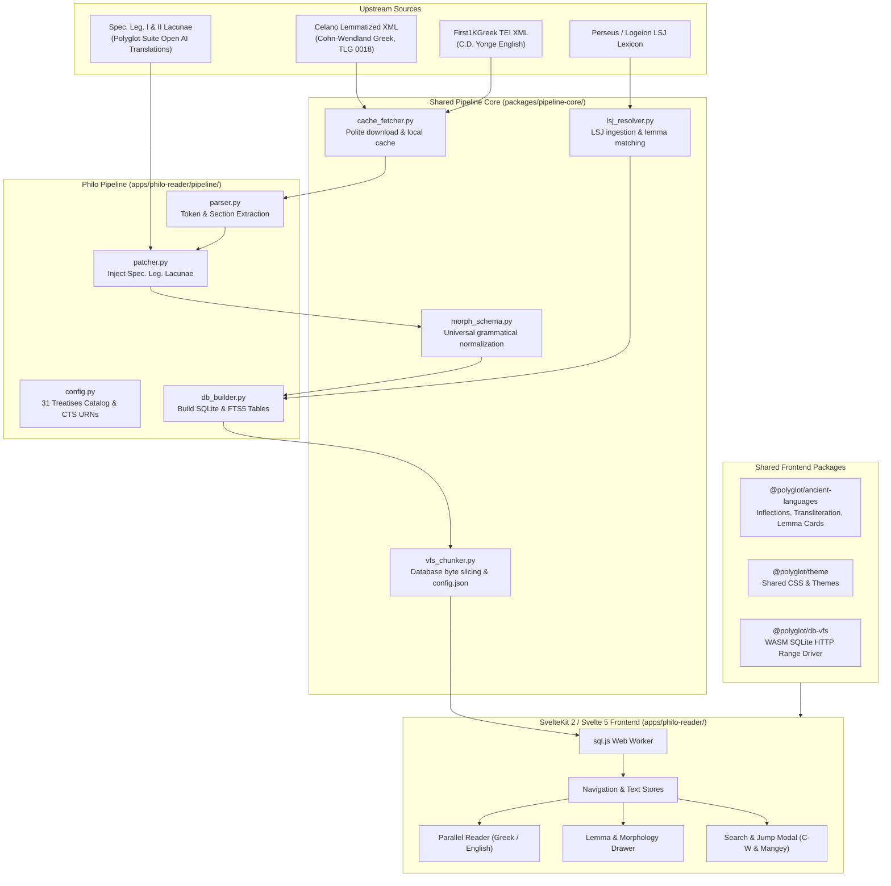

# Philo Reader (`philo-reader`) — Architectural & Implementation Plan

## 1. Executive Summary

This document specifies the technical design, data pipeline, and implementation roadmap for adding **Philo Reader** (`apps/philo-reader`) to the `polyglot-suite` monorepo.

Philo of Alexandria (*Philo Judaeus*, c. 20 BCE – 50 CE) produced a massive corpus bridging Second Temple Judaism, the Septuagint, and Hellenistic philosophy. A synchronized polyglot reader for Philo complements the existing suite:
- **`polyglot-bible-reader`**: Scripture (Hebrew MT, Greek LXX, Greek SBLGNT, Latin Vulgate, English).
- **`josephus-reader`**: Flavius Josephus (Jewish War, Antiquities, Life, Against Apion).
- **`apostolic-fathers-reader`**: Early Christian literature (Clement, Ignatius, Polycarp, Didache, Hermas).
- **`philo-reader`**: The Hellenistic Jewish philosophical and allegorical corpus.

---

## 2. Upstream Data Sources & Legal / Licensing Analysis

### 2.1 Ancient Greek Source: Celano & Cohn-Wendland
- **Text Edition**: Leopold Cohn & Paul Wendland (eds.), *Philonis Alexandrini Opera quae supersunt*, 6 vols. + index (Berlin: Georg Reimer, 1896–1915).
  - **Copyright**: Unambiguously Public Domain worldwide.
- **Repository**: [`gcelano/LemmatizedAncientGreekXML`](https://github.com/gcelano/LemmatizedAncientGreekXML/tree/master/texts).
  - Contains all 31 complete surviving Greek treatises (`tlg0018.tlg001.opp-grc1.xml` through `tlg031.opp-grc1.xml`).
  - **Pre-tokenized & Lemmatized**: Every word form is already tokenized into `<t>` elements with:
    - Passage reference: `p="[Cohn-Wendland section]"`
    - Position and order within section
    - Lemmatized base forms: `<l1>` (PerseusUnderPhilologic) and `<l2>` (Morpheus)
    - Full morphological analysis tags: `o="[POS code]"` (Perseus / Mate tagger format, e.g. `l-p---mg-`, `a-p---mg-`, `n-p---mg-`).
  - **License**: Creative Commons Attribution-ShareAlike (CC-BY-SA 4.0 / Open Access).

### 2.2 English Translation Source: Yonge & First1KGreek
- **Base Translation**: Charles Duke Yonge (C.D. Yonge), *The Works of Philo Judaeus, the Contemporary of Josephus*, 4 vols. (London: H. G. Bohn, 1854–1855; rev. 1890).
  - **Copyright**: Unambiguously Public Domain worldwide.
- **Digital Edition & Alignment**: [`OpenGreekAndLatin/First1KGreek`](https://github.com/OpenGreekAndLatin/First1KGreek/tree/master/data/tlg0018).
  - In May–August 2023, Gregory Crane, Lisa Cerrato, and the Perseus team restructured Yonge's translation from CCEL into individual TEI XML files (`tlg0018.tlg001.1st1K-eng1.xml` through `tlg031.1st1K-eng1.xml`), mapping the English text to modern Cohn-Wendland section numbers based on David M. Scholer's edition.
  - **License**: Creative Commons Attribution-ShareAlike 4.0 (CC-BY-SA 4.0).

### 2.3 Critical Finding: Peter Kirby's Supplemental Sections & Copyright
In Yonge's original 1854 translation, certain passages of *De Specialibus Legibus* (Special Laws) were omitted because Yonge translated Thomas Mangey’s 1742 Greek edition, which had manuscript lacunae for:
- **Book 1**: §§177–193 (17 sections on the New Moon and festive sacrifices).
- **Book 2**: §§124–139, 142–144, 153–154, 163–174, 177–180, 209, 212–213 (~41 sections on festival calendars and inheritance laws).

> [!CAUTION]
> **Copyright Alert on Peter Kirby / Early Jewish Writings**:
> The missing sections hosted on Peter Kirby's *Early Christian Writings* and *Early Jewish Writings* contain this explicit editorial note:
> `"{sections ... were omitted in Yonge's translation because the edition on which Yonge based his translation, Mangey, lacked this material. These sections have been newly translated for this edition.}"`
> This text is copied directly from **Hendrickson Publishers' 1993 edition** (*The Works of Philo*, edited by David M. Scholer, Hendrickson Publishers, 1993). **Hendrickson holds copyright (1993) on those newly translated sections.**
> Scraping or copying these supplemental sections directly from Kirby's site would introduce copyrighted third-party material into the open-source monorepo.

#### **Resolution for the ~58 Missing Sections**:
1. **AI-Assisted Open Translation with Human Review**:
   - Because the Greek text of Cohn-Wendland (1896) for these ~58 sections is in the public domain, the initial modern English translation will be generated by the AI system (Antigravity / LLM) directly from the Cohn-Wendland Greek critical text.
   - This provides an immediate, unencumbered text base suitable for human scholarly review and refinement.
   - The resulting translation will be dedicated to the public domain or released under CC-BY 4.0.
2. **Transparent In-App and Dataset Attribution**:
   - **In the Database**: Flagged with `is_supplement = 1` and `translator = 'Antigravity AI (from Cohn-Wendland GRC; reviewed for Polyglot Suite)'`.
   - **In the Reader UI**: Rendered with an explicit visual badge/pill next to the section: `"[AI Translation — Missing from Yonge 1854]"`. Clicking or hovering will provide a tooltip explaining that Yonge omitted this section due to Mangey's manuscript lacuna.
   - **In the "Sources / Attribution" Page**: Clear documentation stating that while Yonge 1854 covers the vast majority of the corpus, these specific sections were translated using modern AI assistance from the Greek critical edition and are provided under an open license for transparency.

---

## 3. Corpus Scope & Organization

The 31 surviving Greek treatises are organized into the four traditional scholarly divisions:

```
Philo Corpus (31 Treatises, ~600,000 Greek Words)
│
├── 1. The Pentateuchal Allegory (The Allegorical Commentary on Genesis)
│   ├── tlg001: De Opificio Mundi (On the Creation of the World) [172 sections]
│   ├── tlg002: Legum Allegoriarum I–III (Allegorical Interpretation) [472 sections]
│   ├── tlg003: De Cherubim (On the Cherubim) [130 sections]
│   ├── tlg004: De Sacrificiis Abelis et Caini (On the Sacrifices of Abel and Cain) [139 sections]
│   ├── tlg005: Quod Deterius Potiori Insidiari Solet (That the Worse Attacks the Better) [178 sections]
│   ├── tlg006: De Posteritate Caini (On the Posterity of Cain) [185 sections]
│   ├── tlg007: De Gigantibus (On the Giants) [67 sections]
│   ├── tlg008: Quod Deus Sit Immutabilis (That God Is Unchangeable) [183 sections]
│   ├── tlg009: De Agricultura (On Agriculture) [181 sections]
│   ├── tlg010: De Plantatione (On Planting) [177 sections]
│   ├── tlg011: De Ebrietate (On Drunkenness) [224 sections]
│   ├── tlg012: De Sobrietate (On Sobriety) [69 sections]
│   ├── tlg013: De Confusione Linguarum (On the Confusion of Tongues) [198 sections]
│   ├── tlg014: De Migratione Abrahami (On the Migration of Abraham) [225 sections]
│   ├── tlg015: Quis Rerum Divinarum Heres Sit (Who Is the Heir of Divine Things) [316 sections]
│   ├── tlg016: De Congressu Eruditionis Gratia (On Mating with the Preliminary Studies) [180 sections]
│   ├── tlg017: De Fuga et Inventione (On Flight and Finding) [213 sections]
│   ├── tlg018: De Mutatione Nominum (On the Change of Names) [270 sections]
│   └── tlg019: De Somniis I–II (On Dreams) [560 sections]
│
├── 2. The Exposition of the Law
│   ├── tlg020: De Abrahamo (On Abraham) [276 sections]
│   ├── tlg021: De Josepho (On Joseph) [270 sections]
│   ├── tlg022: De Vita Mosis I–II (On the Life of Moses) [628 sections]
│   ├── tlg023: De Decalogo (On the Decalogue) [178 sections]
│   ├── tlg024: De Specialibus Legibus I–IV (On the Special Laws) [1,054 sections]
│   ├── tlg025: De Virtutibus (On the Virtues) [227 sections]
│   └── tlg026: De Praemiis et Poenis (On Rewards and Punishments) [172 sections]
│
├── 3. Historical & Apologetic Writings
│   ├── tlg028: De Vita Contemplativa (On the Contemplative Life) [90 sections]
│   ├── tlg030: In Flaccum (Against Flaccus) [191 sections]
│   └── tlg031: Legatio ad Gaium (On the Embassy to Gaius) [373 sections]
│
└── 4. Philosophical Treatises
    ├── tlg027: Quod Omnis Probus Liber Sit (That Every Good Man Is Free) [160 sections]
    └── tlg029: De Aeternitate Mundi (On the Eternity of the World) [150 sections]
```

*(Note: Treatises surviving predominantly in Armenian—such as Quaestiones in Genesim et Exodum, De Providentia, and De Animalibus—are deferred to Phase 2, keeping Phase 1 focused strictly on the 31 canonical Greek treatises).*

---

## 4. Key Pre-Flight Decisions & Technical Choices

### Decision 1: Database & Storage Strategy
- **Options**:
  - *Option A*: Static JSON chunk files (similar to `josephus-reader`).
  - *Option B (Recommended)*: SQLite Database loaded over HTTP range requests using `@polyglot/db-vfs` and `sql.js-httpvfs` (identical to `apostolic-fathers-reader` and `polyglot-bible-reader`).
- **Rationale**: Philo’s corpus contains ~600,000 words across 31 treatises. Storing this in an indexed SQLite database (~25–35 MB total, split into ~3–5 MB chunks) allows:
  - Sub-millisecond indexed section lookups.
  - Full-text search (FTS5) in Greek and English without loading the entire text into memory.
  - Dynamic lemma search and cross-treatise morphological queries directly in the browser via WebAssembly without incurring server costs.

### Decision 2: Morphology Schema Alignment
- Celano uses Perseus/Mate tagger codes (e.g. `l-p---mg-`, `v3saia---`).
- The monorepo’s [`packages/ancient-languages`](file:///home/cbrannan/dev/2-tmp/polyglot-suite/packages/ancient-languages) expects structured attributes:
  - `pos`, `person`, `number`, `tense`, `mood`, `voice`, `gender`, `case`, `degree`.
- **Pipeline Decision**: The ingestion pipeline will convert Celano's raw codes into the standard `@polyglot/ancient-languages` schema using an automated mapping adapter, supplemented by our neural Stanza / CLTK pipeline for ambiguous tokens.

### Decision 3: Dual Citation Navigation
- Every section will display:
  1. **Canonical Cohn-Wendland Reference**: e.g., *Opif. 15* or *Spec. 1.177*.
  2. **Mangey Milestone**: e.g., *M. 1.12*, extracted from the milestone tags in First1KGreek XML.
- The command palette / jump modal will allow jumping via both Cohn-Wendland section numbers and Mangey volume/page numbers (parallel to the Niese vs. Whiston jump modal in `josephus-reader`).

---

## 5. System Architecture



---

## 6. Database Schema (`philo.sqlite3`)

```sql
-- 1. Metadata for all 31 treatises
CREATE TABLE works (
    id TEXT PRIMARY KEY,             -- e.g. 'tlg001', 'tlg024'
    order_index INTEGER NOT NULL,    -- 1 to 31
    category TEXT NOT NULL,          -- 'allegorical', 'exposition', 'historical', 'philosophical'
    abbrev TEXT NOT NULL,            -- e.g. 'Opif', 'SpecLeg'
    title_english TEXT NOT NULL,     -- 'On the Creation of the World'
    title_greek TEXT NOT NULL,       -- 'Περὶ τῆς κατὰ Μωυσέα κοσμοποιίας'
    title_latin TEXT NOT NULL,       -- 'De Opificio Mundi'
    total_books INTEGER NOT NULL,    -- 1 (or 3 for Leg. All., 4 for Spec. Leg., etc.)
    total_sections INTEGER NOT NULL
);

-- 2. Section level text alignment (Greek + English)
CREATE TABLE sections (
    id INTEGER PRIMARY KEY AUTOINCREMENT,
    work_id TEXT NOT NULL,           -- references works(id)
    book INTEGER NOT NULL DEFAULT 1, -- book number (1, 2, 3, 4)
    section INTEGER NOT NULL,        -- Cohn-Wendland section number
    mangey_ref TEXT,                 -- e.g. 'I p. 1 M.'
    greek_text TEXT NOT NULL,        -- Clean reconstructed Greek sentence/section
    english_text TEXT NOT NULL,      -- Yonge English (or supplement)
    is_supplement INTEGER DEFAULT 0, -- 1 if section is from Polyglot supplement
    UNIQUE(work_id, book, section)
);

-- 3. Token-level morphology & word forms
CREATE TABLE tokens (
    id INTEGER PRIMARY KEY AUTOINCREMENT,
    section_id INTEGER NOT NULL,     -- references sections(id)
    position INTEGER NOT NULL,       -- order within section
    word_raw TEXT NOT NULL,          -- surface form with punctuation
    word_clean TEXT NOT NULL,        -- stripped of punctuation & normalized
    lemma TEXT NOT NULL,             -- dictionary headword (LSJ)
    pos TEXT NOT NULL,               -- noun, verb, adj, etc.
    morph TEXT NOT NULL,             -- standard parsed format (e.g. 'A-S---MN-')
    morph_decoded TEXT NOT NULL,     -- JSON: {"case":"nom","number":"sg",...}
    FOREIGN KEY(section_id) REFERENCES sections(id)
);

-- 4. Lexicon (LSJ entries)
CREATE TABLE lexicon (
    lemma TEXT PRIMARY KEY,
    short_def TEXT,
    full_html TEXT,
    frequency INTEGER NOT NULL DEFAULT 0
);

-- 5. Full-Text Search Virtual Tables (FTS5)
CREATE VIRTUAL TABLE sections_fts USING fts5(
    work_id UNINDEXED,
    book UNINDEXED,
    section UNINDEXED,
    greek_text,
    english_text,
    tokenize = 'unicode61'
);
```

---

## 7. Implementation Roadmap & Milestones

### Phase 1: Establish Shared `pipeline-core` & Ingest Philo
1. **Initialize `packages/pipeline-core/` (Option 3 Prototype)**:
   - Create `packages/pipeline-core/` as an internal workspace Python package.
   - Extract clean, reusable foundation modules from `apostolic-fathers-reader` (without touching or breaking existing reader pipelines):
     - `pipeline_core/vfs_chunker.py`: Slices SQLite databases into 5MB chunks and generates `config.json` for `@polyglot/db-vfs`.
     - `pipeline_core/lsj_resolver.py`: Standardized STEPBible TFLSJ dictionary ingestion, headword normalization, and definition lookup.
     - `pipeline_core/cache_fetcher.py`: Polite HTTP download helper with caching and User-Agent headers.
     - `pipeline_core/morph_schema.py`: Standardized morphological code mapper to `@polyglot/ancient-languages` schema.
2. **Initialize `apps/philo-reader/pipeline/` (First Consumer of `pipeline-core`)**:
   - Create catalog config `pipeline/config.py` defining all 31 treatises, CTS URNs, book divisions, and Latin/English/Greek titles.
   - Implement `pipeline/parser.py` to extract tokens and sections from Celano and First1KGreek using `pipeline_core.cache_fetcher`.
3. **Build the English Supplement Patcher (`pipeline/patcher.py`)**:
   - Provide the open-source CC-BY 4.0 translation file for the ~58 lacuna sections in *De Specialibus Legibus* Books 1 and 2, translated via AI with full attribution metadata (`is_supplement = 1`).
4. **Morphology & Lexicon Indexing**:
   - Ingest Celano’s pre-analyzed tokens via `pipeline_core.morph_schema`.
   - Link lemmas and build frequency tables via `pipeline_core.lsj_resolver`.
5. **Database Compilation & Chunking**:
   - Build `philo.sqlite3` with indexed sections, tokens, lexicon, and FTS5 tables (`pipeline/db_builder.py`).
   - Scribe chunked slices to `apps/philo-reader/static/db/philo.db.00...` using `pipeline_core.vfs_chunker`.

### Phase 2: Core SvelteKit Frontend (COMPLETED)
- [x] Scaffold SvelteKit 2 / Svelte 5 app in `apps/philo-reader` (`vite.config.ts`, `svelte.config.js`, `tsconfig.json`, `app.html`, `app.css`).
- [x] VFS Database Service (`src/lib/services/dbWorker.ts`, `dbClient.ts`) connecting web worker via HTTP range requests.
- [x] Parallel Greek and English layout with responsive single/dual column switching (`ColumnView.svelte`).
- [x] Section pill displaying Cohn-Wendland section (§) and Mangey milestone (`[M. 1.12]`).
- [x] Distinct visual badge and tooltip for the ~58 supplemental AI-translated sections (`[AI Translation — Missing from Yonge 1854]`).

### Phase 3: Interactive Lexical & Morphological Tools (COMPLETED)
- [x] Token click & hover inspector opening lemma details in dockable side panel.
- [x] Reusable integration with `@polyglot/ancient-languages` (`AttestedFormsSection.svelte`, `KwicSnippet.svelte`).
- [x] Unabridged LSJ definition with formatted HTML article and morphological breakdown.
- [x] Concordance / Occurrence search across all 31 treatises with KWIC snippets and jump navigation.
- [x] Persistent lemma highlighting store (`highlightStore.svelte.ts`) with custom color palette.

### Phase 4: Navigation, Search, & Theming (COMPLETED)
- [x] Command Palette & Jump Navigation (`CommandPalette.svelte`) supporting `Opif 10`, `Leg 2.14`, `Spec Leg 1.177`, `M. 1.52`.
- [x] Treatise selection modal (`BookModal.svelte`) grouped by the 4 Philo categories.
- [x] Book and section selection modal (`ChapterModal.svelte`).
- [x] Full-Text Search (FTS5) supporting queries in Cohn-Wendland Greek and English translation in side panel.
- [x] Theming & typography integration (`readingTheme.ts`, `ThemeSlider.svelte`) with continuous contrast and warmth sliders.
- [x] Scholarly citation generator modal (`CitationModal.svelte`, `citationService.ts`) for SBL, Cohn-Wendland, Mangey, Chicago, MLA, and BibTeX.

### Phase 5: Monorepo Integration & Deployment (IN PROGRESS)
- [x] Portal Registration: Added Philo Reader to `scripts/generate_portal.js` under the 4-card grid (`dist/index.html`).
- [x] Root Workspace & Deployment Scripts: Added workspace scripts (`dev:philo`, `build:philo`, `build:www:philo`) in root `package.json`.
- [x] Created `apps/philo-reader/scripts/deploy_www.sh` with `--promote`, `--rollback`, `--history`, and `--clean`.
- [x] Static build verification: `npm run build:www` compiles cleanly and outputs to `build/www`.
- [ ] End-to-end browser / runtime verification.
   - Configure npm deploy targets in `apps/philo-reader/package.json`:
     - `deploy:www`: Deploy to staging release on VPS.
     - `deploy:www:promote` (and shortcut `dwp`): Promote staging to live release.
     - `rollback:www`: Roll back live release to previous stack release.
     - `deploy:www:history`: Inspect deployment history stack.
   - Support `.env.deploy` (git-ignored) for SSH host, remote target directory, and credentials.
3. **Static CI/CD Build**:
   - Ensure `npm run build:static` generates a standalone bundle in `dist/philo` suitable for GitHub Pages and static web hosting.
4. **Verification & Testing**:
   - Unit tests for pipeline alignment across all 31 works.
   - End-to-end tests verifying parallel scrolling, lemma lookup, and search.

### Phase 6: Post-Launch Monorepo Pipeline Unification
Once `philo-reader` is live and its consumption of `packages/pipeline-core` is verified in production:
1. **Migrate `apostolic-fathers-reader`**: Replace its local `chunker.py` and `lsj_adapter.py` with imports from `pipeline-core`.
2. **Migrate `polyglot-bible-reader`**: Replace its local database chunker with `pipeline-core.vfs_chunker`.
3. **Document Core Pipeline**: Provide a standard guide for adding future ancient text corpora to the monorepo in under 100 lines of configuration.

---

## 8. Monorepo Shared Pipeline Architecture (Option 3 Execution)

### Strategy
1. **Zero Disruption to Existing Apps**: The existing pipelines in `apps/apostolic-fathers-reader` and `apps/polyglot-bible-reader` continue to function untouched during Philo development.
2. **Philo as the Pilot for `pipeline-core`**: Philo will be built cleanly on top of `packages/pipeline-core` from day one, proving the shared library under the demanding scale of 31 treatises and 600,000 words.
3. **Modular Extraction**:
   - `packages/pipeline-core/src/pipeline_core/vfs_chunker.py`: Standard chunker.
   - `packages/pipeline-core/src/pipeline_core/lsj_resolver.py`: Standard lexicon resolver.
   - `packages/pipeline-core/src/pipeline_core/cache_fetcher.py`: Standard cached HTTP fetcher.
   - `packages/pipeline-core/src/pipeline_core/morph_schema.py`: Standard morphology mapping.
4. **Backward Migration**: After Philo is verified, migrating the older readers becomes a low-risk, pure cleanup task.
