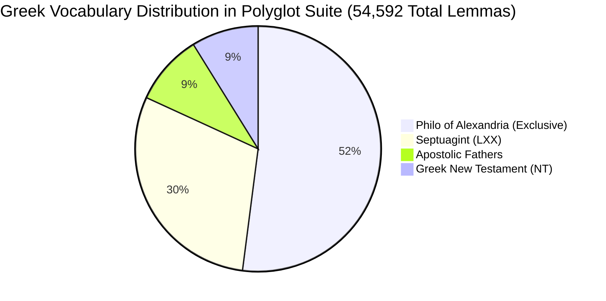

# Phase 4.2.1 Audit Report: Lemma & Corpus Inventory Comparison

> **Document Type**: Technical Audit & Data Layer Gap Analysis  
> **Status**: Completed  
> **Date**: October 26, 2026  
> **Target Subsystems**: Polyglot Bible Reader (PBV), Biblical Lexeme Explorer (BLE), Philo Reader, Apostolic Fathers Reader  

---

## 1. Executive Summary

As part of **Phase 4.2: Database Consolidation**, an automated audit was conducted across all datasets in the monorepo:
1. **PBV Master SQLite Database** (`apps/polyglot-bible-reader/pipeline/build/polyglot-working.sqlite3`, 555MB)
2. **BLE Static JSON Datasets** (`apps/biblical-lexeme-explorer/static/data/` for LXX, SBLGNT, BHS)
3. **Philo of Alexandria Database** (`apps/philo-reader/pipeline/build/philo.sqlite3`)
4. **Apostolic Fathers Database** (`apps/apostolic-fathers-reader/pipeline/build/apostolic-fathers.sqlite3`)

### Key Discoveries & Root Causes:

1. **The Hebrew Lemma "Conflation" in PBV Explained (797 Collapsed Lemmas)**:
   - In PBV's `lemma_stats`, the primary key was defined as `PRIMARY KEY (corpus_id, lemma_key)`, where `lemma_key` was set to `strongs_id` (e.g. `'H776'`).
   - In biblical Hebrew (BHS), **606 Strong's numbers are shared by multiple distinct Hebrew lemmas** (e.g., `H776` represents both `אֶרֶץ` "earth", `אֲבַדֹּון` "destruction", and `צַלְמָוֶת` "darkness").
   - Consequently, PBV collapsed **797 distinct Hebrew lemmas** into shared rows.
   - **Verification**: Exactly 7,294 (PBV) + 797 (collapsed) = **8,091 (BLE entries)**. A global integer `lexeme_id` immediately resolves this data degradation.

2. **The LXX Discrepancy (19,032 BLE vs. 13,844 PBV)**:
   - **Strong's Coverage**: Over **74.8% of LXX words lack Strong's numbers** (14,236 lemmas in BLE; 9,852 in PBV).
   - **Inflected Forms as Pseudo-Lemmas in PBV**: In PBV's token pipeline, when a Greek token had no Strong's number, it fell back to unaccented, inflected surface forms (e.g. `οικετικη` [fem. adj.], `καθεις` [aor. ptcp.], `ηγητεον` [verbal adj.]).
   - In contrast, BLE utilized a dedicated neural & rule-based morphology pipeline that resolved these tokens to genuine grammatical headwords (`οἰκετικός`, `καθίημι`, `ἡγέομαι`) with complete polytonic accents.

3. **Unicode Encoding Incompatibilities**:
   - **Oxia vs. Tonos**: PBV dictionary entries use Greek Oxia (`0x1F70`–`0x1F7D`, Greek Extended block), while BLE uses modern Tonos (`0x03AC`–`0x03CE`, Greek & Coptic block). Standard Unicode NFC normalization **does not** unify Oxia and Tonos.
   - **Zero Accents in PBV's Non-Strong's Words**: All 9,852 non-Strong's lemmas in PBV were stored completely stripped of accents (`display_lemma = 'εφαπτω'`), whereas BLE has full polytonic accents (`ἐφάπτω`).

4. **Multi-Corpus Greek Horizon**:
   - Across the suite (LXX + SBLGNT + Philo + Apostolic Fathers), there are **54,592 unique Greek lemmas**.
   - **70.7% of all Greek New Testament lemmas** (3,838 words) also occur in the Septuagint.
   - **1,810 foundational lemmas** appear across all four corpora.

---

## 2. Corpus & Token Inventory

| Corpus | App / Source | Lexeme / Stats Rows | Total Word Occurrences | With Strong's | Missing Strong's | Strong's Coverage |
| :--- | :--- | :--- | :--- | :--- | :--- | :--- |
| **Septuagint (LXX)** | **BLE** (`static/data/lxx`) | **19,032** | 608,170 | 4,796 | 14,236 | **25.2%** |
| **Septuagint (Swete)** | **PBV** (`swete_lxx`) | 13,844 | 605,183 | 3,992 | 9,852 | **28.8%** |
| **Greek NT (SBLGNT)** | **BLE** (`static/data/sblgnt`) | **5,461** | 137,554 | 5,081 | 380 | **93.0%** |
| **Greek NT (OGNT)** | **PBV** (`ognt`) | 5,399 | 138,013 | 5,399 | 0 | **100.0%** |
| **Hebrew OT (BHS)** | **BLE** (`static/data/bhs`) | **8,091** | 426,590 | 7,173 | 121 (shared: 797) | **88.7%** |
| **Hebrew OT (WLC)** | **PBV** (`wlc`) | 7,294 | 420,141 | 7,174 | 120 | **98.4%** |
| **Philo Judaeus** | **Philo Reader** (`philo.sqlite3`) | 39,704 | 477,100 | 0 | 39,704 | **0.0%** |
| **Apostolic Fathers** | **AF Reader** (`af.sqlite3`) | 5,966 | 63,192 | 0 | 5,966 | **0.0%** |
| **Syriac Peshitta** | **PBV** (`peshitta`) | 45,660 | ~310,000 | 0 | 45,660 | **0.0%** |
| **Latin Vulgate** | **PBV** (`vulgate`) | *(unindexed)* | ~350,000 | 0 | *(all)* | **0.0%** |

---

## 3. Detailed Comparative Findings

### 3.1. Hebrew OT (BHS vs. WLC)
- **Token Count**: Extremely close (426,590 in BHS vs. 420,141 in WLC, < 1.5% difference due to ketiv/qere and prefix split conventions).
- **Strong's Number Overlap**: **100% of Strong's numbers in BLE match PBV** (7,173 identical IDs).
- **The 797 Conflation Gap**:
  - In PBV, whenever multiple lemmas shared a Strong's number, `PRIMARY KEY (corpus_id, lemma_key)` overwrote earlier entries.
  - Examples of lemmas collapsed into a single row in PBV:
    - Under `H776`: `אֶרֶץ` (*'erets*, earth), `אֲבַדֹּון` (*'abaddown*, destruction), and `צַלְמָוֶת` (*tsalmaweth*, darkness).
    - Under `H3808`: 8 distinct lemmas collapsed into one (`אֲבֵדָה`, `בֶּדֶק`, `דַּךְ`, `לֹא`, `סֹבֶל`, etc.).
  - **Verdict**: BLE's 8,091 distinct lemmas represent the superior, uncorrupted dataset. The unified `lexemes` table should preserve BLE's distinct entries.

### 3.2. Greek New Testament (SBLGNT vs. OGNT)
- **Token Count**: 137,554 (SBLGNT) vs. 138,013 (OGNT), a 0.3% difference reflecting textual variants.
- **Strong's Matching**:
  - BLE stores Strong's as pure numbers (`"2424"`), while PBV prefixes `"G"` (`"G2424"`).
  - With prefix normalization, **5,067 out of 5,081 Strong's entries match directly (99.72%)**.
- **Stripped Lemma Overlap**: 4,906 lemmas match character-for-character.

### 3.3. Septuagint (BLE LXX vs. PBV Swete LXX)
- **Token Count**: 608,170 (BLE) vs. 605,183 (PBV), a difference of only 2,987 tokens (0.49%).
- **Strong's Numbers**:
  - James Strong only cataloged words in the English KJV (and Greek TR NT).
  - In BLE, **14,236 lemmas (~75%) have no Strong's number**.
  - In PBV, **9,852 lemmas (~71%) have no Strong's number**.
  - Strong's numbers can never serve as a primary key or universal cross-corpus identifier.
- **Why PBV has 3,915 "lemmas" absent from BLE**:
  - Investigation of PBV-only words (`οικετικη`, `καθεις`, `ηγητεον`, `ερεικτος`) revealed that PBV's pipeline fell back to unaccented, unlemmatized inflected surface tokens.
  - BLE properly lemmatized these into root entries (`οἰκετικός`, `καθίημι`, `ἡγέομαι`).
  - BLE also retained full polytonic accents and breathings for all 19,032 words, whereas PBV completely lost accents for 9,852 words.

---

## 4. Unicode & Normalization Divergence

### 4.1. Greek Oxia vs. Tonos
- Standard Unicode NFC normalization leaves acute accents encoded differently:
  - **PBV**: Uses Greek Oxia (`U+1F71`, `U+1F73`, `U+1F75`, `U+1F77`, `U+1F79`, `U+1F7B`, `U+1F7D`).
  - **BLE**: Uses Greek Tonos (`U+03AC`, `U+03AD`, `U+03AE`, `U+03AF`, `U+03CC`, `U+03CD`, `U+03CE`).
- **Impact**: An exact SQL query `WHERE lemma = 'θεός'` matches in BLE but returns 0 rows in PBV (`θεός` vs `θεός`).
- **Remedy**: The consolidation pipeline must normalize all polytonic Greek lemmas into a single canonical Unicode representation (e.g. NFC with Oxia mapped to Tonos).

### 4.2. Sigma Normalization
- Word-final sigma (`ς`, `U+03C2`) vs. medial sigma (`σ`, `U+03C3`).
- For search keys (`lemma_clean`), all sigmas must be normalized to `σ` to allow seamless prefix searching.

### 4.3. Hebrew Niqqud & Cantillation
- BLE preserves pointed Hebrew lemmas (`'אַלְמֹנִי'`, `'אֲמֵלָל'`).
- PBV stripped vowel points for non-Strong's entries (`'אלמני'`, `'אמלל'`).
- The consolidated `lexemes` table should store the full pointed `lemma` alongside an unpointed consonantal `lemma_clean` for search queries.

---

## 5. Cross-Corpus Greek Overlap

Mapping stripped Greek lemmas across all four Greek corpora in the suite demonstrates the immense analytical power of a consolidated database:



- **Cross-Corpus Overlap Statistics**:
  - **Total Distinct Greek Lemmas**: `54,592`
  - **LXX ∩ NT**: `3,838` words (**70.68% of the NT vocabulary** appears in the LXX).
  - **Core Suite Vocabulary (present in LXX, NT, Philo, AND Apostolic Fathers)**: `1,810` words.

A unified `lexemes` table with numeric `id` enables queries such as:
> *"Show me the distribution and frequency per 10k of `ἀγάπη` (id=125) across LXX, NT, Philo, and Ignatius."*

---

## 6. Actionable Recommendations for Phase 4.2.2 (Schema Migration)

1. **Adopt BLE's Lemma Inventories as Ground Truth for LXX and BHS**:
   - For Hebrew: Use BLE's 8,091 distinct lemmas to recover the 797 lemmas conflated in PBV.
   - For Septuagint: Use BLE's 19,032 accented, lemmatized entries to replace PBV's 9,852 unaccented inflected forms.
   - For NT: Merge SBLGNT (5,461) and OGNT (5,399).

2. **Master `lexemes` Table Definition**:
   ```sql
   CREATE TABLE lexemes (
       id INTEGER PRIMARY KEY AUTOINCREMENT,
       language TEXT NOT NULL,         -- 'greek', 'hebrew', 'aramaic', 'syriac', 'latin'
       lemma TEXT NOT NULL,            -- Canonical NFC (Tonos normalized for Greek, pointed for Hebrew)
       lemma_clean TEXT NOT NULL,      -- Accent-stripped / consonantal search key (sigmas unified)
       strongs_id TEXT,                -- 'G2316', 'H430' (normalized with G/H prefix, nullable)
       pos TEXT,                       -- Standardized Part of Speech
       gloss TEXT,                     -- Primary English gloss
       source_id TEXT,                 -- Original Text-Fabric node ID (for BLE backward compatibility)
       UNIQUE(language, lemma_clean, pos, strongs_id)
   );
   CREATE INDEX idx_lexemes_lookup ON lexemes(language, lemma_clean);
   CREATE INDEX idx_lexemes_strongs ON lexemes(strongs_id) WHERE strongs_id IS NOT NULL;
   ```

3. **Re-index `corpus_lemma_stats` and `concordance_refs` by `(lexeme_id, corpus_id)`**:
   - Eliminates repeating multi-byte Unicode strings across millions of rows, cutting index size by ~40%.
   - Guarantees instant O(1) integer joins across apps.

4. **Autogenerate BLE Manifests (`export_ble_manifests.py`) in Phase 4.2.3**:
   - Dumps `lexemes.json` and columnar `lxxLexes6.json` directly from the SQLite `lexemes` table, guaranteeing that `id` in BLE matches `lexemes.id` in SQLite.
